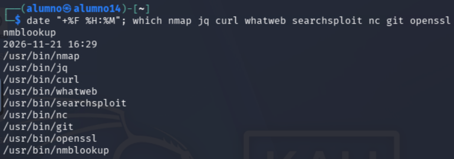
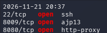
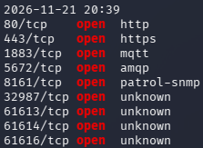
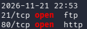
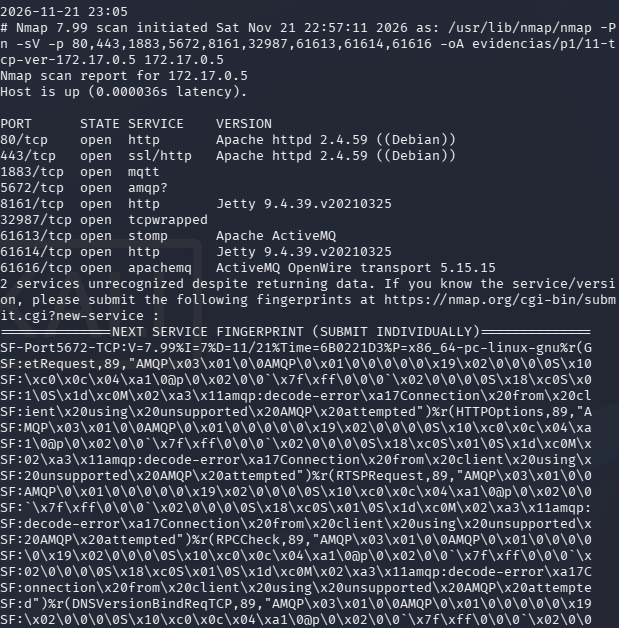
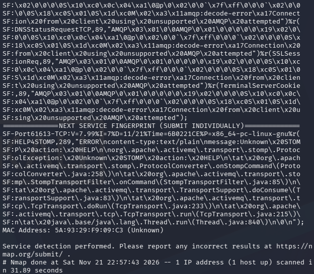
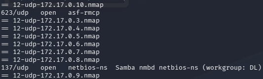

# Cuaderno de trabajo - Pablo Ostenero Reyes

Proyecto: Mapping the Maze
Cliente: Gadir Logística, S.L.
Alcance autorizado: 172.17.0.0/24 (scope.txt)
IP desde la que trabajo: 172.17.0.1
Partes: de la 0 a la 4 (cada integrante las hace todas sobre su propia red)

---

## Parte 0 - Preparación del entorno

Nota de trazabilidad: el historial de bash existía antes de activar las marcas de hora. Las líneas anteriores a las 17:47 del 2026-11-21 corresponden a ejercicios anteriores, no pertenecen a este proyecto y no se citan. Las comprobaciones de las 16:29, 17:38 y 17:39 se hicieron antes de activar la marca de hora en el historial; su hora sale de la captura de pantalla (el comando `date` se ejecutó justo antes), no del historial.

### 2026-11-21 16:29 - Comprobación de herramientas
- **Cuándo:** 2026-11-21 16:29 (hora tomada de la captura; previo a la activación del historial con fecha)
- **Objetivo y alcance:** comprobar que están instaladas las herramientas que usa la guía. Solo afecta a mi propia máquina; no se toca ninguna IP, dentro de 172.17.0.0/24.
- **Qué hice:** `date "+%F %H:%M"; which nmap jq curl whatweb searchsploit nc git openssl nmblookup`
- **Qué salió:** las nueve herramientas están instaladas, cada una con su ruta en `/usr/bin/`. Evidencia: sin fichero, solo captura.
- **Captura:** 
- **Siguiente paso:** comprobar que `scope.txt` contiene el alcance autorizado.

### 2026-11-21 17:38 - Comprobación del alcance (scope.txt)
- **Cuándo:** 2026-11-21 17:38 (hora tomada de la captura; previo a la activación del historial con fecha)
- **Objetivo y alcance:** confirmar que `scope.txt` contiene el rango autorizado antes de escanear. No se contacta con ninguna IP.
- **Qué hice:** `date "+%F %H:%M"; cat scope.txt`
- **Qué salió:** el fichero contiene únicamente `172.17.0.0/24`. Evidencia: sin fichero, solo captura.
- **Captura:** 
- **Siguiente paso:** comprobar la estructura de carpetas del repositorio clonado.

### 2026-11-21 17:39 - Estructura del repositorio
- **Cuándo:** 2026-11-21 17:39 (hora tomada de la captura; previo a la activación del historial con fecha)
- **Objetivo y alcance:** comprobar que el repositorio clonado tiene la estructura del enunciado. Solo ficheros locales, sin tráfico de red.
- **Qué hice:** `date "+%F %H:%M"; ls -R | head -40`
- **Qué salió:** existen `cuadernos/` (con `pablo-ostenero-reyes.md`), `evidencias/` con `p1` a `p4` vacías, `imagenes/` (con `p0-01-herramientas.png`), `inventario.md`, `registro-vulns.md`, `informe-cliente.md`, `README.md` y `scope.txt`. Evidencia: sin fichero, solo captura.
- **Captura:** 
- **Siguiente paso:** comprobar qué shell uso, para decidir si se aplican los comandos de zsh o de bash de la guía.

### 2026-11-21 17:49 - Comprobación de la shell
- **Cuándo:** 2026-11-21 17:49 y 17:50
- **Objetivo y alcance:** saber si la guía (pensada para zsh) se aplica tal cual o con las variantes de bash. Solo local, sin tráfico de red.
- **Qué hice:** `echo $SHELL` y `echo $0`
- **Qué salió:** ambos devuelven `/bin/bash`. Por tanto uso las variantes de bash de la guía y `~/.bashrc` en lugar de `~/.zshrc`. Evidencia: sin fichero, salida en el historial.
- **Captura:** sin captura
- **Siguiente paso:** activar el historial con fecha y hora antes de escanear nada.

### 2026-11-21 17:51 - Activación del historial con fecha y hora
- **Cuándo:** 2026-11-21 17:51
- **Objetivo y alcance:** que cada comando posterior quede registrado con fecha y hora, para poder rastrear los datos del informe. Solo configuración local.
- **Qué hice:** `echo 'export HISTTIMEFORMAT="%F %H:%M "; export HISTSIZE=50000; export HISTFILESIZE=50000; shopt -s histappend; PROMPT_COMMAND="history -a"' >> ~/.bashrc`, después `source ~/.bashrc` y `history | tail -3`
- **Qué salió:** el historial muestra los comandos con fecha y hora (2026-11-21 17:51). Evidencia: `~/.bashrc` (líneas añadidas) y salida del historial.
- **Captura:** sin captura
- **Siguiente paso:** guardar el filtro seguro de nmap (`$SAFE`).

### 2026-11-21 17:53 - Filtro seguro de scripts de nmap
- **Cuándo:** 2026-11-21 17:53
- **Objetivo y alcance:** definir el filtro que limita nmap a scripts `default and safe` y excluye `intrusive`, `exploit`, `dos`, `brute`, `malware`, `broadcast`, `external` y `auth`. Solo configuración local.
- **Qué hice:** `echo "export SAFE='default and safe and not (intrusive or exploit or dos or brute or malware or broadcast or external or auth)'" >> ~/.bashrc`, después `source ~/.bashrc` y `echo "$SAFE"`
- **Qué salió:** `echo "$SAFE"` imprime el filtro completo. Evidencia: `~/.bashrc`.
- **Captura:** sin captura
- **Siguiente paso:** comprobar desde qué IP trabajo.

### 2026-11-21 17:58 - Identificación de mi IP de trabajo
- **Cuándo:** 2026-11-21 17:58
- **Objetivo y alcance:** saber en qué IP y red trabajo, para excluir mi máquina del inventario del cliente. Solo comandos locales, sin tráfico hacia el cliente.
- **Qué hice:** `clear; date "+%F %H:%M"`, `ip -br a` e `ip route | grep 172.17`
- **Qué salió:** mi IP en el rango del cliente es 172.17.0.1, en la interfaz `docker0`, con máscara /16 (ruta `172.17.0.0/16 dev docker0`). Hay otras interfaces fuera del alcance (`eth0` 10.30.0.24/16 y `eth1` 10.50.0.114/24) que no se tocan, y varias `veth` del puente Docker. Como el cliente solo autoriza 172.17.0.0/24, todos los comandos usarán `scope.txt` o IPs concretas de ese /24, nunca el /16. Evidencia: sin fichero, solo captura.
- **Captura:** 
- **Siguiente paso:** poner la IP en la cabecera del cuaderno y configurar git.

### 2026-11-21 18:13 - IP en la cabecera del cuaderno
- **Cuándo:** 2026-11-21 18:13
- **Objetivo y alcance:** comprobar que la cabecera del cuaderno lleva el alcance y mi IP. Solo fichero local.
- **Qué hice:** `head -8 cuadernos/pablo-ostenero-reyes.md`
- **Qué salió:** la cabecera muestra el alcance `172.17.0.0/24` y la IP de trabajo `172.17.0.1`. Evidencia: `cuadernos/pablo-ostenero-reyes.md`.
- **Captura:** sin captura
- **Siguiente paso:** configurar git para poder hacer commit.

### 2026-11-21 18:17 - Configuración de git
- **Cuándo:** 2026-11-21 18:17
- **Objetivo y alcance:** configurar autor y rama por defecto para los commits. Solo configuración local.
- **Qué hice:** `git config --global user.name "Pablo Ostenero Reyes"`, `git config --global user.email "postrey0103@g.educaand.es"` y `git config --global init.defaultBranch main`
- **Qué salió:** sin salida (los comandos no imprimen nada). Se verifica en la entrada siguiente. Evidencia: `~/.gitconfig`.
- **Captura:** sin captura
- **Siguiente paso:** verificar la configuración y comprobar que no quedan restos de la plantilla de otro alumno.

### 2026-11-21 18:19 - Verificación de git y limpieza de la plantilla
- **Cuándo:** 2026-11-21 18:19
- **Objetivo y alcance:** verificar la configuración de git y comprobar que no quedan nombres de la plantilla original. Solo ficheros locales.
- **Qué hice:** `git config --global --list | grep -E "user|branch"`, `grep -rn "Luis Miguel\|Gomila" README.md cuadernos/ inventario.md registro-vulns.md informe-cliente.md` y `grep -n "pablo" README.md`
- **Qué salió:** git muestra `user.name`, `user.email` e `init.defaultbranch=main`. El primer `grep` no devuelve coincidencias, así que no quedan restos de la plantilla. El segundo tampoco, porque el `README.md` está vacío; se rellenará al final adaptando el enlace a `cuadernos/pablo-ostenero-reyes.md`. Evidencia: sin fichero, salida en el historial.
- **Captura:** sin captura
- **Siguiente paso:** subir las capturas p0-02 y p0-03 a `imagenes/`, hacer commit y empezar la Parte 1 con el descubrimiento de equipos vivos.

---

## Parte 1 - Descubrir y mapear

### 2026-11-21 18:31 - Descubrimiento de equipos vivos (ICMP, TCP, UDP)
- **Cuándo:** 2026-11-21 18:31 (marca de inicio de la Parte 1 a las 18:31)
- **Objetivo y alcance:** saber qué equipos responden en la red del cliente, sin escanear puertos. Objetivo 172.17.0.0/24 mediante `-iL scope.txt`, que es exactamente el alcance autorizado.
- **Qué hice:** `sudo nmap -sn -PE -PP -PS21,22,23,25,80,443,445,3389,8080 -PA80 -PU53,161 -iL scope.txt -oA evidencias/p1/01-descubrimiento`
- **Qué salió:** `Nmap done: 256 IP addresses (9 hosts up) scanned in 4.03 seconds`. Evidencia: `evidencias/p1/01-descubrimiento.nmap`, `.gnmap` y `.xml`.
- **Captura:** 
- **Siguiente paso:** extraer la lista limpia de IPs vivas.

### 2026-11-21 18:38 - Lista de equipos vivos
- **Cuándo:** 2026-11-21 18:38
- **Objetivo y alcance:** obtener la lista de IPs vivas a partir del fichero `.gnmap`. Solo trabaja con ficheros locales, sin tráfico de red.
- **Qué hice:** `awk '/Status: Up/{print $2}' evidencias/p1/01-descubrimiento.gnmap | sort -t. -k4 -n | tee evidencias/p1/vivos.txt` y `wc -l evidencias/p1/vivos.txt`
- **Qué salió:** 9 IPs vivas: 172.17.0.1, .3, .4, .5, .6, .7, .8, .9 y .10. La 172.17.0.1 es mi propia máquina (puente docker0). La 172.17.0.2 no respondió a este barrido. Evidencia: `evidencias/p1/vivos.txt`.
- **Captura:** 
- **Siguiente paso:** contrastar con un barrido ARP por si algún equipo no responde a ping ni a las sondas TCP/UDP.

### 2026-11-21 18:53 - Contraste con barrido ARP
- **Cuándo:** 2026-11-21 18:53 (barrido) y 18:54 (lista)
- **Objetivo y alcance:** comprobar que el primer barrido no se dejó ningún equipo. ARP lo responde todo equipo encendido de la red local. Objetivo 172.17.0.0/24 mediante `-iL scope.txt`.
- **Qué hice:** `sudo nmap -sn -PR -iL scope.txt -oA evidencias/p1/02-descubrimiento-arp` y `awk '/Status: Up/{print $2}' evidencias/p1/02-descubrimiento-arp.gnmap | sort -t. -k4 -n > evidencias/p1/vivos-arp.txt`
- **Qué salió:** `Nmap done: 256 IP addresses (9 hosts up) scanned in 4.01 seconds`. Los 9 equipos son los mismos que en el primer barrido (172.17.0.1, .3 a .10), cada uno con su dirección MAC. Evidencia: `evidencias/p1/02-descubrimiento-arp.nmap` y `evidencias/p1/vivos-arp.txt`.
- **Captura:** 
- **Siguiente paso:** comparar `vivos.txt` con `vivos-arp.txt` y quitar mi IP de la lista.

### 2026-11-21 18:54 - Comparación ARP y exclusión de mi IP (sesión de root)
- **Cuándo:** después de las 18:54 (hora no registrada: se hizo en una sesión de root, abierta con `sudo su` a las 18:54, cuyo historial no lleva marca de hora)
- **Objetivo y alcance:** comparar los dos barridos y excluir mi IP del inventario. Solo ficheros locales y comandos de red locales, dentro de 172.17.0.0/24.
- **Qué hice:** `diff evidencias/p1/vivos.txt evidencias/p1/vivos-arp.txt && echo "COINCIDEN"`, después `MIIP=$(ip -br a | grep -oE '172\.17\.0\.[0-9]+' | head -1); echo "Mi IP: $MIIP"`, `grep -vx "$MIIP" evidencias/p1/vivos.txt > /tmp/v && mv /tmp/v evidencias/p1/vivos.txt` y `cat evidencias/p1/vivos.txt`
- **Qué salió:** el `diff` imprimió `COINCIDEN`: los dos barridos ven los mismos 9 equipos, sin diferencias. `Mi IP: 172.17.0.1`. Tras excluirla, `vivos.txt` queda con 8 equipos del cliente: 172.17.0.3 a 172.17.0.10. La 172.17.0.2 no responde ni a ICMP/TCP/UDP ni a ARP. Evidencia: `evidencias/p1/vivos.txt`.
- **Captura:** 
- **Siguiente paso:** identificar el equipo delicado con una pasada suave antes de escanear todos los puertos.

### 2026-11-21 19:20 - Pasada suave para localizar el equipo delicado
- **Cuándo:** 2026-11-21 19:20 (inicio del bucle); el último equipo terminó a las 19:27:42
- **Objetivo y alcance:** localizar el equipo antiguo y delicado antes de escanear todos los puertos, con una pasada suave (100 puertos, versión ligera). Objetivos: los 8 equipos de `evidencias/p1/vivos.txt` (172.17.0.3 a 172.17.0.10), dentro de 172.17.0.0/24. Mientras tanto se vigiló con `ping` desde una segunda terminal.
- **Qué hice:** `for ip in $(cat evidencias/p1/vivos.txt); do echo "=== $ip ==="; sudo nmap -Pn -sS --top-ports 100 -sV --version-light -T2 --max-retries 1 -oA evidencias/p1/03-suave-$ip $ip; done`
- **Qué salió:** cada equipo tardó entre 41 y 65 segundos, sin que ninguno destacara. Evidencia: `evidencias/p1/03-suave-172.17.0.<n>.nmap` (uno por equipo). Los puertos abiertos son:
  - 172.17.0.3: 21/tcp vsftpd 2.3.4 y 80/tcp Apache httpd 2.4.58 (Ubuntu).
  - 172.17.0.4: 22/tcp OpenSSH 7.9p1 Debian 10+deb10u4, 8009/tcp Apache Jserv (AJP 1.3) y 8080/tcp Apache Tomcat 9.0.30.
  - 172.17.0.5: 80/tcp y 443/tcp Apache httpd 2.4.59 (Debian).
  - 172.17.0.6: 22/tcp OpenSSH 9.2p1 Debian 2+deb12u2 y 8080/tcp Jetty 10.0.18.
  - 172.17.0.7: 22/tcp OpenSSH 7.7.
  - 172.17.0.8: 22/tcp OpenSSH 9.6p1 Ubuntu, 80/tcp Apache 2.4.58, 139/tcp y 445/tcp Samba smbd 4.
  - 172.17.0.9: 22/tcp OpenSSH 9.2p1 Debian 2+deb12u10 y 80/tcp Apache 2.4.68.
  - 172.17.0.10: 80/tcp SimpleHTTPServer 0.6 (Python 3.11.2).
- **Captura:** 
- **Siguiente paso:** listar los banners juntos e identificar el equipo delicado.

### 2026-11-21 19:31 - Revisión de banners y tiempos del escaneo suave
- **Cuándo:** 2026-11-21 19:31 (`grep` de puertos abiertos) y 19:36 (`grep` de tiempos). La captura no muestra la hora; la hora sale del historial.
- **Objetivo y alcance:** buscar banners antiguos y tiempos anómalos que delaten el equipo delicado. Solo ficheros locales.
- **Qué hice:** `grep -H "open" evidencias/p1/03-suave-*.nmap` y `grep -H "Nmap done" evidencias/p1/03-suave-*.nmap`
- **Qué salió:** el único banner de software muy antiguo es vsftpd 2.3.4 en 172.17.0.3; el resto son versiones más recientes. Los tiempos (41 a 65 s) no señalan a ningún equipo, y el ping a 172.17.0.5 no perdió paquetes durante el escaneo. Conclusión provisional: se trata 172.17.0.3 como equipo delicado por el banner, no por los tiempos. Se reconsiderará si otro equipo se comporta de forma anómala en el escaneo completo. Evidencia: `evidencias/p1/03-suave-*.nmap`.
- **Hallazgo grave anotado, sin tocarlo:** vsftpd 2.3.4 se detectó solo por banner. No se lanzó ningún script ni prueba contra él.
- **Captura:** 
- **Siguiente paso:** fijar `FRAGIL=172.17.0.3` y escanear los 65 535 puertos TCP, primero los equipos normales y después el delicado, despacio.

### Fallo registrado - ping sin permisos
- **Cuándo:** hora no registrada (se lanzó desde otra terminal, en el directorio `~`, cuyo historial no está en este cuaderno); fue justo antes de las 19:20
- **Objetivo y alcance:** preparar la vigilancia con `ping` del equipo escaneado. Objetivos 172.17.0.3 y 172.17.0.4, dentro de 172.17.0.0/24.
- **Qué hice:** `ping 172.17.0.3` y `ping 172.17.0.4`, y después `sudo ping 172.17.0.5`
- **Qué salió:** los dos primeros fallaron con `socket: Operation not permitted` (falta `cap_net_raw`) porque el usuario `alumno` no puede crear sockets raw sin `sudo`. Con `sudo ping` respondió sin pérdidas. Evidencia: salida en la terminal, sin fichero.
- **Captura:** 
- **Siguiente paso:** lanzar la pasada suave con el ping corriendo en la segunda terminal.

### 2026-11-21 19:57 - Escaneo completo de puertos TCP de los equipos normales
- **Cuándo:** 2026-11-21 19:57 (inicio); fin: 20:36 (último equipo, 172.17.0.10, terminó a las 20:36:24; cada equipo tardó unos 328 s)
- **Objetivo y alcance:** descubrir todos los puertos TCP abiertos, incluidos los altos, de los equipos que no se tratan como delicados. Objetivos 172.17.0.4 a 172.17.0.10, tomados de `evidencias/p1/vivos.txt` sin la .3, dentro de 172.17.0.0/24. Ritmo limitado a 200 paquetes por segundo.
- **Qué hice:** `for ip in $(grep -vx "$FRAGIL" evidencias/p1/vivos.txt); do echo "=== $ip ==="; sudo nmap -Pn -sS -p- -T3 --max-rate 200 -oA evidencias/p1/10-tcp-all-$ip $ip; done`, tras fijar `FRAGIL=172.17.0.3` a las 19:54.
- **Qué salió:** 172.17.0.4: 22, 8009, 8080. 172.17.0.5: 80, 443, 1883, 5672, 8161, 32987, 61613, 61614, 61616 (seis puertos que la pasada suave no vio). 172.17.0.6: 22, 8080. 172.17.0.7: 22. 172.17.0.8: 22, 80, 139, 445. 172.17.0.9: 22, 80. 172.17.0.10: 80. Evidencia: `evidencias/p1/10-tcp-all-172.17.0.<n>.nmap`.
- **Captura:** sin captura (las capturas son por equipo, en la entrada siguiente)
- **Siguiente paso:** capturar la lista de puertos abiertos de cada equipo.

### 2026-11-21 20:37 - Capturas de los puertos abiertos por equipo
- **Cuándo:** 2026-11-21 20:37 a 20:43. Primera captura a las 20:37 (172.17.0.4); después .5 (20:39), .6 (20:40), .7 y .8 (20:41), .9 y .10 (20:42); a las 20:43 se listaron todos juntos.
- **Objetivo y alcance:** dejar captura de los puertos abiertos de cada equipo. Solo ficheros locales.
- **Qué hice:** `grep open evidencias/p1/10-tcp-all-172.17.0.<n>.nmap` (una vez por equipo) y `grep -H open evidencias/p1/10-tcp-all-*.nmap`
- **Qué salió:** los resultados de la entrada anterior. Nota de trazabilidad: la línea del historial de las 20:37 aparece como `grep open ...172.17.0.5.nmap` porque la edité antes de ejecutarla para cambiarla por la de la .4 (el historial la marca como editada). El comando realmente ejecutado a las 20:37 fue el de 172.17.0.4. Evidencia: `evidencias/p1/10-tcp-all-*.nmap`.
- **Captura:**  y 
- **Siguiente paso:** escanear todos los puertos del equipo tratado como delicado, con ping de vigilancia.

### 2026-11-21 20:45 - Escaneo completo de 172.17.0.3 (interrumpido)
- **Cuándo:** 2026-11-21 20:45 (inicio) y 21:42 (parada con Ctrl+C). Las horas son las de la máquina virtual Kali, que va una hora por delante del portátil.
- **Objetivo y alcance:** escanear los 65 535 puertos TCP del equipo que se trata como delicado. Objetivo 172.17.0.3, dentro de 172.17.0.0/24. Se vigiló con `sudo ping 172.17.0.3` desde otra terminal, sin pérdida de paquetes.
- **Qué hice:** `sudo nmap -Pn -sS -p- -T2 --max-rate 30 --max-retries 1 -oA evidencias/p1/10-tcp-all-172.17.0.3 172.17.0.3`
- **Qué salió:** al pulsar la barra espaciadora, `SYN Stealth Scan Timing: About 12.47% done; ETC: 04:03 (6:22:44 remaining)`. El ritmo real era de unos 2,5 puertos por segundo, porque `-T2` impone un retardo entre sondas que anula el efecto de `--max-rate 30`. Terminar habría llevado más de 6 horas y se interrumpió a las 21:42. Los ficheros parciales no se apartaron y se sobrescribieron al repetir el escaneo con el mismo nombre (`-oA`), así que la única evidencia de este intento es la línea de progreso anterior.
- **Captura:** sin captura
- **Siguiente paso:** repetir el escaneo con `-T3` manteniendo `--max-rate 30` y el ping de vigilancia.

### 2026-11-21 21:46 - Escaneo completo de 172.17.0.3 (repetición con -T3)
- **Cuándo:** 2026-11-21 21:46 (inicio); fin: 22:22 (terminó a las 22:22:58, 2185 s). Horas de la máquina virtual.
- **Objetivo y alcance:** repetir el escaneo completo de 172.17.0.3, dentro de 172.17.0.0/24, tras interrumpir el de las 20:45 por lentitud. Se mantiene `--max-rate 30` y `--max-retries 1` y se cambia `-T2` por `-T3`. Se vigiló con `sudo ping 172.17.0.3`. Este cambio se aparta de lo que indica la guía para el equipo delicado.
- **Qué hice:** `sudo nmap -Pn -sS -p- -T3 --max-rate 30 --max-retries 1 -oA evidencias/p1/10-tcp-all-$FRAGIL $FRAGIL`
- **Qué salió:** abiertos 21/tcp (ftp) y 80/tcp (http). Sin puertos altos. El ping a 172.17.0.3 respondió sin pérdida de paquetes durante todo el escaneo. Evidencia: `evidencias/p1/10-tcp-all-172.17.0.3.nmap`.
- **Captura:** 
- **Siguiente paso:** obtener producto y versión de cada puerto abierto con `-sV`.

### 2026-11-21 22:56 - Detección de versiones de los puertos TCP abiertos
- **Cuándo:** 2026-11-21 22:56 (inicio); fin: 22:58 (el último equipo, 172.17.0.10, terminó a las 22:58:18; la .5 fue la más lenta, 31,9 s)
- **Objetivo y alcance:** obtener servicio y versión de cada puerto abierto, sin detección de sistema operativo. Objetivos: los 8 equipos de `evidencias/p1/vivos.txt` (172.17.0.3 a 172.17.0.10), dentro de 172.17.0.0/24. La .3 se escaneó con `--version-light -T2`.
- **Qué hice:** `for ip in $(cat evidencias/p1/vivos.txt); do ports=$(grep -oE '[0-9]+/open/tcp' evidencias/p1/10-tcp-all-$ip.gnmap | cut -d/ -f1 | sort -un | paste -sd, -); [ -z "$ports" ] && { echo "$ip sin TCP abiertos"; continue; }; echo "=== $ip : $ports ==="; if [ "$ip" = "$FRAGIL" ]; then sudo nmap -Pn -sV --version-light -T2 --max-retries 1 -p $ports -oA evidencias/p1/11-tcp-ver-$ip $ip; else sudo nmap -Pn -sV -p $ports -oA evidencias/p1/11-tcp-ver-$ip $ip; fi; done`
- **Qué salió:** .3: vsftpd 2.3.4 y Apache httpd 2.4.58 (Ubuntu). .4: OpenSSH 7.9p1 Debian 10+deb10u4, Apache Jserv (AJP 1.3) y Apache Tomcat 9.0.30. .5: Apache httpd 2.4.59 (80 y 443), mqtt sin versión (1883), amqp? no identificado (5672), Jetty 9.4.39.v20210325 (8161 y 61614), stomp Apache ActiveMQ (61613), ActiveMQ OpenWire transport 5.15.15 (61616) y tcpwrapped (32987). .6: OpenSSH 9.2p1 Debian 2+deb12u2 y Jetty 10.0.18. .7: OpenSSH 7.7. .8: OpenSSH 9.6p1 Ubuntu 3ubuntu13.5, Apache httpd 2.4.58, Samba smbd 4 (139 y 445). .9: OpenSSH 9.2p1 Debian 2+deb12u10 y Apache httpd 2.4.68. .10: SimpleHTTPServer 0.6 (Python 3.11.2). Evidencia: `evidencias/p1/11-tcp-ver-172.17.0.<n>.nmap`.
- **Captura:** sin captura (las capturas son por equipo, en la entrada siguiente)
- **Siguiente paso:** capturar la tabla de versiones de cada equipo.

### 2026-11-21 23:02 - Capturas de versiones por equipo
- **Cuándo:** 2026-11-21 23:02 (.3), 23:04 (.4), 23:05 (.5), 23:07 (.6 y .7), 23:08 (.8), 23:09 (.9), 23:10 (.10 y resumen)
- **Objetivo y alcance:** dejar captura de la tabla PORT/STATE/SERVICE/VERSION de cada equipo. Solo ficheros locales.
- **Qué hice:** `cat evidencias/p1/11-tcp-ver-172.17.0.<n>.nmap` (una vez por equipo) y `grep -H -E "^[0-9]+/tcp +open" evidencias/p1/11-tcp-ver-*.nmap`
- **Qué salió:** los resultados de la entrada anterior. Evidencia: `evidencias/p1/11-tcp-ver-*.nmap`.
- **Captura:**    (y una por cada una de las demás IP)
- **Siguiente paso:** escanear los puertos UDP más comunes.

### 2026-11-21 23:19 - Escaneo UDP de los equipos normales
- **Cuándo:** 2026-11-21 23:19 (inicio); fin: 23:22 (el último equipo, 172.17.0.10, terminó a las 23:22:35; cada equipo tardó unos 25 s)
- **Objetivo y alcance:** descubrir los puertos UDP abiertos entre los 100 más comunes, con versión mínima, porque no todo habla TCP. Objetivos: 172.17.0.4 a 172.17.0.10 (todos menos 172.17.0.3), dentro de 172.17.0.0/24. Ritmo limitado a 100 paquetes por segundo.
- **Qué hice:** `for ip in $(grep -vx "$FRAGIL" evidencias/p1/vivos.txt); do echo "=== $ip ==="; sudo nmap -Pn -sU --top-ports 100 -sV --version-intensity 0 --max-retries 1 -T3 --max-rate 100 -oA evidencias/p1/12-udp-$ip $ip; done`
- **Qué salió:** solo dos puertos UDP en estado `open`: 172.17.0.8 137/udp netbios-ns (Samba nmbd, workgroup: DL) y 172.17.0.10 623/udp asf-rmcp. El resto de puertos no respondió (`open|filtered`) y no se cuentan como abiertos: 172.17.0.4 (91 puertos), .5 (93), .6 (92), .7 (94), .8 (90), .9 (91) y .10 (89). Evidencia: `evidencias/p1/12-udp-172.17.0.<n>.nmap`.
- **Captura:** sin captura (las capturas se hicieron al día siguiente, en la entrada del 2026-11-22)
- **Siguiente paso:** escanear los UDP típicos de 172.17.0.3, que se trata como equipo delicado.

### 2026-11-21 23:22 - Escaneo UDP del equipo delicado (172.17.0.3)
- **Cuándo:** 2026-11-21 23:22 (inicio); fin: 23:23 (terminó a las 23:23:07, 7,6 s)
- **Objetivo y alcance:** comprobar los UDP más típicos de 172.17.0.3 con el mínimo tráfico. Objetivo 172.17.0.3, dentro de 172.17.0.0/24. Solo 10 puertos y `-T2`.
- **Qué hice:** `sudo nmap -Pn -sU -p 53,67,69,123,137,161,500,623,1900,5353 --max-retries 1 -T2 -oA evidencias/p1/12-udp-$FRAGIL $FRAGIL`
- **Qué salió:** ningún puerto `open`. 137/udp (netbios-ns) y 5353/udp (zeroconf) salen `open|filtered`: no respondieron y no se cuentan como abiertos. El ping a 172.17.0.3 respondió sin pérdida de paquetes durante este escaneo. Evidencia: `evidencias/p1/12-udp-172.17.0.3.nmap`.
- **Captura:** sin captura (ver entrada siguiente)
- **Siguiente paso:** listar los puertos UDP en estado `open` de todos los equipos.

### 2026-11-21 23:23 - Revisión de los puertos UDP abiertos
- **Cuándo:** 2026-11-21 23:23 (resumen) y 2026-11-22 15:05 a 15:10 (capturas por equipo). La captura de la .4 se repitió a las 15:07 porque la de las 15:06 no llevaba la hora delante.
- **Objetivo y alcance:** separar los puertos UDP `open` de los `open|filtered` y dejar captura por equipo. Solo ficheros locales, sin tráfico de red.
- **Qué hice:** `grep -H "open" evidencias/p1/12-udp-*.nmap` y, por equipo, `grep -E "open" evidencias/p1/12-udp-172.17.0.<n>.nmap`
- **Qué salió:** confirmados `open`: 172.17.0.8 137/udp y 172.17.0.10 623/udp (puerto de RMCP, usado por IPMI). Las líneas `Not shown: N open|filtered` salen en el `grep` por contener la palabra "open", pero no son puertos abiertos. Los demás equipos no tienen ningún UDP abierto confirmado. Evidencia: `evidencias/p1/12-udp-*.nmap`.
- **Captura:**   (el resto de equipos tienen su captura `p1-07-udp-<IP>.png`, sin puertos `open`)
- **Siguiente paso:** juntar todos los puertos abiertos en un resumen.

### 2026-11-22 15:19 - Resumen de puertos abiertos
- **Cuándo:** 2026-11-22 15:19 (generación del resumen) y 15:25 (comprobación con `cat`)
- **Objetivo y alcance:** juntar en un solo fichero todos los puertos abiertos (TCP con versión y UDP) para rellenar la tabla del inventario. Solo ficheros locales, sin tráfico de red.
- **Qué hice:** `for f in evidencias/p1/11-tcp-ver-*.nmap evidencias/p1/12-udp-*.nmap; do echo "== $(basename $f)"; grep -E "^[0-9]+/(tcp|udp) +open " "$f"; done | tee evidencias/p1/resumen-puertos.txt` y `cat evidencias/p1/resumen-puertos.txt`
- **Qué salió:** 27 puertos TCP abiertos en 8 equipos y 2 UDP abiertos. El UDP abierto confirmado es 623/udp asf-rmcp en la .10 y 137/udp netbios-ns (Samba nmbd, workgroup: DL) en la .8. Los demás equipos no tienen UDP abierto confirmado. Evidencia: `evidencias/p1/resumen-puertos.txt`.
- **Captura:**  
- **Siguiente paso:** comparar este resumen con la hoja de inventario del cliente (Sobra, Falta, Mal).

### 2026-11-22 15:50 - Comparación con la hoja de inventario del cliente
- **Cuándo:** 2026-11-22 15:50 (visualización de la hoja) y 15:54 (comprobación del historial)
- **Objetivo y alcance:** contrastar lo observado con la hoja de inventario que entregó el cliente. La hoja no se usó como fuente; solo se comparó al final. Solo ficheros locales, sin tráfico de red. La hoja incluye una IP fuera del alcance (172.17.1.6), que no se escaneó.
- **Qué hice:** `clear; date "+%F %H:%M"` y `cut -d';' -f1-5 evidencias/p1/inventario-cliente.csv | column -s';' -t`. El fichero se copió a `evidencias/p1/inventario-cliente.csv` fuera de la terminal, por lo que ese paso no consta en el historial.
- **Qué salió:** la hoja tiene 10 filas. Frente a los 8 equipos vivos observados (172.17.0.3 a 172.17.0.10): 7 entradas sobran (172.17.0.11, .20, .2, .50, .254, .30 y .100, que no respondieron), 2 tienen datos erróneos (172.17.0.10 y 172.17.0.9), faltan 6 equipos (172.17.0.3 a .8) y 1 entrada queda fuera de alcance (172.17.1.6). Evidencia: `evidencias/p1/inventario-cliente.csv`.
- **Captura:** 
- **Siguiente paso:** comprobar qué puertos quedan fuera de los 1000 más comunes de nmap y redactar `inventario.md`.

### 2026-11-22 15:57 - Puertos fuera de los 1000 más comunes de nmap
- **Cuándo:** 2026-11-22 15:57
- **Objetivo y alcance:** saber qué puertos abiertos hallados no aparecen entre los 1000 más comunes de nmap, para el apartado de puertos fuera de lo habitual. Solo ficheros locales (`/usr/share/nmap/nmap-services`), sin tráfico de red.
- **Qué hice:** `awk '$2 ~ /\/tcp$/ {print $3, $2}' /usr/share/nmap/nmap-services | sort -rn | head -1000 | awk '{split($2,a,"/"); print a[1]}' > /tmp/top1000.txt` y un bucle `for p in 21 22 80 139 443 445 1883 5672 8009 8080 8161 32987 61613 61614 61616; do grep -qx $p /tmp/top1000.txt && echo "$p: entre los 1000 más comunes" || echo "$p: FUERA"; done`
- **Qué salió:** están entre los 1000 más comunes 21, 22, 80, 139, 443, 445, 8009 y 8080. Quedan fuera 1883, 5672, 8161, 32987, 61613, 61614 y 61616, todos en 172.17.0.5. La lista de los 1000 es una aproximación por frecuencia de la base de datos local de nmap. Evidencia: salida en la terminal, sin fichero.
- **Captura:** sin captura
- **Siguiente paso:** redactar `inventario.md` con la tabla de equipos, el UDP y las correcciones a la hoja del cliente.

