# Cuaderno de trabajo - Pablo Ostenero Reyes

Proyecto: Mapping the Maze
Cliente: Gadir Logística, S.L.
Alcance autorizado: 172.17.0.0/24 (scope.txt)
IP desde la que trabajo: 172.17.0.1
Partes: de la 0 a la 4 (cada integrante las hace todas sobre su propia red)

---

## Parte 0 - Preparación del entorno

Nota de trazabilidad: el historial de bash existía antes de activar las marcas de hora. Las líneas anteriores a las 17:47 del 2026-11-21 corresponden a ejercicios anteriores, no pertenecen a este proyecto y no se citan. Las comprobaciones de las 16:29, 17:38 y 17:39 se hicieron antes de activar la marca de hora en el historial; su hora sale de la captura de pantalla (el comando `date` se ejecutó justo antes), no del historial.

### 2026-11-21 16:29 - Comprobación de herramientas
- **Cuándo:** 2026-11-21 16:29 (hora tomada de la captura; previo a la activación del historial con fecha)
- **Objetivo y alcance:** comprobar que están instaladas las herramientas que usa la guía. Solo afecta a mi propia máquina; no se toca ninguna IP, dentro de 172.17.0.0/24.
- **Qué hice:** `date "+%F %H:%M"; which nmap jq curl whatweb searchsploit nc git openssl nmblookup`
- **Qué salió:** las nueve herramientas están instaladas, cada una con su ruta en `/usr/bin/`. Evidencia: sin fichero, solo captura.
- **Captura:** 
- **Siguiente paso:** comprobar que `scope.txt` contiene el alcance autorizado.

### 2026-11-21 17:38 - Comprobación del alcance (scope.txt)
- **Cuándo:** 2026-11-21 17:38 (hora tomada de la captura; previo a la activación del historial con fecha)
- **Objetivo y alcance:** confirmar que `scope.txt` contiene el rango autorizado antes de escanear. No se contacta con ninguna IP.
- **Qué hice:** `date "+%F %H:%M"; cat scope.txt`
- **Qué salió:** el fichero contiene únicamente `172.17.0.0/24`. Evidencia: sin fichero, solo captura.
- **Captura:** 
- **Siguiente paso:** comprobar la estructura de carpetas del repositorio clonado.

### 2026-11-21 17:39 - Estructura del repositorio
- **Cuándo:** 2026-11-21 17:39 (hora tomada de la captura; previo a la activación del historial con fecha)
- **Objetivo y alcance:** comprobar que el repositorio clonado tiene la estructura del enunciado. Solo ficheros locales, sin tráfico de red.
- **Qué hice:** `date "+%F %H:%M"; ls -R | head -40`
- **Qué salió:** existen `cuadernos/` (con `pablo-ostenero-reyes.md`), `evidencias/` con `p1` a `p4` vacías, `imagenes/` (con `p0-01-herramientas.png`), `inventario.md`, `registro-vulns.md`, `informe-cliente.md`, `README.md` y `scope.txt`. Evidencia: sin fichero, solo captura.
- **Captura:** 
- **Siguiente paso:** comprobar qué shell uso, para decidir si se aplican los comandos de zsh o de bash de la guía.

### 2026-11-21 17:49 - Comprobación de la shell
- **Cuándo:** 2026-11-21 17:49 y 17:50
- **Objetivo y alcance:** saber si la guía (pensada para zsh) se aplica tal cual o con las variantes de bash. Solo local, sin tráfico de red.
- **Qué hice:** `echo $SHELL` y `echo $0`
- **Qué salió:** ambos devuelven `/bin/bash`. Por tanto uso las variantes de bash de la guía y `~/.bashrc` en lugar de `~/.zshrc`. Evidencia: sin fichero, salida en el historial.
- **Captura:** sin captura
- **Siguiente paso:** activar el historial con fecha y hora antes de escanear nada.

### 2026-11-21 17:51 - Activación del historial con fecha y hora
- **Cuándo:** 2026-11-21 17:51
- **Objetivo y alcance:** que cada comando posterior quede registrado con fecha y hora, para poder rastrear los datos del informe. Solo configuración local.
- **Qué hice:** `echo 'export HISTTIMEFORMAT="%F %H:%M "; export HISTSIZE=50000; export HISTFILESIZE=50000; shopt -s histappend; PROMPT_COMMAND="history -a"' >> ~/.bashrc`, después `source ~/.bashrc` y `history | tail -3`
- **Qué salió:** el historial muestra los comandos con fecha y hora (2026-11-21 17:51). Evidencia: `~/.bashrc` (líneas añadidas) y salida del historial.
- **Captura:** sin captura
- **Siguiente paso:** guardar el filtro seguro de nmap (`$SAFE`).

### 2026-11-21 17:53 - Filtro seguro de scripts de nmap
- **Cuándo:** 2026-11-21 17:53
- **Objetivo y alcance:** definir el filtro que limita nmap a scripts `default and safe` y excluye `intrusive`, `exploit`, `dos`, `brute`, `malware`, `broadcast`, `external` y `auth`. Solo configuración local.
- **Qué hice:** `echo "export SAFE='default and safe and not (intrusive or exploit or dos or brute or malware or broadcast or external or auth)'" >> ~/.bashrc`, después `source ~/.bashrc` y `echo "$SAFE"`
- **Qué salió:** `echo "$SAFE"` imprime el filtro completo. Evidencia: `~/.bashrc`.
- **Captura:** sin captura
- **Siguiente paso:** comprobar desde qué IP trabajo.

### 2026-11-21 17:58 - Identificación de mi IP de trabajo
- **Cuándo:** 2026-11-21 17:58
- **Objetivo y alcance:** saber en qué IP y red trabajo, para excluir mi máquina del inventario del cliente. Solo comandos locales, sin tráfico hacia el cliente.
- **Qué hice:** `clear; date "+%F %H:%M"`, `ip -br a` e `ip route | grep 172.17`
- **Qué salió:** mi IP en el rango del cliente es 172.17.0.1, en la interfaz `docker0`, con máscara /16 (ruta `172.17.0.0/16 dev docker0`). Hay otras interfaces fuera del alcance (`eth0` 10.30.0.24/16 y `eth1` 10.50.0.114/24) que no se tocan, y varias `veth` del puente Docker. Como el cliente solo autoriza 172.17.0.0/24, todos los comandos usarán `scope.txt` o IPs concretas de ese /24, nunca el /16. Evidencia: sin fichero, solo captura.
- **Captura:** 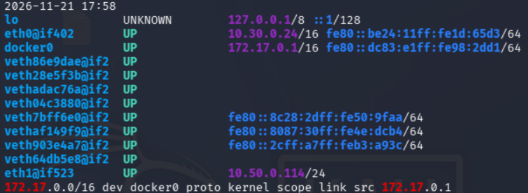
- **Siguiente paso:** poner la IP en la cabecera del cuaderno y configurar git.

### 2026-11-21 18:13 - IP en la cabecera del cuaderno
- **Cuándo:** 2026-11-21 18:13
- **Objetivo y alcance:** comprobar que la cabecera del cuaderno lleva el alcance y mi IP. Solo fichero local.
- **Qué hice:** `head -8 cuadernos/pablo-ostenero-reyes.md`
- **Qué salió:** la cabecera muestra el alcance `172.17.0.0/24` y la IP de trabajo `172.17.0.1`. Evidencia: `cuadernos/pablo-ostenero-reyes.md`.
- **Captura:** sin captura
- **Siguiente paso:** configurar git para poder hacer commit.

### 2026-11-21 18:17 - Configuración de git
- **Cuándo:** 2026-11-21 18:17
- **Objetivo y alcance:** configurar autor y rama por defecto para los commits. Solo configuración local.
- **Qué hice:** `git config --global user.name "Pablo Ostenero Reyes"`, `git config --global user.email "postrey0103@g.educaand.es"` y `git config --global init.defaultBranch main`
- **Qué salió:** sin salida (los comandos no imprimen nada). Se verifica en la entrada siguiente. Evidencia: `~/.gitconfig`.
- **Captura:** sin captura
- **Siguiente paso:** verificar la configuración y comprobar que no quedan restos de la plantilla de otro alumno.

### 2026-11-21 18:19 - Verificación de git y limpieza de la plantilla
- **Cuándo:** 2026-11-21 18:19
- **Objetivo y alcance:** verificar la configuración de git y comprobar que no quedan nombres de la plantilla original. Solo ficheros locales.
- **Qué hice:** `git config --global --list | grep -E "user|branch"`, `grep -rn "Luis Miguel\|Gomila" README.md cuadernos/ inventario.md registro-vulns.md informe-cliente.md` y `grep -n "pablo" README.md`
- **Qué salió:** git muestra `user.name`, `user.email` e `init.defaultbranch=main`. El primer `grep` no devuelve coincidencias, así que no quedan restos de la plantilla. El segundo tampoco, porque el `README.md` está vacío; se rellenará al final adaptando el enlace a `cuadernos/pablo-ostenero-reyes.md`. Evidencia: sin fichero, salida en el historial.
- **Captura:** sin captura
- **Siguiente paso:** subir las capturas p0-02 y p0-03 a `imagenes/`, hacer commit y empezar la Parte 1 con el descubrimiento de equipos vivos.

---

## Parte 1 - Descubrir y mapear

### 2026-11-21 18:31 - Descubrimiento de equipos vivos (ICMP, TCP, UDP)
- **Cuándo:** 2026-11-21 18:31 (marca de inicio de la Parte 1 a las 18:31)
- **Objetivo y alcance:** saber qué equipos responden en la red del cliente, sin escanear puertos. Objetivo 172.17.0.0/24 mediante `-iL scope.txt`, que es exactamente el alcance autorizado.
- **Qué hice:** `sudo nmap -sn -PE -PP -PS21,22,23,25,80,443,445,3389,8080 -PA80 -PU53,161 -iL scope.txt -oA evidencias/p1/01-descubrimiento`
- **Qué salió:** `Nmap done: 256 IP addresses (9 hosts up) scanned in 4.03 seconds`. Evidencia: `evidencias/p1/01-descubrimiento.nmap`, `.gnmap` y `.xml`.
- **Captura:** 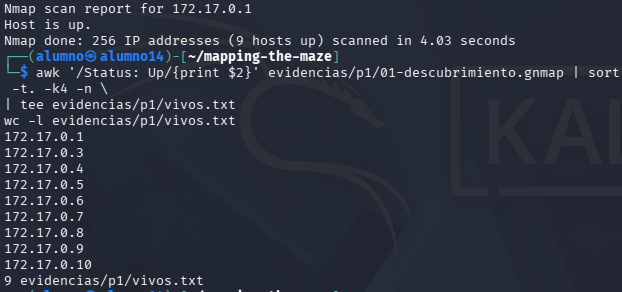
- **Siguiente paso:** extraer la lista limpia de IPs vivas.

### 2026-11-21 18:38 - Lista de equipos vivos
- **Cuándo:** 2026-11-21 18:38
- **Objetivo y alcance:** obtener la lista de IPs vivas a partir del fichero `.gnmap`. Solo trabaja con ficheros locales, sin tráfico de red.
- **Qué hice:** `awk '/Status: Up/{print $2}' evidencias/p1/01-descubrimiento.gnmap | sort -t. -k4 -n | tee evidencias/p1/vivos.txt` y `wc -l evidencias/p1/vivos.txt`
- **Qué salió:** 9 IPs vivas: 172.17.0.1, .3, .4, .5, .6, .7, .8, .9 y .10. La 172.17.0.1 es mi propia máquina (puente docker0). La 172.17.0.2 no respondió a este barrido. Evidencia: `evidencias/p1/vivos.txt`.
- **Captura:** 
- **Siguiente paso:** contrastar con un barrido ARP por si algún equipo no responde a ping ni a las sondas TCP/UDP.

### 2026-11-21 18:53 - Contraste con barrido ARP
- **Cuándo:** 2026-11-21 18:53 (barrido) y 18:54 (lista)
- **Objetivo y alcance:** comprobar que el primer barrido no se dejó ningún equipo. ARP lo responde todo equipo encendido de la red local. Objetivo 172.17.0.0/24 mediante `-iL scope.txt`.
- **Qué hice:** `sudo nmap -sn -PR -iL scope.txt -oA evidencias/p1/02-descubrimiento-arp` y `awk '/Status: Up/{print $2}' evidencias/p1/02-descubrimiento-arp.gnmap | sort -t. -k4 -n > evidencias/p1/vivos-arp.txt`
- **Qué salió:** `Nmap done: 256 IP addresses (9 hosts up) scanned in 4.01 seconds`. Los 9 equipos son los mismos que en el primer barrido (172.17.0.1, .3 a .10), cada uno con su dirección MAC. Evidencia: `evidencias/p1/02-descubrimiento-arp.nmap` y `evidencias/p1/vivos-arp.txt`.
- **Captura:** 
- **Siguiente paso:** comparar `vivos.txt` con `vivos-arp.txt` y quitar mi IP de la lista.

### 2026-11-21 18:54 - Comparación ARP y exclusión de mi IP (sesión de root)
- **Cuándo:** después de las 18:54 (hora no registrada: se hizo en una sesión de root, abierta con `sudo su` a las 18:54, cuyo historial no lleva marca de hora)
- **Objetivo y alcance:** comparar los dos barridos y excluir mi IP del inventario. Solo ficheros locales y comandos de red locales, dentro de 172.17.0.0/24.
- **Qué hice:** `diff evidencias/p1/vivos.txt evidencias/p1/vivos-arp.txt && echo "COINCIDEN"`, después `MIIP=$(ip -br a | grep -oE '172\.17\.0\.[0-9]+' | head -1); echo "Mi IP: $MIIP"`, `grep -vx "$MIIP" evidencias/p1/vivos.txt > /tmp/v && mv /tmp/v evidencias/p1/vivos.txt` y `cat evidencias/p1/vivos.txt`
- **Qué salió:** el `diff` imprimió `COINCIDEN`: los dos barridos ven los mismos 9 equipos, sin diferencias. `Mi IP: 172.17.0.1`. Tras excluirla, `vivos.txt` queda con 8 equipos del cliente: 172.17.0.3 a 172.17.0.10. La 172.17.0.2 no responde ni a ICMP/TCP/UDP ni a ARP. Evidencia: `evidencias/p1/vivos.txt`.
- **Captura:** 
- **Siguiente paso:** identificar el equipo delicado con una pasada suave antes de escanear todos los puertos.

### 2026-11-21 19:20 - Pasada suave para localizar el equipo delicado
- **Cuándo:** 2026-11-21 19:20 (inicio del bucle); el último equipo terminó a las 19:27:42
- **Objetivo y alcance:** localizar el equipo antiguo y delicado antes de escanear todos los puertos, con una pasada suave (100 puertos, versión ligera). Objetivos: los 8 equipos de `evidencias/p1/vivos.txt` (172.17.0.3 a 172.17.0.10), dentro de 172.17.0.0/24. Mientras tanto se vigiló con `ping` desde una segunda terminal.
- **Qué hice:** `for ip in $(cat evidencias/p1/vivos.txt); do echo "=== $ip ==="; sudo nmap -Pn -sS --top-ports 100 -sV --version-light -T2 --max-retries 1 -oA evidencias/p1/03-suave-$ip $ip; done`
- **Qué salió:** cada equipo tardó entre 41 y 65 segundos, sin que ninguno destacara. Evidencia: `evidencias/p1/03-suave-172.17.0.<n>.nmap` (uno por equipo). Los puertos abiertos son:
  - 172.17.0.3: 21/tcp vsftpd 2.3.4 y 80/tcp Apache httpd 2.4.58 (Ubuntu).
  - 172.17.0.4: 22/tcp OpenSSH 7.9p1 Debian 10+deb10u4, 8009/tcp Apache Jserv (AJP 1.3) y 8080/tcp Apache Tomcat 9.0.30.
  - 172.17.0.5: 80/tcp y 443/tcp Apache httpd 2.4.59 (Debian).
  - 172.17.0.6: 22/tcp OpenSSH 9.2p1 Debian 2+deb12u2 y 8080/tcp Jetty 10.0.18.
  - 172.17.0.7: 22/tcp OpenSSH 7.7.
  - 172.17.0.8: 22/tcp OpenSSH 9.6p1 Ubuntu, 80/tcp Apache 2.4.58, 139/tcp y 445/tcp Samba smbd 4.
  - 172.17.0.9: 22/tcp OpenSSH 9.2p1 Debian 2+deb12u10 y 80/tcp Apache 2.4.68.
  - 172.17.0.10: 80/tcp SimpleHTTPServer 0.6 (Python 3.11.2).
- **Captura:** 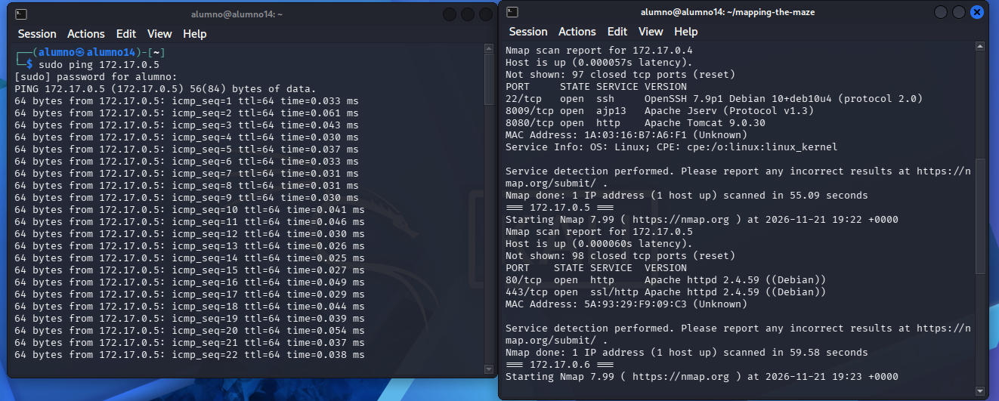
- **Siguiente paso:** listar los banners juntos e identificar el equipo delicado.

### 2026-11-21 19:31 - Revisión de banners y tiempos del escaneo suave
- **Cuándo:** 2026-11-21 19:31 (`grep` de puertos abiertos) y 19:36 (`grep` de tiempos). La captura no muestra la hora; la hora sale del historial.
- **Objetivo y alcance:** buscar banners antiguos y tiempos anómalos que delaten el equipo delicado. Solo ficheros locales.
- **Qué hice:** `grep -H "open" evidencias/p1/03-suave-*.nmap` y `grep -H "Nmap done" evidencias/p1/03-suave-*.nmap`
- **Qué salió:** el único banner de software muy antiguo es vsftpd 2.3.4 en 172.17.0.3; el resto son versiones más recientes. Los tiempos (41 a 65 s) no señalan a ningún equipo, y el ping a 172.17.0.5 no perdió paquetes durante el escaneo. Conclusión provisional: se trata 172.17.0.3 como equipo delicado por el banner, no por los tiempos. Se reconsiderará si otro equipo se comporta de forma anómala en el escaneo completo. Evidencia: `evidencias/p1/03-suave-*.nmap`.
- **Hallazgo grave anotado, sin tocarlo:** vsftpd 2.3.4 se detectó solo por banner. No se lanzó ningún script ni prueba contra él.
- **Captura:** 
- **Siguiente paso:** fijar `FRAGIL=172.17.0.3` y escanear los 65 535 puertos TCP, primero los equipos normales y después el delicado, despacio.

### Fallo registrado - ping sin permisos
- **Cuándo:** hora no registrada (se lanzó desde otra terminal, en el directorio `~`, cuyo historial no está en este cuaderno); fue justo antes de las 19:20
- **Objetivo y alcance:** preparar la vigilancia con `ping` del equipo escaneado. Objetivos 172.17.0.3 y 172.17.0.4, dentro de 172.17.0.0/24.
- **Qué hice:** `ping 172.17.0.3` y `ping 172.17.0.4`, y después `sudo ping 172.17.0.5`
- **Qué salió:** los dos primeros fallaron con `socket: Operation not permitted` (falta `cap_net_raw`) porque el usuario `alumno` no puede crear sockets raw sin `sudo`. Con `sudo ping` respondió sin pérdidas. Evidencia: salida en la terminal, sin fichero.
- **Captura:** 
- **Siguiente paso:** lanzar la pasada suave con el ping corriendo en la segunda terminal.

### 2026-11-21 19:57 - Escaneo completo de puertos TCP de los equipos normales
- **Cuándo:** 2026-11-21 19:57 (inicio); fin: 20:36 (último equipo, 172.17.0.10, terminó a las 20:36:24; cada equipo tardó unos 328 s)
- **Objetivo y alcance:** descubrir todos los puertos TCP abiertos, incluidos los altos, de los equipos que no se tratan como delicados. Objetivos 172.17.0.4 a 172.17.0.10, tomados de `evidencias/p1/vivos.txt` sin la .3, dentro de 172.17.0.0/24. Ritmo limitado a 200 paquetes por segundo.
- **Qué hice:** `for ip in $(grep -vx "$FRAGIL" evidencias/p1/vivos.txt); do echo "=== $ip ==="; sudo nmap -Pn -sS -p- -T3 --max-rate 200 -oA evidencias/p1/10-tcp-all-$ip $ip; done`, tras fijar `FRAGIL=172.17.0.3` a las 19:54.
- **Qué salió:** 172.17.0.4: 22, 8009, 8080. 172.17.0.5: 80, 443, 1883, 5672, 8161, 32987, 61613, 61614, 61616 (seis puertos que la pasada suave no vio). 172.17.0.6: 22, 8080. 172.17.0.7: 22. 172.17.0.8: 22, 80, 139, 445. 172.17.0.9: 22, 80. 172.17.0.10: 80. Evidencia: `evidencias/p1/10-tcp-all-172.17.0.<n>.nmap`.
- **Captura:** sin captura (las capturas son por equipo, en la entrada siguiente)
- **Siguiente paso:** capturar la lista de puertos abiertos de cada equipo.

### 2026-11-21 20:37 - Capturas de los puertos abiertos por equipo
- **Cuándo:** 2026-11-21 20:37 a 20:43. Primera captura a las 20:37 (172.17.0.4); después .5 (20:39), .6 (20:40), .7 y .8 (20:41), .9 y .10 (20:42); a las 20:43 se listaron todos juntos.
- **Objetivo y alcance:** dejar captura de los puertos abiertos de cada equipo. Solo ficheros locales.
- **Qué hice:** `grep open evidencias/p1/10-tcp-all-172.17.0.<n>.nmap` (una vez por equipo) y `grep -H open evidencias/p1/10-tcp-all-*.nmap`
- **Qué salió:** los resultados de la entrada anterior. Nota de trazabilidad: la línea del historial de las 20:37 aparece como `grep open ...172.17.0.5.nmap` porque la edité antes de ejecutarla para cambiarla por la de la .4 (el historial la marca como editada). El comando realmente ejecutado a las 20:37 fue el de 172.17.0.4. Evidencia: `evidencias/p1/10-tcp-all-*.nmap`.
- **Captura:**  y 
- **Siguiente paso:** escanear todos los puertos del equipo tratado como delicado, con ping de vigilancia.

### 2026-11-21 20:45 - Escaneo completo de 172.17.0.3 (interrumpido)
- **Cuándo:** 2026-11-21 20:45 (inicio) y 21:42 (parada con Ctrl+C). Las horas son las de la máquina virtual Kali, que va una hora por delante del portátil.
- **Objetivo y alcance:** escanear los 65 535 puertos TCP del equipo que se trata como delicado. Objetivo 172.17.0.3, dentro de 172.17.0.0/24. Se vigiló con `sudo ping 172.17.0.3` desde otra terminal, sin pérdida de paquetes.
- **Qué hice:** `sudo nmap -Pn -sS -p- -T2 --max-rate 30 --max-retries 1 -oA evidencias/p1/10-tcp-all-172.17.0.3 172.17.0.3`
- **Qué salió:** al pulsar la barra espaciadora, `SYN Stealth Scan Timing: About 12.47% done; ETC: 04:03 (6:22:44 remaining)`. El ritmo real era de unos 2,5 puertos por segundo, porque `-T2` impone un retardo entre sondas que anula el efecto de `--max-rate 30`. Terminar habría llevado más de 6 horas y se interrumpió a las 21:42. Los ficheros parciales no se apartaron y se sobrescribieron al repetir el escaneo con el mismo nombre (`-oA`), así que la única evidencia de este intento es la línea de progreso anterior.
- **Captura:** sin captura
- **Siguiente paso:** repetir el escaneo con `-T3` manteniendo `--max-rate 30` y el ping de vigilancia.

### 2026-11-21 21:46 - Escaneo completo de 172.17.0.3 (repetición con -T3)
- **Cuándo:** 2026-11-21 21:46 (inicio); fin: 22:22 (terminó a las 22:22:58, 2185 s). Horas de la máquina virtual.
- **Objetivo y alcance:** repetir el escaneo completo de 172.17.0.3, dentro de 172.17.0.0/24, tras interrumpir el de las 20:45 por lentitud. Se mantiene `--max-rate 30` y `--max-retries 1` y se cambia `-T2` por `-T3`. Se vigiló con `sudo ping 172.17.0.3`. Este cambio se aparta de lo que indica la guía para el equipo delicado.
- **Qué hice:** `sudo nmap -Pn -sS -p- -T3 --max-rate 30 --max-retries 1 -oA evidencias/p1/10-tcp-all-$FRAGIL $FRAGIL`
- **Qué salió:** abiertos 21/tcp (ftp) y 80/tcp (http). Sin puertos altos. El ping a 172.17.0.3 respondió sin pérdida de paquetes durante todo el escaneo. Evidencia: `evidencias/p1/10-tcp-all-172.17.0.3.nmap`.
- **Captura:** 
- **Siguiente paso:** obtener producto y versión de cada puerto abierto con `-sV`.

### 2026-11-21 22:56 - Detección de versiones de los puertos TCP abiertos
- **Cuándo:** 2026-11-21 22:56 (inicio); fin: 22:58 (el último equipo, 172.17.0.10, terminó a las 22:58:18; la .5 fue la más lenta, 31,9 s)
- **Objetivo y alcance:** obtener servicio y versión de cada puerto abierto, sin detección de sistema operativo. Objetivos: los 8 equipos de `evidencias/p1/vivos.txt` (172.17.0.3 a 172.17.0.10), dentro de 172.17.0.0/24. La .3 se escaneó con `--version-light -T2`.
- **Qué hice:** `for ip in $(cat evidencias/p1/vivos.txt); do ports=$(grep -oE '[0-9]+/open/tcp' evidencias/p1/10-tcp-all-$ip.gnmap | cut -d/ -f1 | sort -un | paste -sd, -); [ -z "$ports" ] && { echo "$ip sin TCP abiertos"; continue; }; echo "=== $ip : $ports ==="; if [ "$ip" = "$FRAGIL" ]; then sudo nmap -Pn -sV --version-light -T2 --max-retries 1 -p $ports -oA evidencias/p1/11-tcp-ver-$ip $ip; else sudo nmap -Pn -sV -p $ports -oA evidencias/p1/11-tcp-ver-$ip $ip; fi; done`
- **Qué salió:** .3: vsftpd 2.3.4 y Apache httpd 2.4.58 (Ubuntu). .4: OpenSSH 7.9p1 Debian 10+deb10u4, Apache Jserv (AJP 1.3) y Apache Tomcat 9.0.30. .5: Apache httpd 2.4.59 (80 y 443), mqtt sin versión (1883), amqp? no identificado (5672), Jetty 9.4.39.v20210325 (8161 y 61614), stomp Apache ActiveMQ (61613), ActiveMQ OpenWire transport 5.15.15 (61616) y tcpwrapped (32987). .6: OpenSSH 9.2p1 Debian 2+deb12u2 y Jetty 10.0.18. .7: OpenSSH 7.7. .8: OpenSSH 9.6p1 Ubuntu 3ubuntu13.5, Apache httpd 2.4.58, Samba smbd 4 (139 y 445). .9: OpenSSH 9.2p1 Debian 2+deb12u10 y Apache httpd 2.4.68. .10: SimpleHTTPServer 0.6 (Python 3.11.2). Evidencia: `evidencias/p1/11-tcp-ver-172.17.0.<n>.nmap`.
- **Captura:** sin captura (las capturas son por equipo, en la entrada siguiente)
- **Siguiente paso:** capturar la tabla de versiones de cada equipo.

### 2026-11-21 23:02 - Capturas de versiones por equipo
- **Cuándo:** 2026-11-21 23:02 (.3), 23:04 (.4), 23:05 (.5), 23:07 (.6 y .7), 23:08 (.8), 23:09 (.9), 23:10 (.10 y resumen)
- **Objetivo y alcance:** dejar captura de la tabla PORT/STATE/SERVICE/VERSION de cada equipo. Solo ficheros locales.
- **Qué hice:** `cat evidencias/p1/11-tcp-ver-172.17.0.<n>.nmap` (una vez por equipo) y `grep -H -E "^[0-9]+/tcp +open" evidencias/p1/11-tcp-ver-*.nmap`
- **Qué salió:** los resultados de la entrada anterior. Evidencia: `evidencias/p1/11-tcp-ver-*.nmap`.
- **Captura:**    (y una por cada una de las demás IP)
- **Siguiente paso:** escanear los puertos UDP más comunes.

### 2026-11-21 23:19 - Escaneo UDP de los equipos normales
- **Cuándo:** 2026-11-21 23:19 (inicio); fin: 23:22 (el último equipo, 172.17.0.10, terminó a las 23:22:35; cada equipo tardó unos 25 s)
- **Objetivo y alcance:** descubrir los puertos UDP abiertos entre los 100 más comunes, con versión mínima, porque no todo habla TCP. Objetivos: 172.17.0.4 a 172.17.0.10 (todos menos 172.17.0.3), dentro de 172.17.0.0/24. Ritmo limitado a 100 paquetes por segundo.
- **Qué hice:** `for ip in $(grep -vx "$FRAGIL" evidencias/p1/vivos.txt); do echo "=== $ip ==="; sudo nmap -Pn -sU --top-ports 100 -sV --version-intensity 0 --max-retries 1 -T3 --max-rate 100 -oA evidencias/p1/12-udp-$ip $ip; done`
- **Qué salió:** solo dos puertos UDP en estado `open`: 172.17.0.8 137/udp netbios-ns (Samba nmbd, workgroup: DL) y 172.17.0.10 623/udp asf-rmcp. El resto de puertos no respondió (`open|filtered`) y no se cuentan como abiertos: 172.17.0.4 (91 puertos), .5 (93), .6 (92), .7 (94), .8 (90), .9 (91) y .10 (89). Evidencia: `evidencias/p1/12-udp-172.17.0.<n>.nmap`.
- **Captura:** sin captura (las capturas se hicieron al día siguiente, en la entrada del 2026-11-22)
- **Siguiente paso:** escanear los UDP típicos de 172.17.0.3, que se trata como equipo delicado.

### 2026-11-21 23:22 - Escaneo UDP del equipo delicado (172.17.0.3)
- **Cuándo:** 2026-11-21 23:22 (inicio); fin: 23:23 (terminó a las 23:23:07, 7,6 s)
- **Objetivo y alcance:** comprobar los UDP más típicos de 172.17.0.3 con el mínimo tráfico. Objetivo 172.17.0.3, dentro de 172.17.0.0/24. Solo 10 puertos y `-T2`.
- **Qué hice:** `sudo nmap -Pn -sU -p 53,67,69,123,137,161,500,623,1900,5353 --max-retries 1 -T2 -oA evidencias/p1/12-udp-$FRAGIL $FRAGIL`
- **Qué salió:** ningún puerto `open`. 137/udp (netbios-ns) y 5353/udp (zeroconf) salen `open|filtered`: no respondieron y no se cuentan como abiertos. El ping a 172.17.0.3 respondió sin pérdida de paquetes durante este escaneo. Evidencia: `evidencias/p1/12-udp-172.17.0.3.nmap`.
- **Captura:** sin captura (ver entrada siguiente)
- **Siguiente paso:** listar los puertos UDP en estado `open` de todos los equipos.

### 2026-11-21 23:23 - Revisión de los puertos UDP abiertos
- **Cuándo:** 2026-11-21 23:23 (resumen) y 2026-11-22 15:05 a 15:10 (capturas por equipo). La captura de la .4 se repitió a las 15:07 porque la de las 15:06 no llevaba la hora delante.
- **Objetivo y alcance:** separar los puertos UDP `open` de los `open|filtered` y dejar captura por equipo. Solo ficheros locales, sin tráfico de red.
- **Qué hice:** `grep -H "open" evidencias/p1/12-udp-*.nmap` y, por equipo, `grep -E "open" evidencias/p1/12-udp-172.17.0.<n>.nmap`
- **Qué salió:** confirmados `open`: 172.17.0.8 137/udp y 172.17.0.10 623/udp (puerto de RMCP, usado por IPMI). Las líneas `Not shown: N open|filtered` salen en el `grep` por contener la palabra "open", pero no son puertos abiertos. Los demás equipos no tienen ningún UDP abierto confirmado. Evidencia: `evidencias/p1/12-udp-*.nmap`.
- **Captura:** 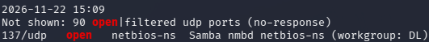  (el resto de equipos tienen su captura `p1-07-udp-<IP>.png`, sin puertos `open`)
- **Siguiente paso:** juntar todos los puertos abiertos en un resumen.

### 2026-11-22 15:19 - Resumen de puertos abiertos
- **Cuándo:** 2026-11-22 15:19 (generación del resumen) y 15:25 (comprobación con `cat`)
- **Objetivo y alcance:** juntar en un solo fichero todos los puertos abiertos (TCP con versión y UDP) para rellenar la tabla del inventario. Solo ficheros locales, sin tráfico de red.
- **Qué hice:** `for f in evidencias/p1/11-tcp-ver-*.nmap evidencias/p1/12-udp-*.nmap; do echo "== $(basename $f)"; grep -E "^[0-9]+/(tcp|udp) +open " "$f"; done | tee evidencias/p1/resumen-puertos.txt` y `cat evidencias/p1/resumen-puertos.txt`
- **Qué salió:** 27 puertos TCP abiertos en 8 equipos y 2 UDP abiertos. El UDP abierto confirmado es 623/udp asf-rmcp en la .10 y 137/udp netbios-ns (Samba nmbd, workgroup: DL) en la .8. Los demás equipos no tienen UDP abierto confirmado. Evidencia: `evidencias/p1/resumen-puertos.txt`.
- **Captura:**  
- **Siguiente paso:** comparar este resumen con la hoja de inventario del cliente (Sobra, Falta, Mal).

### 2026-11-22 15:50 - Comparación con la hoja de inventario del cliente
- **Cuándo:** 2026-11-22 15:50 (visualización de la hoja) y 15:54 (comprobación del historial)
- **Objetivo y alcance:** contrastar lo observado con la hoja de inventario que entregó el cliente. La hoja no se usó como fuente; solo se comparó al final. Solo ficheros locales, sin tráfico de red. La hoja incluye una IP fuera del alcance (172.17.1.6), que no se escaneó.
- **Qué hice:** `clear; date "+%F %H:%M"` y `cut -d';' -f1-5 evidencias/p1/inventario-cliente.csv | column -s';' -t`. El fichero se copió a `evidencias/p1/inventario-cliente.csv` fuera de la terminal, por lo que ese paso no consta en el historial.
- **Qué salió:** la hoja tiene 10 filas. Frente a los 8 equipos vivos observados (172.17.0.3 a 172.17.0.10): 7 entradas sobran (172.17.0.11, .20, .2, .50, .254, .30 y .100, que no respondieron), 2 tienen datos erróneos (172.17.0.10 y 172.17.0.9), faltan 6 equipos (172.17.0.3 a .8) y 1 entrada queda fuera de alcance (172.17.1.6). Evidencia: `evidencias/p1/inventario-cliente.csv`.
- **Captura:** 
- **Siguiente paso:** comprobar qué puertos quedan fuera de los 1000 más comunes de nmap y redactar `inventario.md`.

### 2026-11-22 15:57 - Puertos fuera de los 1000 más comunes de nmap
- **Cuándo:** 2026-11-22 15:57
- **Objetivo y alcance:** saber qué puertos abiertos hallados no aparecen entre los 1000 más comunes de nmap, para el apartado de puertos fuera de lo habitual. Solo ficheros locales (`/usr/share/nmap/nmap-services`), sin tráfico de red.
- **Qué hice:** `awk '$2 ~ /\/tcp$/ {print $3, $2}' /usr/share/nmap/nmap-services | sort -rn | head -1000 | awk '{split($2,a,"/"); print a[1]}' > /tmp/top1000.txt` y un bucle `for p in 21 22 80 139 443 445 1883 5672 8009 8080 8161 32987 61613 61614 61616; do grep -qx $p /tmp/top1000.txt && echo "$p: entre los 1000 más comunes" || echo "$p: FUERA"; done`
- **Qué salió:** están entre los 1000 más comunes 21, 22, 80, 139, 443, 445, 8009 y 8080. Quedan fuera 1883, 5672, 8161, 32987, 61613, 61614 y 61616, todos en 172.17.0.5. La lista de los 1000 es una aproximación por frecuencia de la base de datos local de nmap. Evidencia: salida en la terminal, sin fichero.
- **Captura:** sin captura
- **Siguiente paso:** redactar `inventario.md` con la tabla de equipos, el UDP y las correcciones a la hoja del cliente.

### 2026-11-22 - Redacción de inventario.md (Parte 1)
- **Cuándo:** 2026-11-22, después de las 15:57 (hora exacta no registrada en el historial: el fichero se redactó y se subió fuera de la terminal de este historial)
- **Objetivo y alcance:** dejar escrito el inventario de la Parte 1 (equipos vivos, puertos, servicios, UDP, puertos fuera de lo habitual y correcciones a la hoja del cliente) a partir de mis salidas de nmap y de la hoja del cliente. Solo trabajo con ficheros locales, sin tráfico de red.
- **Qué hice:** redacté `inventario.md` con ayuda de IA a partir de `evidencias/p1/resumen-puertos.txt`, los `.nmap` de la Parte 1 y `evidencias/p1/inventario-cliente.csv`, y comprobé los datos contra mis salidas y capturas. Las funciones de cada equipo (portal, mensajería, consola, equipo antiguo y servidor de pruebas) quedan marcadas como probables. Después corregí los enlaces de las capturas que se habían hecho en dos partes (`p1-06-versiones-172.17.0.5-1.png` y `-2.png`, y `p1-08-resumen-puertos-1.png` y `-2.png`).
- **Qué salió:** `inventario.md` con 8 equipos vivos (172.17.0.3 a 172.17.0.10), 24 puertos TCP y 2 UDP abiertos, 7 puertos fuera de lo habitual (todos en 172.17.0.5) y la tabla de correcciones: 7 entradas sobran, 6 equipos faltan, 2 tienen datos erróneos y 1 queda fuera de alcance. Evidencia: `inventario.md`.
- **Captura:** sin captura
- **Siguiente paso:** empezar la Parte 2 (enumeración sin autenticar), dejando una marca de inicio en el historial.

---

## Parte 2 - Enumerar sin autenticar

### 2026-11-22 16:44 - Inicio de la Parte 2 y comprobación de variables
- **Cuándo:** 2026-11-22 16:44 (marca de inicio) y 16:46 (variables)
- **Objetivo y alcance:** dejar marcado el inicio de la Parte 2 en el historial y comprobar que el filtro `SAFE` y la variable `FRAGIL` están cargados. Solo comprobaciones locales, sin tráfico de red.
- **Qué hice:** `echo "#### INICIO PARTE 2 $(date '+%F %H:%M')"` y `echo "$SAFE"; echo $FRAGIL`
- **Qué salió:** la marca de inicio queda a las 16:44 y las dos variables están definidas (el filtro seguro y 172.17.0.3). Evidencia: salida en el historial.
- **Captura:** sin captura
- **Siguiente paso:** lanzar los scripts NSE seguros sobre los puertos abiertos de los equipos normales.

### 2026-11-22 16:47 - Scripts NSE seguros en los equipos normales
- **Cuándo:** 2026-11-22 16:47 (inicio); fin: antes de las 16:50, hora del comando siguiente
- **Objetivo y alcance:** obtener la información que cada servicio da sin autenticar, con scripts de las categorías default y safe a la vez (filtro `SAFE`). Objetivos: 172.17.0.4 (22, 8080), 172.17.0.5 (80, 443, 8161, 61614), 172.17.0.6 (22, 8080), 172.17.0.7 (22), 172.17.0.8 (22, 80, 139, 445), 172.17.0.9 (22, 80) y 172.17.0.10 (80), dentro de 172.17.0.0/24. Quedan fuera de los scripts el AJP de la .4 (8009) y los puertos de mensajería de la .5 (1883, 5672, 32987, 61613, 61616), por tratarse de servicios donde la guía no permite lanzar scripts.
- **Qué hice:** `for t in 172.17.0.4:22,8080 172.17.0.5:80,443,8161,61614 172.17.0.6:22,8080 172.17.0.7:22 172.17.0.8:22,80,139,445 172.17.0.9:22,80 172.17.0.10:80; do ip=${t%%:*}; ports=${t#*:}; echo "=== $ip : $ports ==="; sudo nmap -Pn -sV -p $ports --script "$SAFE" -oA evidencias/p2/20-nse-$ip $ip; done`
- **Qué salió:** 172.17.0.4: Tomcat 9.0.30 y claves de host SSH. 172.17.0.5: página por defecto de Apache (80), certificado `example.com` caducado el 2025-04-17 y web "DockerLabs | Plantilla gratuita Bootstrap 4.3.x" (443), Jetty 9.4.39 con `Error 401 Unauthorized` y aviso de método TRACE en los puertos Jetty. 172.17.0.6: Jetty 10.0.18 con `robots.txt` que prohíbe `/`. 172.17.0.7: claves de host SSH. 172.17.0.8: título "Login", NetBIOS `SAMBASERVER`, SMB 3.1.1 con firma habilitada pero no obligatoria. 172.17.0.9: Apache 2.4.68 con título "test page". 172.17.0.10: SimpleHTTP/0.6 con título "CTG · IPMI bajo exposición". Evidencia: `evidencias/p2/20-nse-172.17.0.<n>.nmap`.
- **Captura:** sin captura (ver entrada de las capturas por equipo)
- **Siguiente paso:** repetir el análisis, más suave, en el equipo tratado como delicado (172.17.0.3).

### 2026-11-22 16:50 - Scripts NSE seguros en el equipo delicado (172.17.0.3)
- **Cuándo:** 2026-11-22 16:50
- **Objetivo y alcance:** obtener lo que expone el puerto 80 de 172.17.0.3, dentro de 172.17.0.0/24. Se usó `-T2` y `--version-light`, y solo el puerto 80. No se lanzó ningún script contra el FTP (21/tcp, vsftpd 2.3.4), por ser hallazgo grave que no se toca.
- **Qué hice:** `sudo nmap -Pn -sV --version-light -T2 --max-retries 1 -p 80 --script "$SAFE" -oA evidencias/p2/20-nse-$FRAGIL $FRAGIL`
- **Qué salió:** título "Apache2 Ubuntu Default Page: It works". Nada más. El ping a 172.17.0.3 respondió sin pérdida de paquetes durante el escaneo. Evidencia: `evidencias/p2/20-nse-172.17.0.3.nmap`.
- **Captura:** sin captura (ver entrada siguiente)
- **Siguiente paso:** capturar la salida de los scripts de cada equipo.

### 2026-11-22 16:50 - Capturas de los scripts NSE por equipo
- **Cuándo:** 2026-11-22 16:50 (.3), 16:51 (.4), 16:52 (.5), 16:53 (.6 y .7), 16:54 (.8), 16:55 (.9 y .10)
- **Objetivo y alcance:** dejar captura de las líneas `|` de los scripts de cada equipo. Solo ficheros locales.
- **Qué hice:** `cat evidencias/p2/20-nse-172.17.0.<n>.nmap` (una vez por equipo, con `clear; date "+%F %H:%M"` delante)
- **Qué salió:** los resultados de las dos entradas anteriores. Evidencia: `evidencias/p2/20-nse-172.17.0.<n>.nmap`.
- **Captura:**    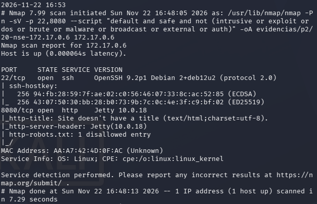  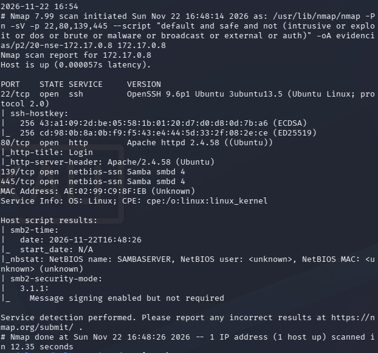  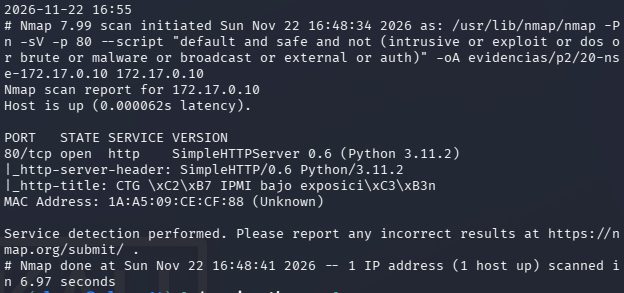
- **Siguiente paso:** comprobar las categorías de los scripts sueltos que se van a usar.

### 2026-11-22 16:56 - Categorías de los scripts sueltos
- **Cuándo:** 2026-11-22 16:56
- **Objetivo y alcance:** comprobar que ningún script suelto previsto es intrusive, exploit, dos, brute, malware ni auth. Solo consulta de la ayuda local de nmap, sin tráfico de red.
- **Qué hice:** `for s in ssh2-enum-algos ssh-hostkey smb-os-discovery smb2-security-mode smb-security-mode smb-protocols nbstat ipmi-version; do nmap --script-help $s | grep -iE "^$s|categories"; done`
- **Qué salió:** los ocho scripts son de categorías safe y discovery (algunos también default); ninguno es intrusive, exploit, dos, brute, malware ni auth. Evidencia: salida en la terminal, sin fichero.
- **Captura:** 
- **Siguiente paso:** revisar lo que han devuelto los scripts y pasar a la enumeración web.

### 2026-11-22 16:58 - Lectura de las líneas de los scripts
- **Cuándo:** 2026-11-22 16:58
- **Objetivo y alcance:** revisar de una vez las líneas `|` de todos los scripts para decidir los siguientes pasos. Solo ficheros locales.
- **Qué hice:** `grep -h "^|" evidencias/p2/20-nse-*.nmap`
- **Qué salió:** ninguna cuenta de usuario revelada de momento. Hallazgos de interés para la Parte 3: certificado caducado y genérico en 172.17.0.5:443 y aviso de método TRACE en un puerto Jetty de la 172.17.0.5. Evidencia: `evidencias/p2/20-nse-*.nmap`.
- **Captura:** sin captura
- **Siguiente paso:** enumerar los servicios web con cabeceras, `robots.txt`, pistas de la portada y whatweb.

### 2026-11-22 17:05 - Enumeración web: cabeceras, robots.txt y whatweb
- **Cuándo:** 2026-11-22 17:05
- **Objetivo y alcance:** ver qué expone cada servicio web sin autenticar, con tres peticiones normales por servicio (cabeceras, `robots.txt`) más `whatweb -a 1`. Objetivos: 172.17.0.3:80, 172.17.0.4:8080, 172.17.0.5:80, 443 y 8161, 172.17.0.6:8080, 172.17.0.8:80, 172.17.0.9:80 y 172.17.0.10:80, dentro de 172.17.0.0/24. Sin rastreo de rutas ni pruebas de login.
- **Qué hice:** `for t in 172.17.0.3:80:http 172.17.0.4:8080:http 172.17.0.5:80:http 172.17.0.5:443:https 172.17.0.5:8161:http 172.17.0.6:8080:http 172.17.0.8:80:http 172.17.0.9:80:http 172.17.0.10:80:http; do IP=${t%%:*}; r=${t#*:}; P=${r%%:*}; S=${r#*:}; URL=$S://$IP:$P; echo "=== $URL ==="; curl -sk -m 10 -I $URL | tee evidencias/p2/21-http-cabeceras-$IP-$P.txt; curl -sk -m 10 $URL/robots.txt | head -c 1000 | tee evidencias/p2/21-http-robots-$IP-$P.txt; whatweb -a 1 $URL | tee evidencias/p2/21-whatweb-$IP-$P.txt; done`. Por un descuido, el bucle no incluía la petición de las pistas de la portada; se hizo después (entrada de las 17:25).
- **Qué salió:** las cabeceras confirman las versiones de la Parte 1: Apache 2.4.58 (.3 y .8), 2.4.59 (.5), 2.4.68 (.9), Jetty 9.4.39 (.5:8161), Jetty 10.0.18 (.6) y SimpleHTTP/0.6 con Python 3.11.2 (.10). La .6 es Jenkins 2.441: cabecera `X-Jenkins: 2.441`, `whatweb` con `Jenkins[2.441]` y redirección a `/login` con formulario de contraseña (no se entró). La .5:8161 responde 401 con `WWW-Authenticate: ActiveMQRealm basic` (no se probó ninguna credencial). Ningún `robots.txt` publica rutas salvo el de la .6, que contiene `Disallow: /`. Evidencia: `evidencias/p2/21-http-cabeceras-*.txt`, `21-http-robots-*.txt` y `21-whatweb-*.txt`.
- **Captura:** sin captura (ver entrada de las capturas)
- **Siguiente paso:** obtener el certificado de la 172.17.0.5:443.

### 2026-11-22 17:11 - Certificado TLS de 172.17.0.5:443
- **Cuándo:** 2026-11-22 17:11
- **Objetivo y alcance:** leer el certificado del único servicio HTTPS (organización, emisor, fechas). Solo la negociación TLS, contra 172.17.0.5, dentro de 172.17.0.0/24.
- **Qué hice:** `echo | openssl s_client -connect 172.17.0.5:443 2>/dev/null | openssl x509 -noout -subject -issuer -dates | tee evidencias/p2/21-tls-cert-172.17.0.5-443.txt`
- **Qué salió:** certificado autofirmado (emisor igual al sujeto): `C=US, ST=California, L=San Francisco, O=Your Organization, OU=Your Unit, CN=example.com`. Válido del 17 de abril de 2024 al 17 de abril de 2025 (caducado). Parece un certificado de plantilla. Evidencia: `evidencias/p2/21-tls-cert-172.17.0.5-443.txt`.
- **Captura:** 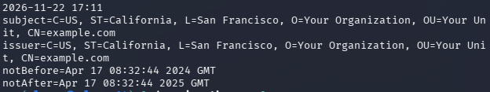
- **Siguiente paso:** capturar la salida de cada servicio web.

### 2026-11-22 17:13 - Capturas de la enumeración web por servicio
- **Cuándo:** 2026-11-22 17:13 (.3:80), 17:14 (.4:8080), 17:15 (.5:80), 17:16 (.5:443), 17:17 (.5:8161), 17:18 (.6:8080), 17:19 (.8:80 y .9:80) y 17:20 (.10:80)
- **Objetivo y alcance:** dejar captura de lo recogido por cada servicio web. Solo ficheros locales.
- **Qué hice:** `cat evidencias/p2/21-*-172.17.0.<n>-<puerto>.txt` (uno por servicio, con `clear; date "+%F %H:%M"` delante)
- **Qué salió:** los resultados de la entrada de las 17:05. Evidencia: `evidencias/p2/21-*-172.17.0.<n>-<puerto>.txt`.
- **Captura:** 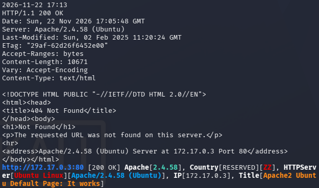 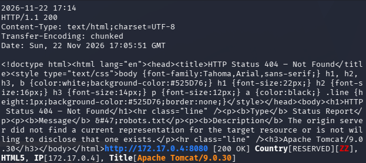 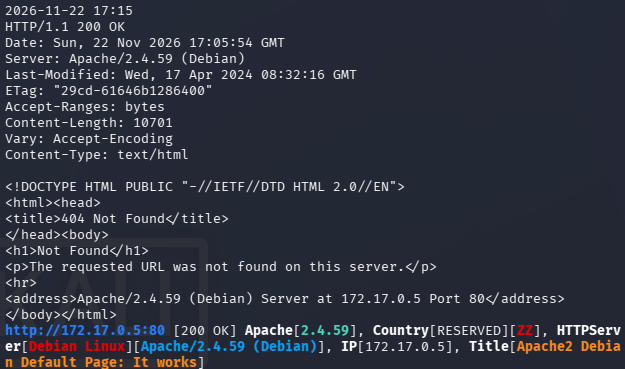 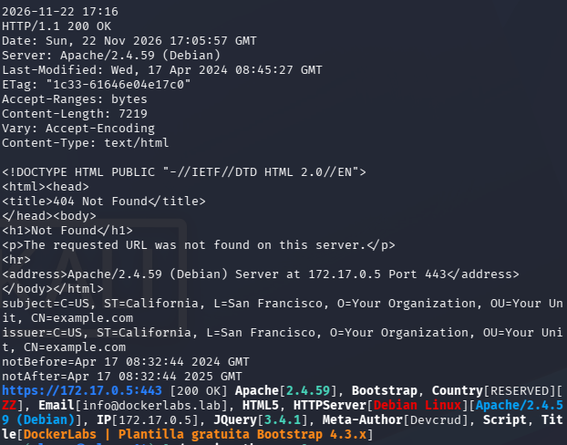 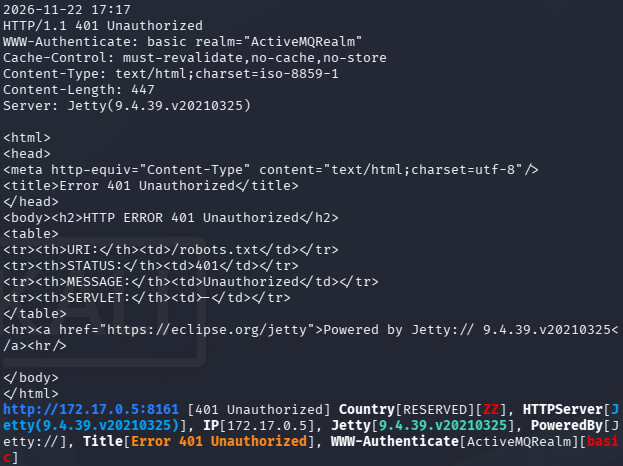 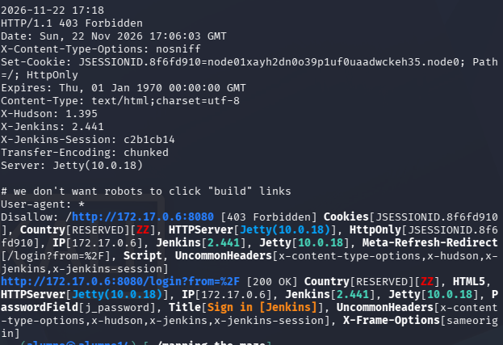 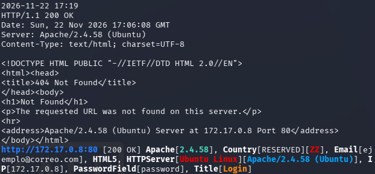 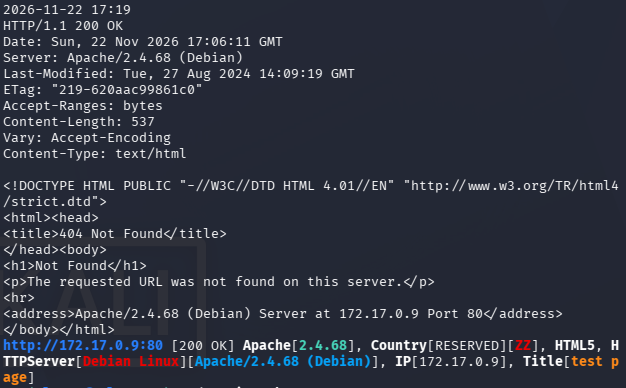 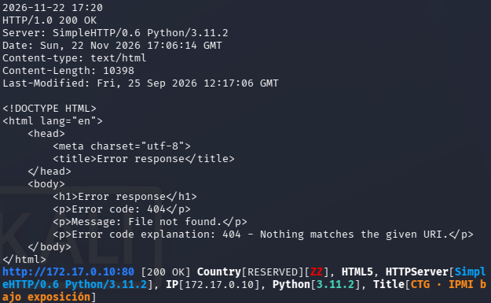
- **Siguiente paso:** revisar cabeceras y robots.txt de una vez y comprobar las pistas de la portada.

### 2026-11-22 17:21 - Intento fallido de las pistas de la portada
- **Cuándo:** 2026-11-22 17:21 (lectura) y 17:23 (segundo intento)
- **Objetivo y alcance:** revisar cabeceras y `robots.txt` y recoger las pistas de la portada (comentarios, correos, autores). Solo ficheros locales, y una petición a `/` por servicio en el segundo intento, dentro de 172.17.0.0/24.
- **Qué hice:** `grep -iH -E "^(server|x-powered-by)" evidencias/p2/21-http-cabeceras-*.txt` y `cat evidencias/p2/21-http-robots-*.txt evidencias/p2/21-http-pistas-*.txt` (17:21); después el bucle de las pistas con el patrón del `grep` entre comillas dobles (17:23)
- **Qué salió:** a las 17:21, el `cat` de las pistas dio `No such file or directory`, porque esa petición no se había lanzado. A las 17:23 el bucle falló con `bash: !-: event not found`: la secuencia `<!--` dentro de comillas dobles se interpreta como expansión del historial. Solo se ejecutaron los `echo`. Evidencia: salida en la terminal, sin fichero.
- **Captura:** sin captura
- **Siguiente paso:** repetir el bucle con el patrón del `grep` entre comillas simples.

### 2026-11-22 17:25 - Pistas de la portada de los servicios web
- **Cuándo:** 2026-11-22 17:25
- **Objetivo y alcance:** recoger comentarios HTML, correos, autores y versiones de la portada de cada servicio web, con una sola petición a `/` por servicio. Dentro de 172.17.0.0/24.
- **Qué hice:** `for t in 172.17.0.3:80:http 172.17.0.4:8080:http 172.17.0.5:80:http 172.17.0.5:443:https 172.17.0.5:8161:http 172.17.0.6:8080:http 172.17.0.8:80:http 172.17.0.9:80:http 172.17.0.10:80:http; do IP=${t%%:*}; r=${t#*:}; P=${r%%:*}; S=${r#*:}; URL=$S://$IP:$P; echo "=== $URL ==="; curl -sk -m 10 $URL/ | grep -iE 'generator|version|author|<title|mailto|@|<!--' | cut -c1-200 | tee evidencias/p2/21-http-pistas-$IP-$P.txt; done` y `grep -H . evidencias/p2/21-http-pistas-*.txt`
- **Qué salió:** la web de 172.17.0.5:443 es una plantilla de ejemplo ("DockerLabs | Plantilla gratuita Bootstrap 4.3.x", autor de la plantilla `Devcrud`, comentarios de relleno) y su pie muestra el correo `info@dockerlabs.lab`, que se anota como cuenta. La 172.17.0.8 muestra un formulario de login con el texto de ejemplo `ejemplo@correo.com`, que no se considera cuenta. Las demás portadas solo devuelven su título o su página por defecto. Evidencia: `evidencias/p2/21-http-pistas-*.txt`.
- **Captura:** sin captura
- **Siguiente paso:** enumerar SSH y leer los banners de FTP y de los puertos sin identificar.

### 2026-11-22 17:29 - SSH: banner, algoritmos y claves de host
- **Cuándo:** 2026-11-22 17:29 (inicio); fin: no registrada (el siguiente comando es de las 17:30). Capturas entre las 17:32 y las 17:41.
- **Objetivo y alcance:** conocer la versión de SSH y su configuración sin autenticar. Objetivos: 172.17.0.4, .6, .7, .8 y .9, puerto 22, dentro de 172.17.0.0/24. No se usó `ssh-auth-methods` ni se intentó conectar con ningún usuario.
- **Qué hice:** `for ip in 172.17.0.4 172.17.0.6 172.17.0.7 172.17.0.8 172.17.0.9; do echo "=== $ip ==="; nc -nv -w 3 $ip 22 </dev/null | tee evidencias/p2/22-ssh-banner-$ip.txt; sudo nmap -Pn -p 22 --script ssh2-enum-algos,ssh-hostkey $ip -oA evidencias/p2/22-ssh-$ip; done`
- **Qué salió:** algoritmos de intercambio de claves, cifrado y claves de host de cada servidor. Los banners guardados por `nc` se veían recortados o ausentes al listarlos con `grep` (ver entrada de las 17:55). Las capturas de cada equipo se hicieron en dos partes porque no cabían. Evidencia: `evidencias/p2/22-ssh-172.17.0.<n>.nmap` y `evidencias/p2/22-ssh-banner-172.17.0.<n>.txt`.
- **Captura:** 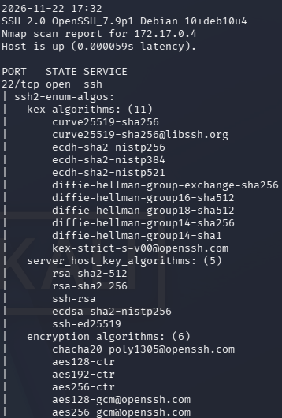 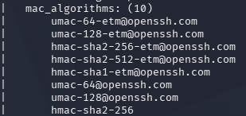 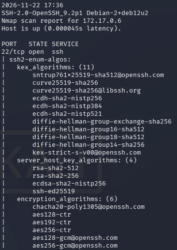 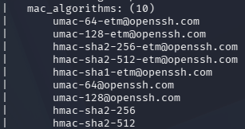 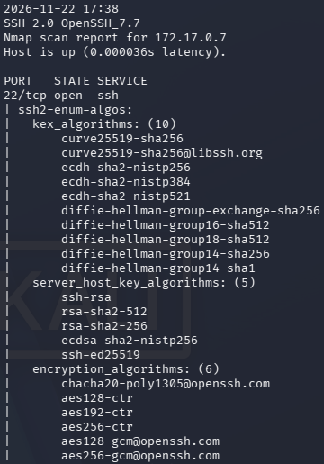 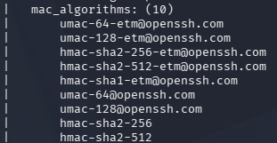 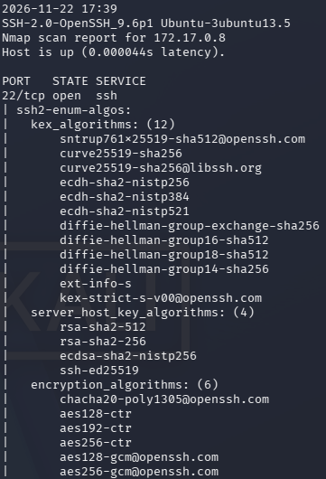 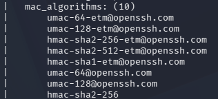 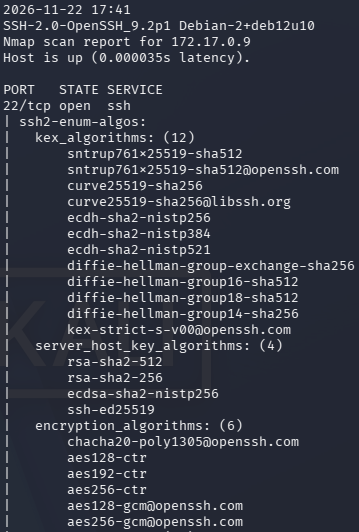 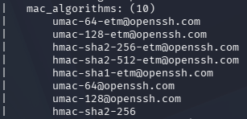
- **Siguiente paso:** leer el banner del FTP y de los puertos sin identificar.

### 2026-11-22 17:30 - Banners de FTP y de los puertos sin identificar de 172.17.0.5
- **Cuándo:** 2026-11-22 17:30 (FTP con `nc`), 17:31 (5672 y 32987 con `nc`), capturas a las 17:46, 17:48 y 17:50, y 20:09 (repetición con `/dev/tcp`, hora tomada del `date` de la captura)
- **Objetivo y alcance:** leer el saludo del FTP de 172.17.0.3 (21/tcp) y de los puertos 5672 y 32987 de 172.17.0.5, que `nmap -sV` no identificó. Dentro de 172.17.0.0/24. Solo se lee el saludo; no se envía ningún comando ni se inicia sesión. El `ping` a 172.17.0.3 respondió sin pérdida de paquetes durante la lectura del FTP.
- **Qué hice:** `nc -nv -w 3 172.17.0.3 21 </dev/null | tee evidencias/p2/23-ftp-banner-172.17.0.3.txt`, `nc -nv -w 3 172.17.0.5 5672 </dev/null | tee evidencias/p2/23-banner-172.17.0.5-5672.txt` y el equivalente para el puerto 32987. Después, en la repetición del FTP (entrada de las 17:55), `/dev/tcp`; y a las 20:09 `for p in 5672 32987; do echo "=== 172.17.0.5:$p ==="; timeout 5 bash -c "exec 3<>/dev/tcp/172.17.0.5/$p; head -c 100 <&3" | tee evidencias/p2/23-banner-172.17.0.5-$p-bash.txt; done` y `wc -c evidencias/p2/23-banner-172.17.0.5-*-bash.txt`
- **Qué salió:** con `nc`, los ficheros de 5672 y 32987 quedaron vacíos (0 bytes). El del FTP se repitió porque no se pudo verificar con `nc` y, con `/dev/tcp`, devolvió `220 (vsFTPd 2.3.4)` (ver entrada de las 17:55). Con `/dev/tcp`, el puerto 5672 mantuvo la conexión abierta sin enviar nada durante 5 s (`timeout` la cortó) y el puerto 32987 terminó sin devolver datos; ambos ficheros tienen 0 bytes. Ninguno de los dos servicios envía saludo sin que el cliente hable primero, por lo que no se obtuvo versión ni más información. Evidencia: `evidencias/p2/23-banner-172.17.0.5-5672-bash.txt` y `23-banner-172.17.0.5-32987-bash.txt`.
- **Captura:** 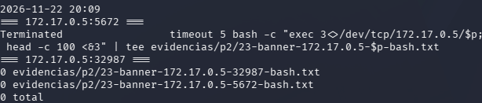
- **Siguiente paso:** enumerar SMB y NetBIOS de 172.17.0.8 y la versión de IPMI de 172.17.0.10.

### 2026-11-22 20:14 - SMB y NetBIOS de 172.17.0.8
- **Cuándo:** 2026-11-22 20:14 (comandos) y 20:15 (captura)
- **Objetivo y alcance:** conocer nombre del equipo, grupo, dialectos y firma de SMB sin autenticar. Objetivo 172.17.0.8 (139 y 445/tcp, 137/udp), dentro de 172.17.0.0/24. Sin sesión nula, sin enumeración de usuarios ni de recursos compartidos.
- **Qué hice:** `sudo nmap -Pn -p 139,445 --script smb-os-discovery,smb2-security-mode,smb-security-mode,smb-protocols 172.17.0.8 -oA evidencias/p2/24-smb-172.17.0.8`, `sudo nmap -Pn -sU -p 137 --script nbstat 172.17.0.8 -oA evidencias/p2/24-nbstat-172.17.0.8` y `nmblookup -A 172.17.0.8 | tee evidencias/p2/24-nmblookup-172.17.0.8.txt`; después `cat` de los tres resultados
- **Qué salió:** SMB 3.1.1 con firma habilitada pero no obligatoria; dialectos 2.0.2, 2.1, 3.0, 3.0.2 y 3.1.1. NetBIOS: nombre `SAMBASERVER`, usuario `<unknown>`; nombres `SAMBASERVER<00>`, `<03>` y `<20>`, `__MSBROWSE__<01>` y `ESEEMEB.DL<00>`, `<1d>` y `<1e>`; `nmblookup` coincide, con MAC `00-00-00-00-00-00`. Los scripts `smb-os-discovery` y `smb-security-mode` no muestran líneas en la salida. En la Parte 1, `-sV` mostró `workgroup: DL`; `nbstat` muestra el grupo como `ESEEMEB.DL`. Ninguna cuenta de usuario revelada. Evidencia: `evidencias/p2/24-smb-172.17.0.8.nmap`, `24-nbstat-172.17.0.8.nmap` y `24-nmblookup-172.17.0.8.txt`.
- **Captura:** 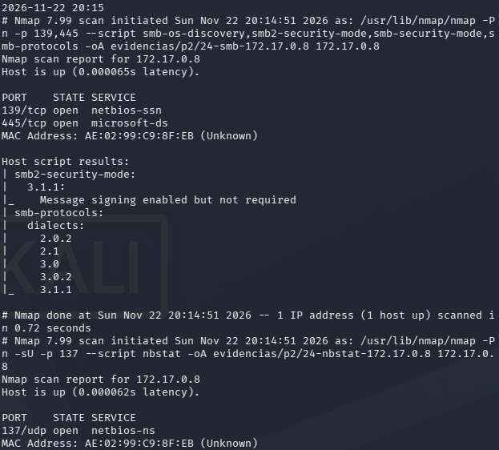 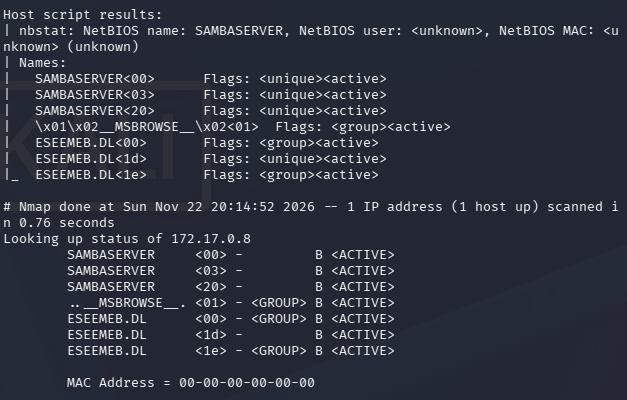
- **Siguiente paso:** comprobar la versión de IPMI de 172.17.0.10.

### 2026-11-22 20:17 - Versión de IPMI de 172.17.0.10
- **Cuándo:** 2026-11-22 20:17
- **Objetivo y alcance:** conocer la versión de IPMI que anuncia el puerto 623/udp de 172.17.0.10, dentro de 172.17.0.0/24. Solo el script `ipmi-version`; no se probó ninguna credencial ni se enviaron más peticiones.
- **Qué hice:** `sudo nmap -Pn -sU -p 623 --script ipmi-version 172.17.0.10 -oA evidencias/p2/25-ipmi-172.17.0.10`; después `cat evidencias/p2/25-ipmi-172.17.0.10.nmap`
- **Qué salió:** IPMI 2.0. `UserAuth: password, md5, md2, null`; `PassAuth: auth_msg, auth_user, non_null_user`; niveles 1.5 y 2.0. Es lo que el servicio anuncia: la opción `null` queda pendiente de comprobar en una fase posterior, con permiso. Evidencia: `evidencias/p2/25-ipmi-172.17.0.10.nmap`.
- **Captura:** 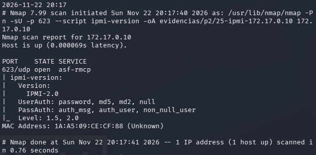
- **Siguiente paso:** buscar cuentas de usuario en todo lo recogido.

### 2026-11-22 20:24 - Búsqueda de cuentas de usuario en las evidencias
- **Cuándo:** 2026-11-22 20:24 (comando) y 20:26 (lectura)
- **Objetivo y alcance:** buscar cuentas de usuario reveladas por los servicios, en mis propias evidencias de la Parte 2. Solo ficheros locales, sin tráfico de red.
- **Qué hice:** `grep -rhoiE "(user(name)?|login|owner|author|contact|admin)[^<]{0,60}|[a-z0-9._-]+@[a-z0-9.-]+" --include='*.nmap' --include='*.txt' evidencias/p2/ | sort -u | tee evidencias/p2/29-cuentas-candidatas.txt` y `cat evidencias/p2/29-cuentas-candidatas.txt`
- **Qué salió:** 33 candidatos, de los que solo uno es una cuenta real: `info@dockerlabs.lab`, en el pie de la web de 172.17.0.5:443. Se descartan `ejemplo@correo.com` (texto de ejemplo del formulario de login de 172.17.0.8), `Devcrud` (autor de la plantilla web), los nombres de algoritmos SSH con forma de correo (`...@openssh.com`, `...@libssh.org`), `tailwindcss@2.2.19` y las opciones de autenticación de IPMI. Algunos candidatos llevan el prefijo `22m`, un resto de color de la salida de `whatweb`. Evidencia: `evidencias/p2/29-cuentas-candidatas.txt`.
- **Captura:** 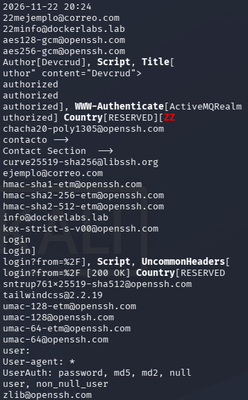
- **Siguiente paso:** redactar la Parte 2 de `inventario.md`.

### 2026-11-22 20:28 - Puerto con aviso de método TRACE (cierre de la Parte 2)
- **Cuándo:** 2026-11-22 20:28
- **Objetivo y alcance:** saber en qué puerto de 172.17.0.5 avisó nmap de `TRACE`. Solo ficheros locales, sin tráfico de red.
- **Qué hice:** `grep -B4 -A2 "TRACE" evidencias/p2/20-nse-172.17.0.5.nmap`
- **Qué salió:** el aviso `Potentially risky methods: TRACE` corresponde a 172.17.0.5:61614 (Jetty 9.4.39.v20210325). Evidencia: `evidencias/p2/20-nse-172.17.0.5.nmap`.
- **Captura:** sin captura
- **Siguiente paso:** empezar la Parte 3.

---

## Parte 3 - De la versión al CVE

### 2026-11-22 20:35 - Inicio de la Parte 3 y comprobación de acceso a NVD
- **Cuándo:** 2026-11-22 20:35 (marca de inicio) y 20:41 (comprobación)
- **Objetivo y alcance:** dejar marcado el inicio de la Parte 3 y comprobar que hay acceso a internet para consultar NVD. La consulta es a una web pública y no toca la red del cliente.
- **Qué hice:** `echo "#### INICIO PARTE 3 $(date '+%F %H:%M')"` y `curl -sI https://services.nvd.nist.gov | head -1`
- **Qué salió:** `HTTP/2 200`: hay acceso a NVD. Evidencia: salida en el historial.
- **Captura:** sin captura
- **Siguiente paso:** preparar la lista de productos y versiones.

### 2026-11-22 20:44 - Lista de productos y versiones
- **Cuándo:** 2026-11-22 20:44
- **Objetivo y alcance:** reunir en un fichero los puertos abiertos con su producto y versión, como punto de partida de la búsqueda de CVE. Solo ficheros locales de la Parte 1, sin tráfico de red.
- **Qué hice:** `grep -hE "^[0-9]+/(tcp|udp) +open " evidencias/p1/11-tcp-ver-*.nmap evidencias/p1/12-udp-*.nmap | awk '{ $2=""; print }' | sort -u | tee evidencias/p3/30-versiones.txt`
- **Qué salió:** lista sin repeticiones de puertos, servicios y versiones de los 8 equipos. Evidencia: `evidencias/p3/30-versiones.txt`.
- **Captura:** sin captura
- **Siguiente paso:** pedir a `vulners` los CVE candidatos de los equipos normales.

### 2026-11-22 20:45 - Candidatos automáticos con vulners
- **Cuándo:** 2026-11-22 20:45 (inicio); fin: 20:47 (el último equipo, 172.17.0.10, terminó a las 20:47:07; cada equipo tardó entre 6 y 37 s)
- **Objetivo y alcance:** obtener CVE candidatos comparando cada versión con la base de datos de `vulners`, sin tocar la vulnerabilidad. Objetivos: 172.17.0.4 a 172.17.0.10, dentro de 172.17.0.0/24. No se lanzó a 172.17.0.3 (equipo delicado): sus versiones se revisan a mano en NVD.
- **Qué hice:** `for ip in $(grep -vx "$FRAGIL" evidencias/p1/vivos.txt); do ports=$(grep -oE '[0-9]+/open/tcp' evidencias/p1/10-tcp-all-$ip.gnmap | cut -d/ -f1 | paste -sd, -); [ -z "$ports" ] && continue; echo "=== $ip : $ports ==="; sudo nmap -Pn -sV -p $ports --script vulners --script-args mincvss=5.0 -oA evidencias/p3/31-vulners-$ip $ip; done`
- **Qué salió:** líneas con `CVE-` por equipo: .4 162, .5 339, .6 47, .7 34, .8 329, .9 68 y .10 0. Estas cifras incluyen duplicados de otras fuentes (`MEND:` y `1DAYEXPLOIT:`), así que no son CVE distintos ni hallazgos. Evidencia: `evidencias/p3/31-vulners-172.17.0.<n>.nmap`.
- **Captura:** sin captura (ver entrada siguiente)
- **Siguiente paso:** capturar los CVE propuestos en cada equipo.

### 2026-11-22 21:48 - Capturas de los CVE propuestos por vulners
- **Cuándo:** 2026-11-22 21:48 (.4), 21:51 (.5), 21:52 (.6), 21:54 (.7), 21:55 (.8 y .9) y 21:56 (.10)
- **Objetivo y alcance:** dejar captura de los CVE que propone `vulners` en cada equipo. Solo ficheros locales.
- **Qué hice:** `grep -E "CVE-" evidencias/p3/31-vulners-172.17.0.<n>.nmap | head -30` (uno por equipo, con `clear; date "+%F %H:%M"` delante)
- **Qué salió:** los resultados de la entrada anterior (los 30 primeros CVE de cada equipo; 172.17.0.10 no devuelve ninguno). La captura de 172.17.0.5 se hizo en dos partes. Evidencia: `evidencias/p3/31-vulners-172.17.0.<n>.nmap`.
- **Captura:** 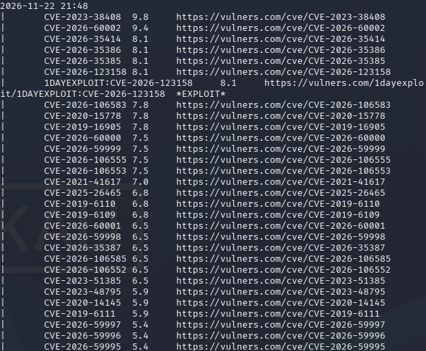 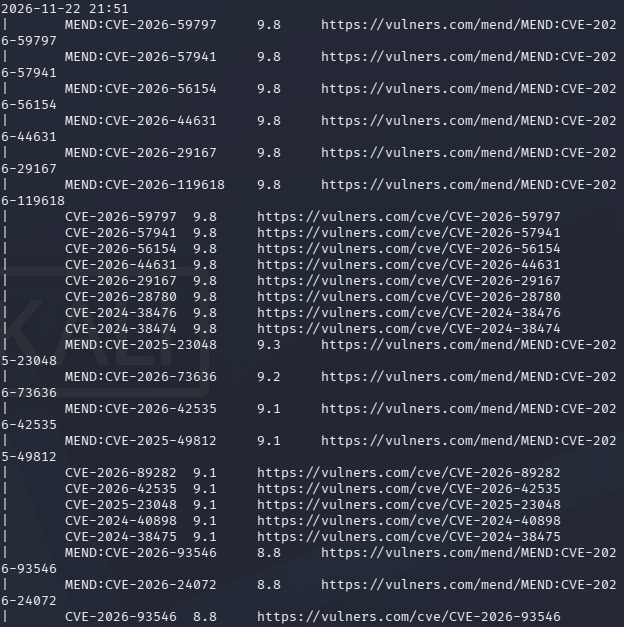 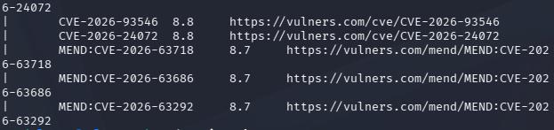 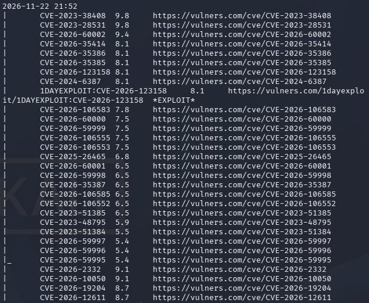 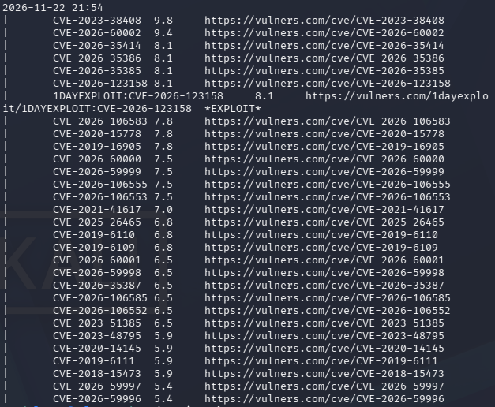 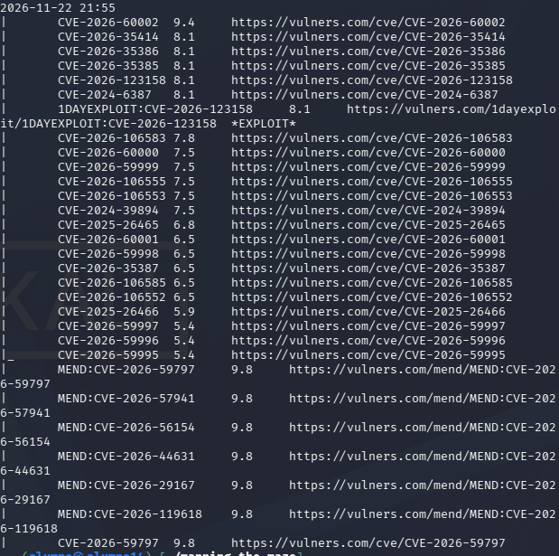 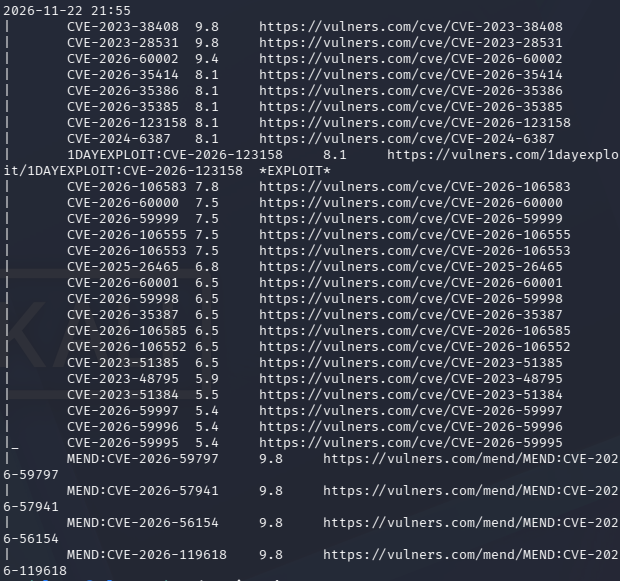 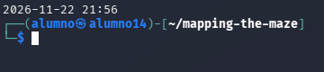
- **Siguiente paso:** buscar con `searchsploit` si hay algo público para las versiones más delicadas.

### 2026-11-22 21:57 - Búsqueda de exploits públicos con searchsploit (solo listado)
- **Cuándo:** 2026-11-22 21:57
- **Objetivo y alcance:** saber si existe algo público para las versiones clave, como dato para la priorización. Búsqueda en una base local, sin tráfico de red. No se abrió, copió ni ejecutó ningún exploit.
- **Qué hice:** `for q in "vsftpd 2.3.4" "Apache Tomcat 9.0.30" "ActiveMQ 5.15" "Jenkins 2.441" "OpenSSH 7.7" "OpenSSH 7.9"; do echo "=== $q ==="; searchsploit "$q" | tee -a evidencias/p3/32-searchsploit.txt; done`
- **Qué salió:** hay entradas para vsftpd 2.3.4 ("Backdoor Command Execution", 2 entradas), Jenkins 2.441 ("Local File Inclusion") y OpenSSH hasta 7.7 ("Username Enumeration", 3 entradas). La búsqueda de OpenSSH 7.9 no devuelve exploits. Evidencia: `evidencias/p3/32-searchsploit.txt`.
- **Captura:** 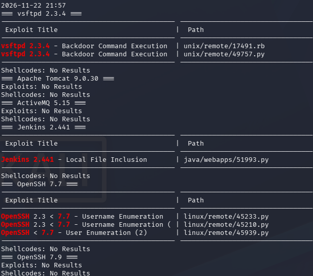
- **Siguiente paso:** revisar los resultados y consultar NVD para los candidatos.

### 2026-11-22 22:00 - Revisión de los resultados automáticos
- **Cuándo:** 2026-11-22 22:00
- **Objetivo y alcance:** revisar de una vez lo que han devuelto `vulners` y `searchsploit`. Solo ficheros locales.
- **Qué hice:** `grep -c "CVE-" evidencias/p3/31-vulners-*.nmap`, `grep -H "CVE-" evidencias/p3/31-vulners-*.nmap | head -60` y `cat evidencias/p3/32-searchsploit.txt`
- **Qué salió:** los recuentos están inflados por los duplicados de otras fuentes, y 172.17.0.10 devuelve 0 porque no tiene una versión de producto comparable. Algunos identificadores propuestos para 172.17.0.4 no se pueden dar por buenos sin verificar en NVD. Se eligen como candidatos CVE-2011-2523 (vsftpd 2.3.4, de `searchsploit`), CVE-2020-1938 y CVE-2025-24813 (Tomcat, de `vulners`), CVE-2024-23897 (Jenkins), CVE-2023-46604 (ActiveMQ) y CVE-2018-15473 (OpenSSH 7.7). Evidencia: `evidencias/p3/31-vulners-*.nmap` y `32-searchsploit.txt`.
- **Captura:** sin captura
- **Siguiente paso:** descargar la ficha de NVD de cada candidato.

### 2026-11-22 22:03 - CVE con exploit público marcado por vulners
- **Cuándo:** 2026-11-22 22:03 (primera ejecución) y 2026-11-23 16:08 (repetición para revisar la salida)
- **Objetivo y alcance:** ver qué entradas de `vulners` llevan la marca `*EXPLOIT*`, como dato para la priorización. Solo ficheros locales, sin tráfico de red. No se abrió, descargó ni ejecutó ningún exploit.
- **Qué hice:** `grep -H "\*EXPLOIT\*" evidencias/p3/31-vulners-*.nmap | sed 's#evidencias/p3/31-vulners-##' | cut -c1-110`
- **Qué salió:** hay entradas marcadas en 172.17.0.4 a 172.17.0.9 y ninguna en 172.17.0.10. Casi todas son repositorios y listados genéricos (GitHub, Gitee, PacketStorm), que no se consideran hallazgos. Se anotan las que tienen nombre propio: módulos de Metasploit de Ghostcat (CVE-2020-1938) y de la deserialización de Tomcat (CVE-2025-24813) en 172.17.0.4; el módulo de ActiveMQ CVE-2023-46604 y el de Jetty (WEB-INF) en 172.17.0.5; el módulo de enumeración de usuarios SSH en 172.17.0.7; detectores de Samba y de Zerologon en 172.17.0.8; y la entrada de Jetty también en 172.17.0.6. La marca solo indica que existe algo público, no que el servicio sea explotable. Evidencia: `evidencias/p3/31-vulners-172.17.0.<n>.nmap`.
- **Captura:** sin captura
- **Siguiente paso:** descargar las fichas de NVD de los candidatos a descarte y comprobar los trackers de Debian y Ubuntu.

### 2026-11-22 22:04 - Fichas de NVD de los candidatos
- **Cuándo:** 2026-11-22 22:04
- **Objetivo y alcance:** descargar la ficha oficial de cada CVE candidato y ver su CWE. Consulta a una web pública (NVD), que no toca la red del cliente.
- **Qué hice:** `for CVE in CVE-2011-2523 CVE-2020-1938 CVE-2025-24813 CVE-2024-23897 CVE-2023-46604 CVE-2018-15473; do curl -s "https://services.nvd.nist.gov/rest/json/cves/2.0?cveId=$CVE" -o evidencias/p3/33-nvd-$CVE.json; jq -r '.vulnerabilities[0].cve | "\(.id) CWE: \([.weaknesses[]?.description[]?.value]|unique|join(", "))"' evidencias/p3/33-nvd-$CVE.json; sleep 6; done`
- **Qué salió:** CWE según NVD: CVE-2011-2523 CWE-78; CVE-2020-1938 NVD-CWE-Other; CVE-2025-24813 CWE-44, CWE-502 y CWE-706; CVE-2024-23897 CWE-22 y CWE-27; CVE-2023-46604 CWE-502; CVE-2018-15473 CWE-362. Evidencia: `evidencias/p3/33-nvd-<CVE>.json`.
- **Captura:** sin captura (ver entrada siguiente)
- **Siguiente paso:** comprobar los rangos de versiones afectadas frente a las versiones observadas.

### 2026-11-23 08:28 - Ficha de NVD y rangos de versiones de cada candidato
- **Cuándo:** 2026-11-23 08:28 (CVE-2011-2523), 08:29 (CVE-2020-1938), 08:32 (CVE-2025-24813), 08:35 (CVE-2024-23897), 08:36 (CVE-2023-46604) y 08:39 (CVE-2018-15473)
- **Objetivo y alcance:** ver CWE, descripción y rango de versiones afectadas de cada candidato, a partir de las fichas de NVD ya descargadas. Solo ficheros locales, sin tráfico de red.
- **Qué hice:** `{ jq -r '.vulnerabilities[0].cve | "\(.id)\nCWE: ..."' evidencias/p3/33-nvd-$CVE.json; jq -r '.vulnerabilities[0].cve.configurations[]?.nodes[]?.cpeMatch[]? | select(.vulnerable==true) | ...' evidencias/p3/33-nvd-$CVE.json | head -15; } | fold -s -w 110`, con `CVE=` cada uno de los seis (comando completo en el historial)
- **Qué salió:** la CWE, la descripción y los rangos de cada CVE, que se comparan con las versiones observadas en la entrada siguiente. Evidencia: `evidencias/p3/33-nvd-<CVE>.json`.
- **Captura:** 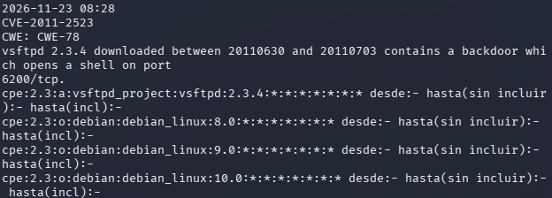 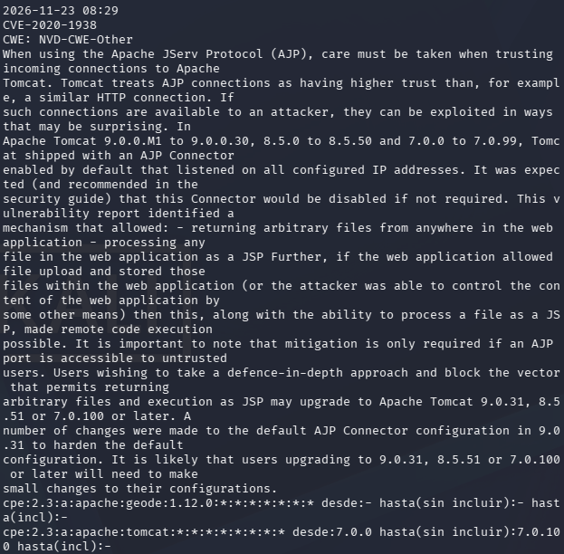 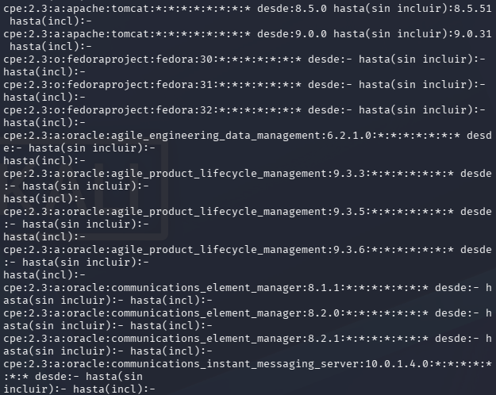 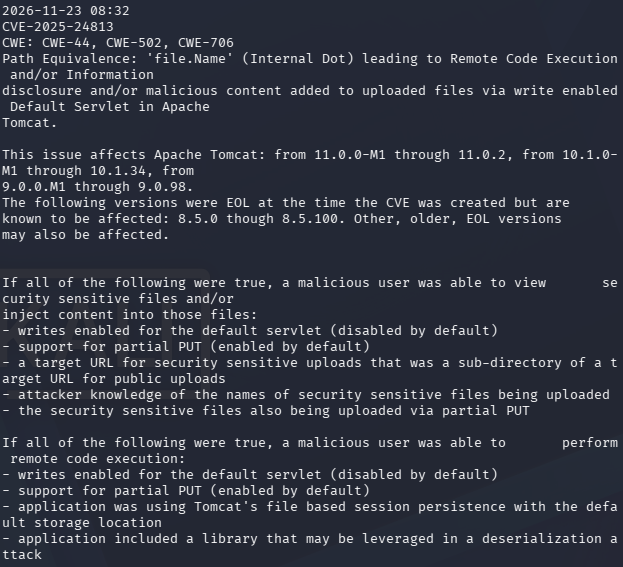 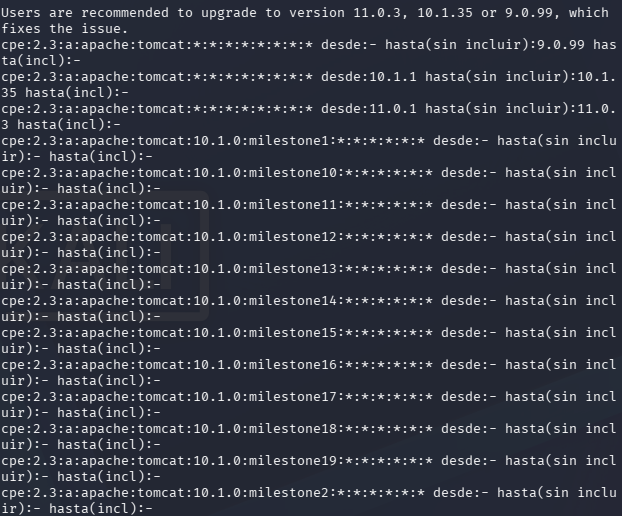 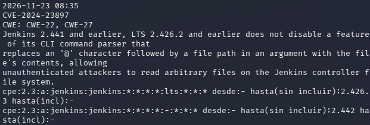 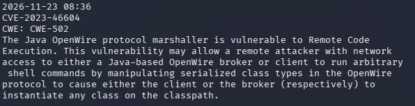 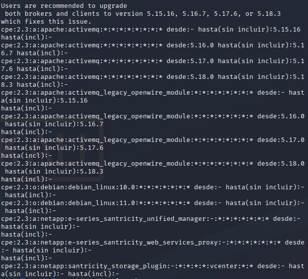 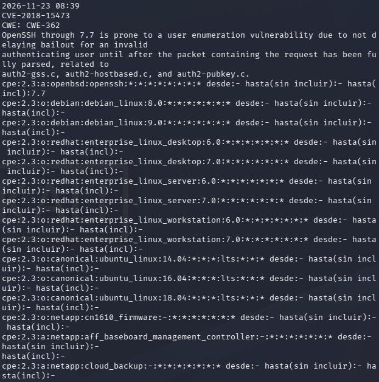
- **Siguiente paso:** comparar los rangos con las versiones observadas.

### 2026-11-23 08:40 - Comparación de rangos con las versiones observadas
- **Cuándo:** 2026-11-23 08:40 (rangos) y 08:41 (horas de fin de `vulners`)
- **Objetivo y alcance:** comprobar si cada versión observada entra en el rango afectado. Solo ficheros locales.
- **Qué hice:** `for CVE in CVE-2011-2523 CVE-2020-1938 CVE-2025-24813 CVE-2024-23897 CVE-2023-46604 CVE-2018-15473; do echo "== $CVE"; jq -r '.vulnerabilities[0].cve.configurations[]?.nodes[]?.cpeMatch[]? | select(.vulnerable==true) | ...' evidencias/p3/33-nvd-$CVE.json | head -15; done` y `grep -H "Nmap done" evidencias/p3/31-vulners-*.nmap`
- **Qué salió:** CVE-2011-2523, vsftpd 2.3.4 exacto (observado 2.3.4 en 172.17.0.3). CVE-2020-1938, Tomcat 9.0.0 a 9.0.31 sin incluir (observado 9.0.30 en 172.17.0.4). CVE-2025-24813, Tomcat hasta 9.0.99 sin incluir (observado 9.0.30). CVE-2024-23897, Jenkins hasta 2.442 sin incluir en versiones no LTS (observado 2.441 en 172.17.0.6). CVE-2023-46604, ActiveMQ hasta 5.15.16 sin incluir (observado 5.15.15 en 172.17.0.5). CVE-2018-15473, OpenSSH hasta 7.7 incluida (observado 7.7 en 172.17.0.7). Las seis versiones entran en el rango. Evidencia: `evidencias/p3/33-nvd-<CVE>.json`.
- **Captura:** sin captura
- **Siguiente paso:** ver en qué equipos propuso `vulners` cada candidato y elegir los descartes.

### 2026-11-23 08:50 - Qué propuso vulners de cada candidato
- **Cuándo:** 2026-11-23 08:50
- **Objetivo y alcance:** saber en qué equipos propuso `vulners` cada candidato y localizar falsos positivos en los equipos con OpenSSH. Solo ficheros locales.
- **Qué hice:** `grep -H -E "CVE-2018-15473|CVE-2023-38408|CVE-2020-1938|CVE-2025-24813|CVE-2024-23897|CVE-2023-46604|CVE-2011-2523" evidencias/p3/31-vulners-*.nmap | sed 's#evidencias/p3/31-vulners-##' | cut -c1-90` y `grep -H "CVE-" evidencias/p3/31-vulners-172.17.0.9.nmap | grep -v -E "MEND:|1DAYEXPLOIT:" | head -15`
- **Qué salió:** CVE-2020-1938 y CVE-2025-24813 en 172.17.0.4; CVE-2023-46604 en 172.17.0.5; CVE-2018-15473 en 172.17.0.7; CVE-2023-38408 en 172.17.0.4, .6, .7 y .9; en 172.17.0.9 además CVE-2023-28531, CVE-2024-6387 y CVE-2025-26465, entre otros. `vulners` no propuso CVE-2024-23897 (Jenkins) ni CVE-2011-2523 (vsftpd; no se escaneó la .3), que vienen de `searchsploit` y de NVD. Evidencia: `evidencias/p3/31-vulners-*.nmap`.
- **Captura:** sin captura
- **Siguiente paso:** descargar las fichas de NVD de los candidatos a descarte y comprobar los trackers de Debian.

### 2026-11-23 09:01 - Fichas de NVD de los candidatos a descarte de OpenSSH
- **Cuándo:** 2026-11-23 09:01 (`grep` de `vulners`) y 09:02 (consulta a NVD)
- **Objetivo y alcance:** ver en qué equipos propuso `vulners` los CVE de OpenSSH y comprobar en NVD la descripción, la CWE y el rango de cada uno, para decidir los descartes. El `grep` lee ficheros locales; las consultas a NVD son a una web pública y no tocan la red del cliente.
- **Qué hice:** `grep -H -E "CVE-2024-6387|CVE-2025-26465|CVE-2023-28531" evidencias/p3/31-vulners-172.17.0.*.nmap | sed 's#evidencias/p3/31-vulners-##' | cut -c1-90` y `for CVE in CVE-2024-6387 CVE-2023-38408 CVE-2025-26465 CVE-2023-28531 CVE-2026-60002; do curl -s "https://services.nvd.nist.gov/rest/json/cves/2.0?cveId=$CVE" -o evidencias/p3/33-nvd-$CVE.json; ...; sleep 6; done`
- **Qué salió:** `vulners` propuso CVE-2025-26465 en 172.17.0.4, .6, .7, .8 y .9; CVE-2024-6387 en .6, .8 y .9; y CVE-2023-28531 en .6 y .9. NVD: CVE-2024-6387 es una condición de carrera en `sshd` (CWE-362 y CWE-364) que afecta a OpenSSH 8.6 hasta 9.8 incluida. CVE-2023-38408 afecta a `ssh-agent` con reenvío de agente (CWE-428), antes de 9.3. CVE-2025-26465 solo ocurre con `VerifyHostKeyDNS` activado (CWE-390). CVE-2023-28531 afecta a `ssh-add` desde 8.9 hasta 9.3 sin incluir (CWE-284). CVE-2026-60002 es un uso tras liberación (CWE-416) en el cliente `ssh` antes de 10.4, solo del lado cliente. Evidencia: `evidencias/p3/33-nvd-<CVE>.json`.
- **Captura:** sin captura
- **Siguiente paso:** comprobar en el tracker de Debian si la versión de OpenSSH de la .6 y la .9 está parcheada.

### 2026-11-23 - Comprobación de backport en el tracker de Debian
- **Cuándo:** 2026-11-23 (hora no registrada: se hizo en el navegador de mi ordenador, no en la terminal)
- **Objetivo y alcance:** saber si Debian ha parcheado sin cambiar el número de versión CVE-2024-6387 y CVE-2023-38408 en las versiones de OpenSSH de 172.17.0.6 y 172.17.0.9. Consulta a una web pública, sin tráfico hacia el cliente.
- **Qué hice:** abrí `https://security-tracker.debian.org/tracker/CVE-2024-6387` y `https://security-tracker.debian.org/tracker/CVE-2023-38408` y comparé la versión `fixed` de bookworm con las observadas.
- **Qué salió:** en los dos CVE el tracker da como `fixed` `1:9.2p1-2+deb12u10` en bookworm y `1:9.2p1-2+deb12u9` en bookworm (security). La 172.17.0.9 (`deb12u10`) tiene una versión igual o superior: parcheada, se descarta por backport. La 172.17.0.6 (`deb12u2`) tiene una versión inferior: sin parche según el tracker, de modo que CVE-2024-6387 se registra para ese equipo. Evidencia: sin fichero, solo captura.
- **Captura:**  
- **Siguiente paso:** comprobar el tracker de Ubuntu para CVE-2024-6387 en 172.17.0.8.

### 2026-11-23 16:16 - Fichas de NVD de los candidatos a descarte de Apache, Jetty, Samba y OpenSSH
- **Cuándo:** 2026-11-23 16:16 (hora tomada del `date` de la salida)
- **Objetivo y alcance:** comprobar en NVD la descripción y el rango de versiones de los CVE que `vulners` propuso en Apache, Jetty, Samba y OpenSSH, para decidir los descartes. Consulta a una web pública (NVD), que no toca la red del cliente.
- **Qué hice:** `for CVE in CVE-2026-123158 CVE-2026-119618 CVE-2021-28169 CVE-2017-7494 CVE-2020-1472 CVE-2024-38475; do curl -s "https://services.nvd.nist.gov/rest/json/cves/2.0?cveId=$CVE" -o evidencias/p3/33-nvd-$CVE.json; ...; sleep 6; done`
- **Qué salió:** CVE-2026-123158: `sshd` de OpenSSH antes de 10.6 en Linux con musl libc sin PAM. CVE-2026-119618: `mod_http2` de Apache, de 2.4.55 hasta antes de 2.4.71. CVE-2021-28169: `ConcatServlet` de Jetty, hasta antes de 9.4.41 y de 10.0.0 a antes de 10.0.3. CVE-2017-7494: Samba de 3.5.0 a antes de 4.6.4 (y 4.5.10 y 4.4.14). CVE-2020-1472: Netlogon en un controlador de dominio; Samba antes de 4.10.18, 4.11.13 y 4.12.7. CVE-2024-38475: `mod_rewrite` de Apache de 2.4.0 a antes de 2.4.60. Evidencia: `evidencias/p3/33-nvd-<CVE>.json`.
- **Captura:** sin captura
- **Siguiente paso:** comprobar el backport de OpenSSH en el tracker de Ubuntu para la 172.17.0.8.

### 2026-11-23 - Comprobación de backport en el tracker de Ubuntu
- **Cuándo:** 2026-11-23 (hora no registrada: se hizo en el navegador de mi ordenador, no en la terminal)
- **Objetivo y alcance:** saber si Ubuntu ha parcheado sin cambiar el número de versión CVE-2024-6387 en el OpenSSH de 172.17.0.8. Consulta a una web pública, sin tráfico hacia el cliente.
- **Qué hice:** abrí `https://ubuntu.com/security/CVE-2024-6387` y comparé la versión `fixed` de 24.04 noble con la observada.
- **Qué salió:** el tracker da como corregida en noble la versión `1:9.6p1-3ubuntu13.3`. La 172.17.0.8 tiene `3ubuntu13.5`, igual o superior: parcheada, se descarta por backport. Evidencia: sin fichero, solo captura.
- **Captura:** 
- **Siguiente paso:** redactar `registro-vulns.md` con las fichas y la tabla de descartados.

### 2026-11-23 16:33 - Redacción de registro-vulns.md (Parte 3)
- **Cuándo:** 2026-11-23 16:33 (lectura de las descripciones de NVD) y 16:39 (comprobación del historial). El fichero se redactó después de las 16:33, fuera de la terminal de este historial: hora exacta no registrada.
- **Objetivo y alcance:** dejar escrito el registro de vulnerabilidades potenciales con una ficha por hallazgo y la tabla de descartados. Solo trabajo con ficheros locales y con las fichas de NVD ya descargadas, sin tráfico hacia el cliente.
- **Qué hice:** `for CVE in CVE-2011-2523 CVE-2020-1938 CVE-2025-24813 CVE-2024-23897 CVE-2023-46604 CVE-2018-15473; do echo "== $CVE"; jq -r '.vulnerabilities[0].cve.descriptions[]|select(.lang=="en").value' evidencias/p3/33-nvd-$CVE.json | cut -c1-450; done` y después redacté `registro-vulns.md` con ayuda de IA a partir de mis ficheros de `evidencias/p3/` y mis capturas, y lo comprobé contra ellos.
- **Qué salió:** `registro-vulns.md` con 7 fichas (V-01 vsftpd, V-02 y V-06 Tomcat, V-03 ActiveMQ, V-04 Jenkins, V-05 OpenSSH 7.7 y V-07 OpenSSH 9.2p1 de 172.17.0.6) y 14 filas de descartados. Las dos CWE elegidas por mí (CVE-2020-1938 y la principal del CVE-2025-24813) quedan marcadas como propuesta. Evidencia: `registro-vulns.md`.
- **Captura:** sin captura
- **Siguiente paso:** comprobar los enlaces a imágenes, hacer commit y empezar la Parte 4 (CVSS, EPSS y KEV).

### 2026-11-23 16:40 - Ficha de NVD del CVE-2024-6387 (captura pendiente de la Parte 3)
- **Cuándo:** 2026-11-23 16:40
- **Objetivo y alcance:** dejar captura de la descripción, la CWE y el rango de versiones del CVE de OpenSSH registrado en la ficha V-07, que no la tenía. Solo ficheros locales (la ficha de NVD ya estaba descargada), sin tráfico de red.
- **Qué hice:** `CVE=CVE-2024-6387` y `{ jq -r '.vulnerabilities[0].cve | "\(.id)\nCWE: ..."' evidencias/p3/33-nvd-$CVE.json; jq -r '.vulnerabilities[0].cve.configurations[]?.nodes[]?.cpeMatch[]? | select(.vulnerable==true) | ...' evidencias/p3/33-nvd-$CVE.json | head -15; } | fold -s -w 110`
- **Qué salió:** CWE-362 y CWE-364; condición de carrera en `sshd`; rango de OpenSSH de 8.6 a 9.8 incluida (y antes de 4.4). Evidencia: `evidencias/p3/33-nvd-CVE-2024-6387.json`.
- **Captura:** 
- **Siguiente paso:** empezar la Parte 4 (CVSS, EPSS y KEV).

---

## Parte 4 - Priorizar e informar

### 2026-11-23 16:48 - Inicio de la Parte 4 y lista de CVE de las fichas
- **Cuándo:** 2026-11-23 16:48
- **Objetivo y alcance:** dejar marcado el inicio de la Parte 4 y reunir los CVE de las fichas del registro, sin los descartados. Solo ficheros locales, sin tráfico de red. La fecha de consulta de las fuentes queda en `evidencias/p4/fecha-consulta.txt`.
- **Qué hice:** `echo "#### INICIO PARTE 4 $(date '+%F %H:%M')"`, `grep -E '^\| CVE \|' registro-vulns.md | grep -oE 'CVE-[0-9]{4}-[0-9]+' | sort -u | tee evidencias/p4/39-cves.txt` y `date "+%F" | tee evidencias/p4/fecha-consulta.txt`
- **Qué salió:** siete CVE: CVE-2011-2523, CVE-2018-15473, CVE-2020-1938, CVE-2023-46604, CVE-2024-23897, CVE-2024-6387 y CVE-2025-24813. Fecha de consulta: 2026-11-23. Se usa un `grep` que lee solo la fila "CVE" de cada ficha, porque el de la guía incluiría también los CVE descartados. Evidencia: `evidencias/p4/39-cves.txt` y `evidencias/p4/fecha-consulta.txt`.
- **Captura:** sin captura
- **Siguiente paso:** obtener la puntuación CVSS de cada CVE desde las fichas de NVD.

### 2026-11-23 16:50 - Puntuaciones CVSS de cada CVE
- **Cuándo:** 2026-11-23 16:50 (comando) y 16:51 (lectura)
- **Objetivo y alcance:** obtener versión, puntuación, gravedad y vector CVSS de cada CVE de las fichas, distinguiendo la métrica de NVD (`Primary`) de la del fabricante (`Secondary`). Solo ficheros locales (las fichas de NVD ya descargadas), sin tráfico de red.
- **Qué hice:** `for CVE in $(cat evidencias/p4/39-cves.txt); do jq -r --arg c "$CVE" '.vulnerabilities[0].cve.metrics | to_entries[] | .key as $k | .value[] | "\($c) \($k) \(.type) \(.cvssData.baseScore) \(.cvssData.baseSeverity // .baseSeverity) \(.cvssData.vectorString)"' evidencias/p3/33-nvd-$CVE.json; done | tee evidencias/p4/40-cvss.txt` y `cat evidencias/p4/40-cvss.txt`
- **Qué salió:** todos los CVE tienen CVSS 3.1 (ninguno trae 4.0). Primary: CVE-2011-2523 9.8, CVE-2020-1938 9.8, CVE-2023-46604 9.8, CVE-2024-23897 9.8, CVE-2025-24813 9.8, CVE-2024-6387 8.1 y CVE-2018-15473 5.3. Secondary que difiere: CVE-2023-46604 10.0, CVE-2025-24813 10.0 y CVE-2018-15473 5.9. Las filas `ssvcV203` no son CVSS y se ignoran. Evidencia: `evidencias/p4/40-cvss.txt`.
- **Captura:** 
- **Siguiente paso:** consultar el EPSS de cada CVE.

### 2026-11-23 16:54 - EPSS de cada CVE
- **Cuándo:** 2026-11-23 16:54
- **Objetivo y alcance:** consultar la probabilidad de explotación en los próximos 30 días (EPSS) de los siete CVE de las fichas. Consulta a una web pública (FIRST), que no toca la red del cliente.
- **Qué hice:** `LISTA=$(paste -sd, evidencias/p4/39-cves.txt)`, `curl -s "https://api.first.org/data/v1/epss?cve=$LISTA" -o evidencias/p4/41-epss.json` y `jq -r '.data[] | "\(.cve) EPSS=\(.epss) percentil=\(.percentile) fecha=\(.date)"' evidencias/p4/41-epss.json | tee evidencias/p4/41-epss.txt`
- **Qué salió:** siete CVE con fecha de los datos 2026-11-23. EPSS y percentil: CVE-2024-23897 0,99999 y 0,99995; CVE-2023-46604 0,9999 y 0,9999; CVE-2025-24813 0,9994 y 0,9997; CVE-2024-6387 0,9951 y 0,9995; CVE-2020-1938 0,9927 y 0,9994; CVE-2018-15473 0,9868 y 0,9993; CVE-2011-2523 0,9618 y 0,9988. Todos superan el umbral de 0,1 y de percentil 0,95, así que el EPSS no distingue entre ellos. Evidencia: `evidencias/p4/41-epss.json` y `41-epss.txt`.
- **Captura:** 
- **Siguiente paso:** consultar el catálogo KEV de CISA.

### 2026-11-23 16:55 - Catálogo KEV de CISA
- **Cuándo:** 2026-11-23 16:55
- **Objetivo y alcance:** comprobar qué CVE de las fichas figuran en el catálogo de vulnerabilidades explotadas de CISA (KEV) y si consta su uso en ransomware. Consulta a una web pública, que no toca la red del cliente.
- **Qué hice:** `curl -s https://www.cisa.gov/sites/default/files/feeds/known_exploited_vulnerabilities.json -o evidencias/p4/42-kev-$(date +%F).json`, `jq '.vulnerabilities | length' evidencias/p4/42-kev-$(date +%F).json` y un bucle con `jq` que busca cada CVE y lo guarda con `tee evidencias/p4/42-kev.txt`
- **Qué salió:** figuran en KEV CVE-2023-46604 (desde 2023-11-02, ransomware: Known), CVE-2024-23897 (desde 2024-08-19, ransomware: Known), CVE-2020-1938 (desde 2022-03-03, Unknown) y CVE-2025-24813 (desde 2025-04-01, Unknown). No figuran CVE-2011-2523, CVE-2018-15473 ni CVE-2024-6387. Evidencia: `evidencias/p4/42-kev-2026-11-23.json` y `42-kev.txt`.
- **Captura:** 
- **Siguiente paso:** comprobar el aviso de la noticia contra el inventario.

### 2026-11-23 17:02 - Comprobación del aviso de la noticia (CVE-2026-123158)
- **Cuándo:** 2026-11-23 17:02
- **Objetivo y alcance:** contrastar el aviso del cliente (sshole) con mi inventario. Consultas a webs públicas (NVD, FIRST y CISA), que no tocan la red del cliente; el resto son ficheros locales. Fuente del aviso: artículo reenviado por el cliente (ox.security).
- **Qué hice:** `CVE=CVE-2026-123158`, `curl -s "https://services.nvd.nist.gov/rest/json/cves/2.0?cveId=$CVE" -o evidencias/p4/43-aviso-nvd.json`, tres `jq` sobre ese fichero (publicación, métricas y rangos), `curl -s "https://api.first.org/data/v1/epss?cve=$CVE" | tee evidencias/p4/43-aviso-epss.json`, un `jq` sobre `evidencias/p4/42-kev-*.json`, la lectura de los banners SSH de los equipos .4, .6, .7, .8 y .9, y `grep -rilE "alpine|musl" evidencias/p1 evidencias/p2`
- **Qué salió:** publicado el 2026-11-05. Solo hay puntuación de la CNA, 8,1 (`CVSS:3.1/AV:N/AC:H/PR:N/UI:N/S:U/C:H/I:H/A:H`). Afecta a OpenSSH anterior a 10.6. EPSS 0,95538 (percentil 0,99871). Figura en KEV desde 2026-11-09, con uso en ransomware Unknown. Banners: Debian en 172.17.0.4, .6 y .9; Ubuntu en .8; 172.17.0.7 sin distribución. Sin indicios de Alpine ni musl en mis evidencias, lo que no prueba su ausencia porque mis escaneos no muestran la libc. Según el artículo y NVD, el fallo solo afecta a Linux con musl sin PAM: no afecta a Debian ni Ubuntu. Evidencia: `evidencias/p4/43-aviso-nvd.json` y `43-aviso-epss.json`.
- **Captura:** 
- **Siguiente paso:** añadir la ficha V-08 para 172.17.0.7 y completar las fichas con CVSS, EPSS y KEV.

### 2026-11-23 - Revisión del registro tras el aviso
- **Cuándo:** 2026-11-23, después de las 17:02 (hora no registrada en el historial)
- **Objetivo y alcance:** reflejar en `registro-vulns.md` el resultado del aviso. Solo ficheros locales, sin tráfico de red.
- **Qué hice:** moví 172.17.0.7 de la tabla de descartados a una ficha nueva V-08 y reescribí la fila de descarte de CVE-2026-123158, que queda para 172.17.0.4, .6, .8 y .9 por usar Debian o Ubuntu (glibc).
- **Qué salió:** el registro tiene 8 fichas. La V-08 queda como "pendiente de comprobar" porque no se puede saber la libc de la .7. Evidencia: `registro-vulns.md`.
- **Captura:** sin captura
- **Siguiente paso:** completar cada ficha con CVSS, EPSS y KEV y redactar el orden de prioridad.

### 2026-11-23 17:18 - CVSS, EPSS, KEV y orden de prioridad en registro-vulns.md
- **Cuándo:** 2026-11-23 17:14 (comprobación previa de las fichas) y 17:18 (copia de seguridad, script y comprobaciones)
- **Objetivo y alcance:** completar cada ficha con CVSS, qué implica para confidencialidad, integridad y disponibilidad, EPSS y KEV, y escribir el orden de prioridad justificado. Solo ficheros locales, con los datos ya descargados, sin tráfico de red.
- **Qué hice:** `cp registro-vulns.md /tmp/registro-antes-p4.md`, un script de Python que sustituye en las ocho fichas la fila "CVSS, EPSS y KEV" y añade el apartado "Orden de prioridad", y después `grep -c "^| Prioridad |" registro-vulns.md`, `grep -n "Lo completa la Parte 4" registro-vulns.md` y `grep -n "^## " registro-vulns.md`
- **Qué salió:** ocho fichas completas y una tabla de prioridades. Orden: V-03 ActiveMQ, V-04 Jenkins, V-02 Tomcat (AJP), V-08 OpenSSH 7.7 (sshole), V-06 Tomcat (PUT parcial), V-01 vsftpd, V-07 OpenSSH 9.2p1 y V-05 OpenSSH 7.7 (enumeración de usuarios). El EPSS no distingue entre los ocho (todos superan 0,95), así que decide KEV y, dentro de KEV, el uso en ransomware. Evidencia: `registro-vulns.md`.
- **Captura:** sin captura
- **Siguiente paso:** redactar el informe para el cliente.

### 2026-11-23 17:22 - Redacción y comprobación de informe-cliente.md (Parte 4)
- **Cuándo:** entre las 17:18 y las 17:22 del 2026-11-23 (el comando que creó el fichero no consta en este historial; a las 17:22 ya existía y se comprobó)
- **Objetivo y alcance:** redactar el informe final para la dirección del cliente, en lenguaje claro, con el resumen, el inventario, las vulnerabilidades por orden de prioridad, las advertencias y la respuesta al aviso de la noticia. Solo trabajo con ficheros locales, sin tráfico de red.
- **Qué hice:** redacté `informe-cliente.md` con ayuda de IA a partir de `inventario.md`, `registro-vulns.md` y los resultados de la comprobación del aviso, respetando el orden de prioridad del registro. Lo comprobé con `grep -c "^| [1-8] |" informe-cliente.md` y `grep -n "PENDIENTE" informe-cliente.md`.
- **Qué salió:** un informe con 8 equipos activos y 8 vulnerabilidades potenciales (5 en KEV, 2 con uso en ransomware conocido). Recomienda corregir primero ActiveMQ, Jenkins y Tomcat. La tabla de prioridades tiene 8 filas y el fichero no tiene ningún `PENDIENTE`. Sobre el aviso (CVE-2026-123158), responde que no se puede descartar del todo: según lo observado no afecta a 4 de los 5 equipos con SSH (Debian y Ubuntu) y queda pendiente 172.17.0.7. Evidencia: `informe-cliente.md`.
- **Captura:** sin captura
- **Siguiente paso:** comprobar los enlaces a imágenes, hacer commit, rellenar el README y compartir los cuadernos con el grupo.