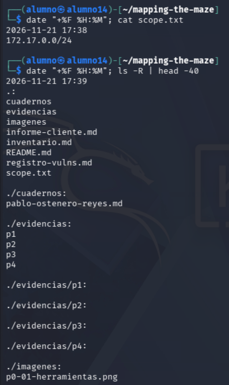
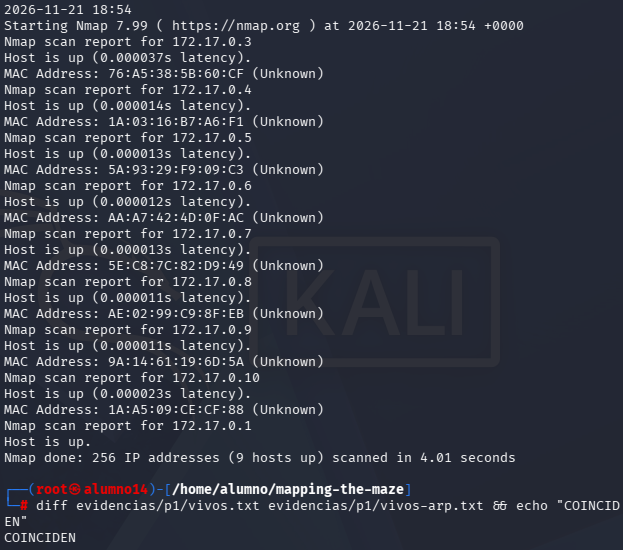

# Cuaderno de trabajo - Pablo Ostenero Reyes

Proyecto: Mapping the Maze
Cliente: Gadir Logística, S.L.
Alcance autorizado: 172.17.0.0/24 (scope.txt)
IP desde la que trabajo: 172.17.0.1
Partes: de la 0 a la 4 (cada integrante las hace todas sobre su propia red)

---

## Parte 0 - Preparación del entorno

Nota de trazabilidad: el historial de bash existía antes de activar las marcas de hora. Las líneas anteriores a las 17:47 del 2026-11-21 corresponden a ejercicios anteriores, no pertenecen a este proyecto y no se citan. Las comprobaciones de las 16:29, 17:38 y 17:39 se hicieron antes de activar la marca de hora en el historial; su hora sale de la captura de pantalla (el comando `date` se ejecutó justo antes), no del historial.

### 2026-11-21 16:29 - Comprobación de herramientas
- **Cuándo:** 2026-11-21 16:29 (hora tomada de la captura; previo a la activación del historial con fecha)
- **Objetivo y alcance:** comprobar que están instaladas las herramientas que usa la guía. Solo afecta a mi propia máquina; no se toca ninguna IP, dentro de 172.17.0.0/24.
- **Qué hice:** `date "+%F %H:%M"; which nmap jq curl whatweb searchsploit nc git openssl nmblookup`
- **Qué salió:** las nueve herramientas están instaladas, cada una con su ruta en `/usr/bin/`. Evidencia: sin fichero, solo captura.
- **Captura:** 
- **Siguiente paso:** comprobar que `scope.txt` contiene el alcance autorizado.

### 2026-11-21 17:38 - Comprobación del alcance (scope.txt)
- **Cuándo:** 2026-11-21 17:38 (hora tomada de la captura; previo a la activación del historial con fecha)
- **Objetivo y alcance:** confirmar que `scope.txt` contiene el rango autorizado antes de escanear. No se contacta con ninguna IP.
- **Qué hice:** `date "+%F %H:%M"; cat scope.txt`
- **Qué salió:** el fichero contiene únicamente `172.17.0.0/24`. Evidencia: sin fichero, solo captura.
- **Captura:** 
- **Siguiente paso:** comprobar la estructura de carpetas del repositorio clonado.

### 2026-11-21 17:39 - Estructura del repositorio
- **Cuándo:** 2026-11-21 17:39 (hora tomada de la captura; previo a la activación del historial con fecha)
- **Objetivo y alcance:** comprobar que el repositorio clonado tiene la estructura del enunciado. Solo ficheros locales, sin tráfico de red.
- **Qué hice:** `date "+%F %H:%M"; ls -R | head -40`
- **Qué salió:** existen `cuadernos/` (con `pablo-ostenero-reyes.md`), `evidencias/` con `p1` a `p4` vacías, `imagenes/` (con `p0-01-herramientas.png`), `inventario.md`, `registro-vulns.md`, `informe-cliente.md`, `README.md` y `scope.txt`. Evidencia: sin fichero, solo captura.
- **Captura:** 
- **Siguiente paso:** comprobar qué shell uso, para decidir si se aplican los comandos de zsh o de bash de la guía.

### 2026-11-21 17:49 - Comprobación de la shell
- **Cuándo:** 2026-11-21 17:49 y 17:50
- **Objetivo y alcance:** saber si la guía (pensada para zsh) se aplica tal cual o con las variantes de bash. Solo local, sin tráfico de red.
- **Qué hice:** `echo $SHELL` y `echo $0`
- **Qué salió:** ambos devuelven `/bin/bash`. Por tanto uso las variantes de bash de la guía y `~/.bashrc` en lugar de `~/.zshrc`. Evidencia: sin fichero, salida en el historial.
- **Captura:** sin captura
- **Siguiente paso:** activar el historial con fecha y hora antes de escanear nada.

### 2026-11-21 17:51 - Activación del historial con fecha y hora
- **Cuándo:** 2026-11-21 17:51
- **Objetivo y alcance:** que cada comando posterior quede registrado con fecha y hora, para poder rastrear los datos del informe. Solo configuración local.
- **Qué hice:** `echo 'export HISTTIMEFORMAT="%F %H:%M "; export HISTSIZE=50000; export HISTFILESIZE=50000; shopt -s histappend; PROMPT_COMMAND="history -a"' >> ~/.bashrc`, después `source ~/.bashrc` y `history | tail -3`
- **Qué salió:** el historial muestra los comandos con fecha y hora (2026-11-21 17:51). Evidencia: `~/.bashrc` (líneas añadidas) y salida del historial.
- **Captura:** sin captura
- **Siguiente paso:** guardar el filtro seguro de nmap (`$SAFE`).

### 2026-11-21 17:53 - Filtro seguro de scripts de nmap
- **Cuándo:** 2026-11-21 17:53
- **Objetivo y alcance:** definir el filtro que limita nmap a scripts `default and safe` y excluye `intrusive`, `exploit`, `dos`, `brute`, `malware`, `broadcast`, `external` y `auth`. Solo configuración local.
- **Qué hice:** `echo "export SAFE='default and safe and not (intrusive or exploit or dos or brute or malware or broadcast or external or auth)'" >> ~/.bashrc`, después `source ~/.bashrc` y `echo "$SAFE"`
- **Qué salió:** `echo "$SAFE"` imprime el filtro completo. Evidencia: `~/.bashrc`.
- **Captura:** sin captura
- **Siguiente paso:** comprobar desde qué IP trabajo.

### 2026-11-21 17:58 - Identificación de mi IP de trabajo
- **Cuándo:** 2026-11-21 17:58
- **Objetivo y alcance:** saber en qué IP y red trabajo, para excluir mi máquina del inventario del cliente. Solo comandos locales, sin tráfico hacia el cliente.
- **Qué hice:** `clear; date "+%F %H:%M"`, `ip -br a` e `ip route | grep 172.17`
- **Qué salió:** mi IP en el rango del cliente es 172.17.0.1, en la interfaz `docker0`, con máscara /16 (ruta `172.17.0.0/16 dev docker0`). Hay otras interfaces fuera del alcance (`eth0` 10.30.0.24/16 y `eth1` 10.50.0.114/24) que no se tocan, y varias `veth` del puente Docker. Como el cliente solo autoriza 172.17.0.0/24, todos los comandos usarán `scope.txt` o IPs concretas de ese /24, nunca el /16. Evidencia: sin fichero, solo captura.
- **Captura:** 
- **Siguiente paso:** poner la IP en la cabecera del cuaderno y configurar git.

### 2026-11-21 18:13 - IP en la cabecera del cuaderno
- **Cuándo:** 2026-11-21 18:13
- **Objetivo y alcance:** comprobar que la cabecera del cuaderno lleva el alcance y mi IP. Solo fichero local.
- **Qué hice:** `head -8 cuadernos/pablo-ostenero-reyes.md`
- **Qué salió:** la cabecera muestra el alcance `172.17.0.0/24` y la IP de trabajo `172.17.0.1`. Evidencia: `cuadernos/pablo-ostenero-reyes.md`.
- **Captura:** sin captura
- **Siguiente paso:** configurar git para poder hacer commit.

### 2026-11-21 18:17 - Configuración de git
- **Cuándo:** 2026-11-21 18:17
- **Objetivo y alcance:** configurar autor y rama por defecto para los commits. Solo configuración local.
- **Qué hice:** `git config --global user.name "Pablo Ostenero Reyes"`, `git config --global user.email "postrey0103@g.educaand.es"` y `git config --global init.defaultBranch main`
- **Qué salió:** sin salida (los comandos no imprimen nada). Se verifica en la entrada siguiente. Evidencia: `~/.gitconfig`.
- **Captura:** sin captura
- **Siguiente paso:** verificar la configuración y comprobar que no quedan restos de la plantilla de otro alumno.

### 2026-11-21 18:19 - Verificación de git y limpieza de la plantilla
- **Cuándo:** 2026-11-21 18:19
- **Objetivo y alcance:** verificar la configuración de git y comprobar que no quedan nombres de la plantilla original. Solo ficheros locales.
- **Qué hice:** `git config --global --list | grep -E "user|branch"`, `grep -rn "Luis Miguel\|Gomila" README.md cuadernos/ inventario.md registro-vulns.md informe-cliente.md` y `grep -n "pablo" README.md`
- **Qué salió:** git muestra `user.name`, `user.email` e `init.defaultbranch=main`. El primer `grep` no devuelve coincidencias, así que no quedan restos de la plantilla. El segundo tampoco, porque el `README.md` está vacío; se rellenará al final adaptando el enlace a `cuadernos/pablo-ostenero-reyes.md`. Evidencia: sin fichero, salida en el historial.
- **Captura:** sin captura
- **Siguiente paso:** subir las capturas p0-02 y p0-03 a `imagenes/`, hacer commit y empezar la Parte 1 con el descubrimiento de equipos vivos.

---

## Parte 1 - Descubrir y mapear

### 2026-11-21 18:31 - Descubrimiento de equipos vivos (ICMP, TCP, UDP)
- **Cuándo:** 2026-11-21 18:31 (marca de inicio de la Parte 1 a las 18:31)
- **Objetivo y alcance:** saber qué equipos responden en la red del cliente, sin escanear puertos. Objetivo 172.17.0.0/24 mediante `-iL scope.txt`, que es exactamente el alcance autorizado.
- **Qué hice:** `sudo nmap -sn -PE -PP -PS21,22,23,25,80,443,445,3389,8080 -PA80 -PU53,161 -iL scope.txt -oA evidencias/p1/01-descubrimiento`
- **Qué salió:** `Nmap done: 256 IP addresses (9 hosts up) scanned in 4.03 seconds`. Evidencia: `evidencias/p1/01-descubrimiento.nmap`, `.gnmap` y `.xml`.
- **Captura:** 
- **Siguiente paso:** extraer la lista limpia de IPs vivas.

### 2026-11-21 18:38 - Lista de equipos vivos
- **Cuándo:** 2026-11-21 18:38
- **Objetivo y alcance:** obtener la lista de IPs vivas a partir del fichero `.gnmap`. Solo trabaja con ficheros locales, sin tráfico de red.
- **Qué hice:** `awk '/Status: Up/{print $2}' evidencias/p1/01-descubrimiento.gnmap | sort -t. -k4 -n | tee evidencias/p1/vivos.txt` y `wc -l evidencias/p1/vivos.txt`
- **Qué salió:** 9 IPs vivas: 172.17.0.1, .3, .4, .5, .6, .7, .8, .9 y .10. La 172.17.0.1 es mi propia máquina (puente docker0). La 172.17.0.2 no respondió a este barrido. Evidencia: `evidencias/p1/vivos.txt`.
- **Captura:** 
- **Siguiente paso:** contrastar con un barrido ARP por si algún equipo no responde a ping ni a las sondas TCP/UDP.

### 2026-11-21 18:53 - Contraste con barrido ARP
- **Cuándo:** 2026-11-21 18:53 (barrido) y 18:54 (lista)
- **Objetivo y alcance:** comprobar que el primer barrido no se dejó ningún equipo. ARP lo responde todo equipo encendido de la red local. Objetivo 172.17.0.0/24 mediante `-iL scope.txt`.
- **Qué hice:** `sudo nmap -sn -PR -iL scope.txt -oA evidencias/p1/02-descubrimiento-arp` y `awk '/Status: Up/{print $2}' evidencias/p1/02-descubrimiento-arp.gnmap | sort -t. -k4 -n > evidencias/p1/vivos-arp.txt`
- **Qué salió:** `Nmap done: 256 IP addresses (9 hosts up) scanned in 4.01 seconds`. Los 9 equipos son los mismos que en el primer barrido (172.17.0.1, .3 a .10), cada uno con su dirección MAC. Evidencia: `evidencias/p1/02-descubrimiento-arp.nmap` y `evidencias/p1/vivos-arp.txt`.
- **Captura:** 
- **Siguiente paso:** comparar `vivos.txt` con `vivos-arp.txt` y quitar mi IP de la lista.

### 2026-11-21 18:54 - Comparación ARP y exclusión de mi IP (sesión de root)
- **Cuándo:** después de las 18:54 (hora no registrada: se hizo en una sesión de root, abierta con `sudo su` a las 18:54, cuyo historial no lleva marca de hora)
- **Objetivo y alcance:** comparar los dos barridos y excluir mi IP del inventario. Solo ficheros locales y comandos de red locales, dentro de 172.17.0.0/24.
- **Qué hice:** `diff evidencias/p1/vivos.txt evidencias/p1/vivos-arp.txt && echo "COINCIDEN"`, después `MIIP=$(ip -br a | grep -oE '172\.17\.0\.[0-9]+' | head -1); echo "Mi IP: $MIIP"`, `grep -vx "$MIIP" evidencias/p1/vivos.txt > /tmp/v && mv /tmp/v evidencias/p1/vivos.txt` y `cat evidencias/p1/vivos.txt`
- **Qué salió:** el `diff` imprimió `COINCIDEN`: los dos barridos ven los mismos 9 equipos, sin diferencias. `Mi IP: 172.17.0.1`. Tras excluirla, `vivos.txt` queda con 8 equipos del cliente: 172.17.0.3 a 172.17.0.10. La 172.17.0.2 no responde ni a ICMP/TCP/UDP ni a ARP. Evidencia: `evidencias/p1/vivos.txt`.
- **Captura:** 
- **Siguiente paso:** identificar el equipo delicado con una pasada suave antes de escanear todos los puertos.
