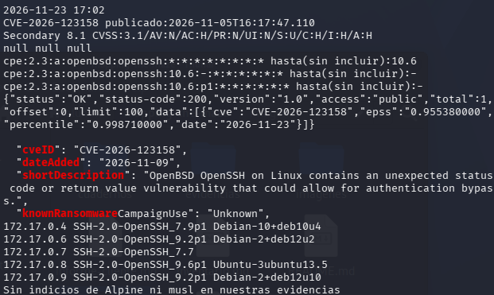

cat > informe-cliente.md <<'FIN'
# Informe de vulnerabilidades priorizado - Gadir Logística, S.L.

**Para:** Dirección de Gadir Logística, S.L.
**Fecha:** 2026-11-23
**Alcance:** red interna 172.17.0.0/24
**Tipo de revisión:** identificación no intrusiva. No se ha explotado ni modificado nada y ningún servicio se ha interrumpido.

## 1. Resumen para la dirección

Hemos revisado su red interna y hemos encontrado **8 equipos activos** (su hoja de inventario recogía 10 entradas, de las que solo 2 corresponden a equipos que existen) y **8 vulnerabilidades potenciales**. De ellas, **5 figuran en el catálogo de fallos ya aprovechados por atacantes** de la agencia de ciberseguridad de EE. UU. (CISA, catálogo KEV), y en **2** consta además su uso en ataques de secuestro de datos (ransomware).

Con el presupuesto de este trimestre, recomendamos corregir primero estas tres:

1. **Mensajería con los operadores (equipo 172.17.0.5):** el programa que gestiona los mensajes (ActiveMQ) está en una versión con un fallo que permite a un atacante ejecutar órdenes en el equipo sin conocer ninguna contraseña. Acción: actualizar ActiveMQ a la versión 5.15.16 o posterior y limitar quién puede conectarse al puerto 61616.
2. **Servidor de automatización (equipo 172.17.0.6):** Jenkins, una herramienta para construir y desplegar programas, tiene un fallo que permite leer cualquier fichero del servidor, incluidas posibles claves de acceso. Acción: actualizar Jenkins a una versión corregida y limitar el acceso al equipo desde el resto de la red.
3. **Servidor de aplicaciones (equipo 172.17.0.4):** Apache Tomcat está en una versión con dos fallos conocidos y tiene abierto un puerto de comunicación interna (8009) que no debería estar al alcance de toda la red. Acción: actualizar Tomcat a la versión 9.0.99 o posterior, que corrige los dos, y cerrar ese puerto salvo que se necesite.

## 2. Qué hay en su red

| Equipo | Para qué sirve (probable) | Servicios que ofrece a la red |
|---|---|---|
| 172.17.0.3 | Equipo antiguo y delicado | Transferencia de ficheros (FTP, versión de 2011) y una página web |
| 172.17.0.4 | Servidor de aplicaciones | Acceso remoto (SSH), aplicaciones web Tomcat y un puerto de comunicación interna (8009) |
| 172.17.0.5 | Mensajería con operadores | Una web y el sistema de mensajería ActiveMQ en varios puertos |
| 172.17.0.6 | Servidor donde el antiguo informático montaba cosas | Acceso remoto (SSH) y Jenkins |
| 172.17.0.7 | Sin función clara | Solo acceso remoto (SSH) |
| 172.17.0.8 | Portal de clientes (indicio débil) | Acceso remoto (SSH), una web con inicio de sesión y compartición de ficheros (Samba) |
| 172.17.0.9 | Sin función clara | Acceso remoto (SSH) y una web de prueba |
| 172.17.0.10 | Consola de gestión de servidores | Una web sencilla y un puerto de gestión remota (IPMI) |

Las funciones son deducciones a partir de los servicios que se ven; ninguna está confirmada. Su hoja de inventario no está al día: **7** entradas son de equipos que no respondieron, **6** equipos no aparecían en la hoja y **2** entradas tienen datos erróneos. Además, una entrada (172.17.1.6) está fuera de la red revisada y no se pudo comprobar. El detalle está en `inventario.md`.

## 3. Vulnerabilidades por orden de prioridad

La nota de gravedad técnica (CVSS) va de 0 a 10. La probabilidad de explotación en el próximo mes (EPSS) es una estimación: en todos los casos supera el 95 %.

| Prioridad | Equipo | Qué le pasa | Riesgo para el negocio | Qué hacer |
|---|---|---|---|---|
| 1 | 172.17.0.5, mensajería | Fallo de ActiveMQ que permite ejecutar órdenes sin contraseña. Ya usado en ataques de secuestro de datos | Parada o manipulación de los mensajes con los operadores, y por tanto de la facturación | Actualizar a 5.15.16 o posterior y limitar el puerto 61616 |
| 2 | 172.17.0.6, Jenkins | Fallo que permite leer ficheros del servidor. Ya usado en ataques de secuestro de datos | Robo de claves de acceso que permitan llegar a otros equipos | Actualizar Jenkins y limitar el acceso |
| 3 | 172.17.0.4, Tomcat | Puerto de comunicación interna abierto en una versión con fallo conocido | Lectura de ficheros de las aplicaciones web del servidor | Actualizar a 9.0.99 o posterior y cerrar el puerto 8009 |
| 4 | 172.17.0.7, acceso remoto | Fallo de OpenSSH muy comentado en las noticias; solo afecta a ciertos sistemas y no sabemos si este lo es | Entrada sin contraseña, si el sistema es de los afectados | Desactivar las contraseñas en SSH, actualizar OpenSSH y comprobar el sistema base |
| 5 | 172.17.0.4, Tomcat | Otro fallo de Tomcat que exige una configuración concreta | Ejecución de órdenes en el servidor, si se dan las condiciones | La misma actualización de la prioridad 3 |
| 6 | 172.17.0.3, equipo antiguo | Versión del programa de transferencia de ficheros con una posible puerta trasera | Control del equipo; si cae, se paraliza la facturación | Planificar su sustitución y aislarlo del resto de la red |
| 7 | 172.17.0.6, acceso remoto | Fallo de OpenSSH que exige muchos intentos y no está en la lista de fallos ya usados | Entrada al servidor sin contraseña | Actualizar el paquete OpenSSH |
| 8 | 172.17.0.7, acceso remoto | Permite saber si un usuario existe | Ayuda a un atacante a preparar otro ataque, pero no da acceso | Actualizar OpenSSH (misma acción que la prioridad 4) |

**Por qué este orden.** No hemos ordenado solo por la nota de gravedad técnica (CVSS). Hemos adelantado lo que los atacantes ya están usando (catálogo KEV), y dentro de eso, lo que se ha usado en secuestro de datos. Por eso el fallo de OpenSSH de la prioridad 4, con nota 8,1, va antes que el del equipo antiguo, con nota 9,8: el primero ya se usa en ataques y el segundo no. Y también influye qué equipo es: la mensajería está ligada a la facturación.

**Dos acciones cubren cuatro hallazgos.** Una sola actualización de Tomcat resuelve las prioridades 3 y 5, y actualizar OpenSSH en el equipo 172.17.0.7 resuelve las prioridades 4 y 8.

## 4. Advertencias

- El equipo **172.17.0.3** es antiguo y delicado: cualquier prueba agresiva puede tumbarlo. Recomendamos planificar su sustitución y aislarlo del resto de la red.
- Hay hallazgos graves que **no hemos tocado**, como pedía el contrato, y que deberían confirmarse en una siguiente fase con su permiso: la posible puerta trasera del equipo 172.17.0.3, ActiveMQ (172.17.0.5), Jenkins (172.17.0.6) y Tomcat (172.17.0.4).
- El puerto de gestión remota del equipo 172.17.0.10 anuncia entre sus métodos de autenticación uno "nulo", es decir, sin contraseña. No lo hemos probado; debe comprobarse en la siguiente fase.
- El certificado de seguridad de la web del equipo 172.17.0.5 caducó el 17 de abril de 2025 y es de ejemplo.
- Todo lo indicado es **potencial**: se basa en las versiones observadas desde la red, no en haber atacado los equipos.

## 5. Respuesta a su consulta sobre la noticia (CVE-2026-123158, "sshole")

**¿Les afecta?** No podemos descartarlo del todo. Según lo observado, **no afecta a 4 de sus 5 servidores con acceso remoto (SSH)**, y en el quinto no se puede saber.

- **Qué es:** un fallo de OpenSSH, el programa que usan los servidores para entrar en remoto. Permite entrar a ciertas cuentas sin conocer la contraseña, enviando una muy larga. Solo afecta a servidores Linux que usan una librería concreta (musl) y no usan el módulo de autenticación PAM, como los basados en Alpine Linux. Se corrigió el 5 de noviembre de 2026 en la versión 10.6p2. Gravedad CVSS 8,1; probabilidad de explotación EPSS 0,955; figura en el catálogo KEV de CISA desde el 9 de noviembre de 2026, sin uso en ransomware conocido.
- **Lo que podemos sostener con nuestras pruebas:** hay acceso remoto (SSH) en cinco equipos (172.17.0.4, .6, .7, .8 y .9). En cuatro de ellos funciona un paquete de Debian o de Ubuntu, que según la ficha oficial del fallo y el artículo que nos reenvía no están afectados. Los equipos 172.17.0.3, .5 y .10 no ofrecen acceso remoto. Evidencia: `evidencias/p2/22-ssh-banner-172.17.0.4-bash.txt`, `22-ssh-banner-172.17.0.6-bash.txt`, `22-ssh-banner-172.17.0.8-bash.txt`, `22-ssh-banner-172.17.0.9-bash.txt` y `evidencias/p4/43-aviso-nvd.json`.
- **Lo que queda pendiente de comprobar:** en el equipo **172.17.0.7** funciona OpenSSH 7.7, una versión anterior a la corregida, y su identificación no dice con qué sistema funciona, así que no sabemos si es de los afectados. En los otros cuatro, lo hemos deducido de la identificación del programa y de dos fuentes, no del seguimiento de seguridad de Debian y Ubuntu. Además, solo vemos lo que está expuesto y encendido durante la revisión, y no hemos probado ninguna contraseña.
- **Recomendación:** en el equipo 172.17.0.7, desactivar el acceso con contraseña (entrar solo con clave), actualizar OpenSSH a la versión 10.6p2 o posterior y comprobar con quien lo montó qué sistema usa. En los demás, no requiere acción urgente por este fallo; basta con mantenerlos actualizados.

## 6. Fuentes y fecha

NVD (base de datos de vulnerabilidades de EE. UU.), FIRST EPSS y CISA KEV, consultados el 2026-11-23, junto con el artículo sobre el aviso que nos reenvió Gerencia (ox.security). La clasificación sigue MITRE CWE y MITRE ATT&CK.
El detalle técnico está en `registro-vulns.md` y en los cuadernos de trabajo.
FIN
