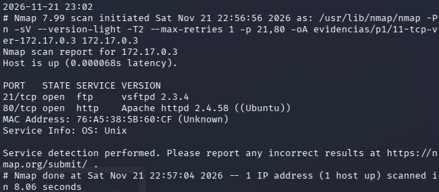
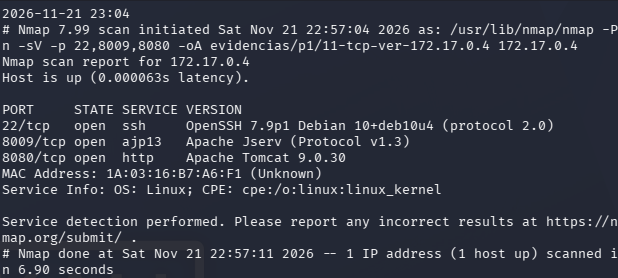
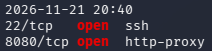
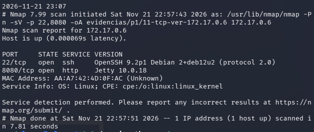
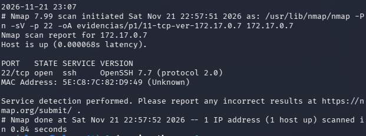
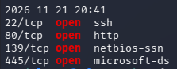
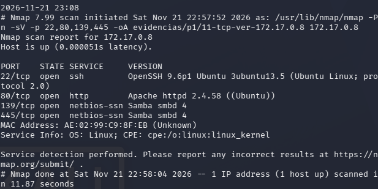
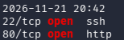
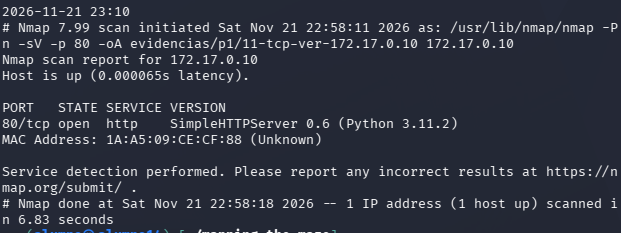
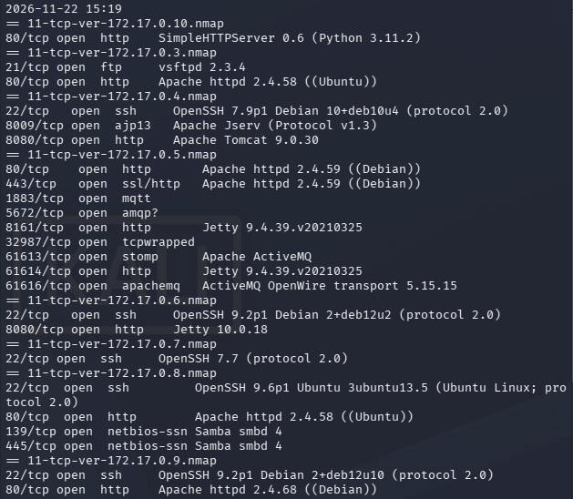

# Inventario de red - Gadir Logística, S.L.

**Alcance:** 172.17.0.0/24 (scope.txt)
**Fecha de las comprobaciones:** 2026-11-21 y 2026-11-22 (hora de la máquina virtual Kali)
**Autor:** Pablo Ostenero Reyes
**Criterio de evaluación:** RA3.b, inventario de equipos mediante técnicas activas.

## Método

- Descubrimiento activo con nmap combinando ICMP, TCP SYN/ACK, UDP y ARP. Los dos barridos se contrastaron entre sí y coinciden (`evidencias/p1/01-descubrimiento.*` y `02-descubrimiento-arp.*`).
- Pasada suave previa (100 puertos TCP, `-T2`, versión ligera) para localizar el equipo delicado antes del escaneo fuerte.
- Escaneo de los 65 535 puertos TCP de cada equipo (`-p-`) y de los 100 puertos UDP más comunes.
- Detección de versión (`-sV`) sobre los puertos abiertos, sin detección activa de sistema operativo.
- Sin scripts intrusivos ni de explotación.
- El equipo 172.17.0.3 se trató como delicado de forma provisional, por el banner `vsftpd 2.3.4`; los tiempos de la pasada suave (41 a 65 s por equipo) no señalaron a ningún equipo. Su primer escaneo completo con `-T2 --max-rate 30` se interrumpió al 12,47 % por lentitud y se repitió con `-T3 --max-rate 30 --max-retries 1`, vigilando con `ping` sin pérdida de paquetes. El `-T3` se aparta de la indicación de la guía para este equipo.
- Mi IP de trabajo (172.17.0.1, interfaz `docker0`) responde en la red pero no forma parte del cliente y se excluye del inventario.

## Parte 1 - Equipos vivos, puertos y servicios

**Equipos vivos del cliente:** 8, de 172.17.0.3 a 172.17.0.10 (`evidencias/p1/vivos.txt`). 172.17.0.2 no respondió a ningún barrido.

| IP | Función probable | Puerto | Proto | Servicio | Producto y versión | Evidencia |
|---|---|---|---|---|---|---|
| 172.17.0.3 | Equipo antiguo y delicado (probable) | 21 | tcp | ftp | vsftpd 2.3.4 | `evidencias/p1/11-tcp-ver-172.17.0.3.nmap` |
| 172.17.0.3 | idem | 80 | tcp | http | Apache httpd 2.4.58 ((Ubuntu)) | idem |
| 172.17.0.4 | Sin función asignada (servidor de aplicaciones Java) | 22 | tcp | ssh | OpenSSH 7.9p1 Debian 10+deb10u4 (protocol 2.0) | `evidencias/p1/11-tcp-ver-172.17.0.4.nmap` |
| 172.17.0.4 | idem | 8009 | tcp | ajp13 | Apache Jserv (Protocol v1.3) | idem |
| 172.17.0.4 | idem | 8080 | tcp | http | Apache Tomcat 9.0.30 | idem |
| 172.17.0.5 | Mensajería con operadores (probable) | 80 | tcp | http | Apache httpd 2.4.59 ((Debian)) | `evidencias/p1/11-tcp-ver-172.17.0.5.nmap` |
| 172.17.0.5 | idem | 443 | tcp | ssl/http | Apache httpd 2.4.59 ((Debian)) | idem |
| 172.17.0.5 | idem | 1883 | tcp | mqtt | no identificada | idem |
| 172.17.0.5 | idem | 5672 | tcp | amqp? | no identificada | idem |
| 172.17.0.5 | idem | 8161 | tcp | http | Jetty 9.4.39.v20210325 | idem |
| 172.17.0.5 | idem | 32987 | tcp | tcpwrapped | no identificada | idem |
| 172.17.0.5 | idem | 61613 | tcp | stomp | Apache ActiveMQ (sin versión) | idem |
| 172.17.0.5 | idem | 61614 | tcp | http | Jetty 9.4.39.v20210325 | idem |
| 172.17.0.5 | idem | 61616 | tcp | apachemq | ActiveMQ OpenWire transport 5.15.15 | idem |
| 172.17.0.6 | Sin función asignada (servidor de aplicaciones Java) | 22 | tcp | ssh | OpenSSH 9.2p1 Debian 2+deb12u2 (protocol 2.0) | `evidencias/p1/11-tcp-ver-172.17.0.6.nmap` |
| 172.17.0.6 | idem | 8080 | tcp | http | Jetty 10.0.18 | idem |
| 172.17.0.7 | Sin función asignada (solo SSH) | 22 | tcp | ssh | OpenSSH 7.7 (protocol 2.0) | `evidencias/p1/11-tcp-ver-172.17.0.7.nmap` |
| 172.17.0.8 | Servidor de pruebas (probable) | 22 | tcp | ssh | OpenSSH 9.6p1 Ubuntu 3ubuntu13.5 (Ubuntu Linux; protocol 2.0) | `evidencias/p1/11-tcp-ver-172.17.0.8.nmap` |
| 172.17.0.8 | idem | 80 | tcp | http | Apache httpd 2.4.58 ((Ubuntu)) | idem |
| 172.17.0.8 | idem | 139 | tcp | netbios-ssn | Samba smbd 4 | idem |
| 172.17.0.8 | idem | 445 | tcp | netbios-ssn | Samba smbd 4 | idem |
| 172.17.0.8 | idem | 137 | udp | netbios-ns | Samba nmbd netbios-ns (workgroup: DL) | `evidencias/p1/12-udp-172.17.0.8.nmap` |
| 172.17.0.9 | Portal de clientes (probable, provisional) | 22 | tcp | ssh | OpenSSH 9.2p1 Debian 2+deb12u10 (protocol 2.0) | `evidencias/p1/11-tcp-ver-172.17.0.9.nmap` |
| 172.17.0.9 | idem | 80 | tcp | http | Apache httpd 2.4.68 ((Debian)) | idem |
| 172.17.0.10 | Consola de gestión de servidores (probable) | 80 | tcp | http | SimpleHTTPServer 0.6 (Python 3.11.2) | `evidencias/p1/11-tcp-ver-172.17.0.10.nmap` |
| 172.17.0.10 | idem | 623 | udp | asf-rmcp | no identificada | `evidencias/p1/12-udp-172.17.0.10.nmap` |

Las funciones son deducciones a partir de los servicios que se ven y del correo del cliente; ninguna está confirmada. La del portal es la menos sólida y se revisará en la Parte 2.

Hallazgo grave anotado, sin tocarlo: `vsftpd 2.3.4` en 172.17.0.3:21, detectado solo por banner. Queda para la Parte 3.

### Capturas por equipo

**172.17.0.3 - Equipo antiguo y delicado**

**172.17.0.4**

**172.17.0.5 - Mensajería con operadores (probable)**

**172.17.0.6**

**172.17.0.7**

**172.17.0.8**

**172.17.0.9**

**172.17.0.10**

### Puertos fuera de lo habitual

Encontrados gracias al escaneo completo (`-p-`). No están entre los 1000 puertos más comunes de nmap (comprobado con la base de datos local de nmap, `/usr/share/nmap/nmap-services`):

- 172.17.0.5:1883/tcp - mqtt, versión no identificada
- 172.17.0.5:5672/tcp - amqp?, versión no identificada
- 172.17.0.5:8161/tcp - Jetty 9.4.39.v20210325
- 172.17.0.5:32987/tcp - tcpwrapped, versión no identificada
- 172.17.0.5:61613/tcp - stomp, Apache ActiveMQ
- 172.17.0.5:61614/tcp - Jetty 9.4.39.v20210325
- 172.17.0.5:61616/tcp - ActiveMQ OpenWire transport 5.15.15

### UDP

- Abiertos confirmados: 172.17.0.8:137/udp (netbios-ns, Samba nmbd, workgroup: DL) y 172.17.0.10:623/udp (asf-rmcp).
- Sin confirmar (`open|filtered`, el servicio no respondió): 172.17.0.4 (91 puertos), 172.17.0.5 (93), 172.17.0.6 (92), 172.17.0.7 (94), 172.17.0.8 (90), 172.17.0.9 (91) y 172.17.0.10 (89). En 172.17.0.3, solo escaneado en 10 puertos, 137/udp y 5353/udp. No se cuentan como abiertos.

### Sistema operativo (deducido de los banners)

No se usó detección activa de sistema operativo (`-O`) para no enviar tráfico innecesario.

| IP | Sistema operativo según banners | De dónde sale |
|---|---|---|
| 172.17.0.3 | Linux (Ubuntu) | Apache httpd 2.4.58 ((Ubuntu)) |
| 172.17.0.4 | Linux (Debian 10) | OpenSSH 7.9p1 Debian 10+deb10u4 |
| 172.17.0.5 | Linux (Debian) | Apache httpd 2.4.59 ((Debian)) |
| 172.17.0.6 | Linux (Debian 12) | OpenSSH 9.2p1 Debian 2+deb12u2 |
| 172.17.0.7 | no identificado | OpenSSH 7.7 sin distribución en el banner |
| 172.17.0.8 | Linux (Ubuntu) | OpenSSH 9.6p1 Ubuntu 3ubuntu13.5 |
| 172.17.0.9 | Linux (Debian 12) | OpenSSH 9.2p1 Debian 2+deb12u10 |
| 172.17.0.10 | no identificado | SimpleHTTPServer 0.6 (Python 3.11.2) sin sistema en el banner |

## Correcciones al inventario del cliente

Hoja del cliente comparada con lo observado el 2026-11-22. La hoja no se usó como fuente; solo se contrastó al final. Las entradas que sobran significan que no respondieron desde esta red en el momento de la revisión, no que no existan: se recomienda comprobarlas físicamente.

| Entrada de la hoja | Lo observado | Corrección | Tipo |
|---|---|---|---|
| SRV-PORTAL01, 172.17.0.10, Windows Server 2008 R2, IIS 7.5, 80 y 443 | Vivo, pero solo 80/tcp con SimpleHTTPServer 0.6 (Python 3.11.2). Sin 443 ni IIS. Además 623/udp abierto | Sistema, servicio, versión y puertos incorrectos | Mal |
| SRV-PORTAL01, 172.17.0.11, SQL Server 1433 | No responde a ICMP, TCP, UDP ni ARP | Dar de baja o comprobar físicamente. El nombre está duplicado en la hoja | Sobra |
| srv-mensajeria, 172.17.0.20, MSMQ 1801 | No responde | Dar de baja o comprobar físicamente | Sobra |
| FTP-ALMACEN, 172.17.0.2, FileZilla 21 | No responde | Dar de baja o comprobar físicamente | Sobra |
| NAS-OFICINA, 172.17.0.50, 445 | No responde | Dar de baja o comprobar físicamente | Sobra |
| consola sala tecnica, 172.17.0.254, HP iLO 2 | No responde. La hoja dice que solo se llega por cable | Comprobar físicamente | Sobra |
| IMPRESORA-MUELLE, 172.17.0.30, 9100 | No responde | Dar de baja o comprobar físicamente | Sobra |
| srv-backup, 172.17.0.100, Debian 7, OpenSSH 5.5 | No responde. Ningún equipo vivo tiene OpenSSH 5.5 | Dar de baja o comprobar físicamente | Sobra |
| TPV-RECEPCION, 172.17.0.9, Windows 7, RDP 3389 | Vivo, con 22 (OpenSSH 9.2p1 Debian 12) y 80 (Apache 2.4.68). Sin 3389 | Sistema, servicios y puertos incorrectos | Mal |
| PC-PRUEBAS, 172.17.1.6 | Fuera del alcance autorizado. No se escaneó | No verificable en esta revisión | Fuera de alcance |
| (no aparece) | 172.17.0.3 vivo con vsftpd 2.3.4 y Apache 2.4.58 | Añadirlo y asignarle responsable | Falta |
| (no aparece) | 172.17.0.4 vivo con SSH, AJP y Tomcat 9.0.30 | Añadirlo y asignarle responsable | Falta |
| (no aparece) | 172.17.0.5 vivo con web y ActiveMQ (1883, 5672, 8161, 61613, 61614, 61616) | Añadirlo y asignarle responsable | Falta |
| (no aparece) | 172.17.0.6 vivo con SSH y Jetty 10.0.18 | Añadirlo y asignarle responsable | Falta |
| (no aparece) | 172.17.0.7 vivo con OpenSSH 7.7 | Añadirlo y asignarle responsable | Falta |
| (no aparece) | 172.17.0.8 vivo con SSH, Apache y Samba (139, 445, 137/udp) | Añadirlo y asignarle responsable | Falta |

**Conclusión:** la hoja del cliente tiene 7 entradas que sobran, le faltan 6 equipos y contiene 2 entradas con datos erróneos. Una entrada más (172.17.1.6) queda fuera del alcance y no se pudo verificar. El inventario válido es el de este documento.
