# Inventario de red - Gadir Logística, S.L.

**Alcance:** 172.17.0.0/24 (scope.txt)
**Fecha de las comprobaciones:** 2026-11-21 y 2026-11-22 (hora de la máquina virtual Kali)
**Autor:** Pablo Ostenero Reyes
**Criterio de evaluación:** RA3.b, inventario de equipos mediante técnicas activas.

## Método

- Descubrimiento activo con nmap combinando ICMP, TCP SYN/ACK, UDP y ARP. Los dos barridos se contrastaron entre sí y coinciden (`evidencias/p1/01-descubrimiento.*` y `02-descubrimiento-arp.*`).
- Pasada suave previa (100 puertos TCP, `-T2`, versión ligera) para localizar el equipo delicado antes del escaneo fuerte.
- Escaneo de los 65 535 puertos TCP de cada equipo (`-p-`) y de los 100 puertos UDP más comunes.
- Detección de versión (`-sV`) sobre los puertos abiertos, sin detección activa de sistema operativo.
- Sin scripts intrusivos ni de explotación.
- El equipo 172.17.0.3 se trató como delicado de forma provisional, por el banner `vsftpd 2.3.4`; los tiempos de la pasada suave (41 a 65 s por equipo) no señalaron a ningún equipo. Su primer escaneo completo con `-T2 --max-rate 30` se interrumpió al 12,47 % por lentitud y se repitió con `-T3 --max-rate 30 --max-retries 1`, vigilando con `ping` sin pérdida de paquetes. El `-T3` se aparta de la indicación de la guía para este equipo.
- Mi IP de trabajo (172.17.0.1, interfaz `docker0`) responde en la red pero no forma parte del cliente y se excluye del inventario.

## Parte 1 - Equipos vivos, puertos y servicios

**Equipos vivos del cliente:** 8, de 172.17.0.3 a 172.17.0.10 (`evidencias/p1/vivos.txt`). 172.17.0.2 no respondió a ningún barrido.

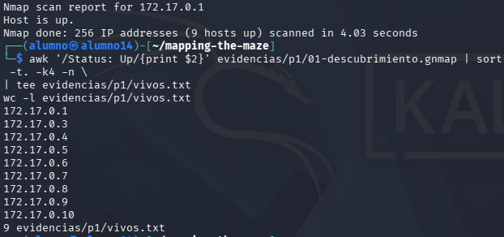
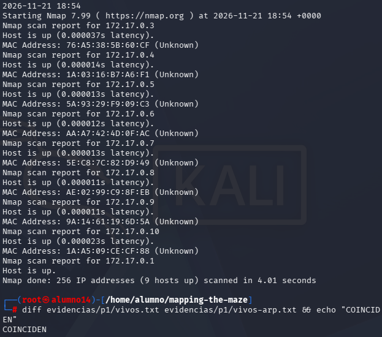

| IP | Función probable | Puerto | Proto | Servicio | Producto y versión | Evidencia |
|---|---|---|---|---|---|---|
| 172.17.0.3 | Equipo antiguo y delicado (probable) | 21 | tcp | ftp | vsftpd 2.3.4 | `evidencias/p1/11-tcp-ver-172.17.0.3.nmap` |
| 172.17.0.3 | idem | 80 | tcp | http | Apache httpd 2.4.58 ((Ubuntu)) | idem |
| 172.17.0.4 | Sin función asignada (servidor de aplicaciones Java) | 22 | tcp | ssh | OpenSSH 7.9p1 Debian 10+deb10u4 (protocol 2.0) | `evidencias/p1/11-tcp-ver-172.17.0.4.nmap` |
| 172.17.0.4 | idem | 8009 | tcp | ajp13 | Apache Jserv (Protocol v1.3) | idem |
| 172.17.0.4 | idem | 8080 | tcp | http | Apache Tomcat 9.0.30 | idem |
| 172.17.0.5 | Mensajería con operadores (probable) | 80 | tcp | http | Apache httpd 2.4.59 ((Debian)) | `evidencias/p1/11-tcp-ver-172.17.0.5.nmap` |
| 172.17.0.5 | idem | 443 | tcp | ssl/http | Apache httpd 2.4.59 ((Debian)) | idem |
| 172.17.0.5 | idem | 1883 | tcp | mqtt | no identificada | idem |
| 172.17.0.5 | idem | 5672 | tcp | amqp? | no identificada | idem |
| 172.17.0.5 | idem | 8161 | tcp | http | Jetty 9.4.39.v20210325 | idem |
| 172.17.0.5 | idem | 32987 | tcp | tcpwrapped | no identificada | idem |
| 172.17.0.5 | idem | 61613 | tcp | stomp | Apache ActiveMQ (sin versión) | idem |
| 172.17.0.5 | idem | 61614 | tcp | http | Jetty 9.4.39.v20210325 | idem |
| 172.17.0.5 | idem | 61616 | tcp | apachemq | ActiveMQ OpenWire transport 5.15.15 | idem |
| 172.17.0.6 | Servidor donde se montaban cosas (probable: Jenkins) | 22 | tcp | ssh | OpenSSH 9.2p1 Debian 2+deb12u2 (protocol 2.0) | `evidencias/p1/11-tcp-ver-172.17.0.6.nmap` |
| 172.17.0.6 | idem | 8080 | tcp | http | Jetty 10.0.18 | idem |
| 172.17.0.7 | Sin función asignada (solo SSH) | 22 | tcp | ssh | OpenSSH 7.7 (protocol 2.0) | `evidencias/p1/11-tcp-ver-172.17.0.7.nmap` |
| 172.17.0.8 | Portal de clientes (probable, indicio débil) | 22 | tcp | ssh | OpenSSH 9.6p1 Ubuntu 3ubuntu13.5 (Ubuntu Linux; protocol 2.0) | `evidencias/p1/11-tcp-ver-172.17.0.8.nmap` |
| 172.17.0.8 | idem | 80 | tcp | http | Apache httpd 2.4.58 ((Ubuntu)) | idem |
| 172.17.0.8 | idem | 139 | tcp | netbios-ssn | Samba smbd 4 | idem |
| 172.17.0.8 | idem | 445 | tcp | netbios-ssn | Samba smbd 4 | idem |
| 172.17.0.8 | idem | 137 | udp | netbios-ns | Samba nmbd netbios-ns (workgroup: DL) | `evidencias/p1/12-udp-172.17.0.8.nmap` |
| 172.17.0.9 | Sin función asignada (web "test page") | 22 | tcp | ssh | OpenSSH 9.2p1 Debian 2+deb12u10 (protocol 2.0) | `evidencias/p1/11-tcp-ver-172.17.0.9.nmap` |
| 172.17.0.9 | idem | 80 | tcp | http | Apache httpd 2.4.68 ((Debian)) | idem |
| 172.17.0.10 | Consola de gestión de servidores (probable) | 80 | tcp | http | SimpleHTTPServer 0.6 (Python 3.11.2) | `evidencias/p1/11-tcp-ver-172.17.0.10.nmap` |
| 172.17.0.10 | idem | 623 | udp | asf-rmcp | no identificada | `evidencias/p1/12-udp-172.17.0.10.nmap` |

Las funciones son deducciones a partir de los servicios que se ven y del correo del cliente; ninguna está confirmada. La del portal es la menos sólida y se revisará en la Parte 2.

Hallazgo grave anotado, sin tocarlo: `vsftpd 2.3.4` en 172.17.0.3:21, detectado solo por banner. Queda para la Parte 3.

### Capturas por equipo

**172.17.0.3 - Equipo antiguo y delicado**
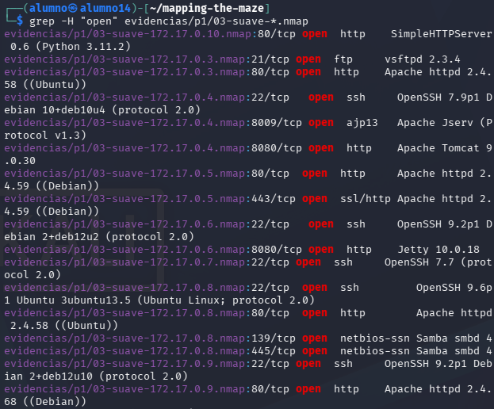
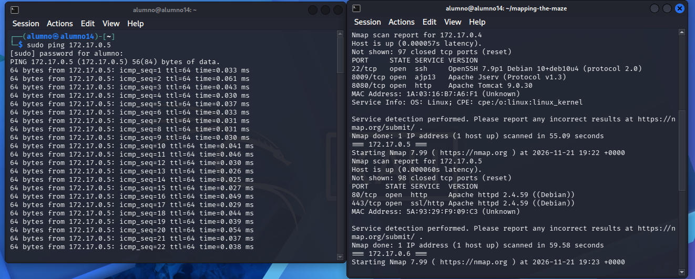
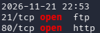

**172.17.0.4**
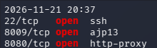

**172.17.0.5 - Mensajería con operadores (probable)**
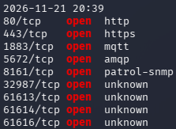
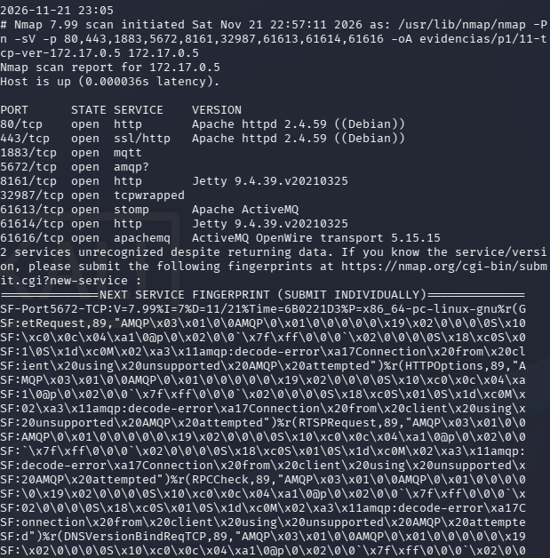
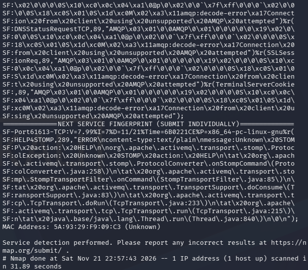

**172.17.0.6**

**172.17.0.7**
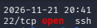

**172.17.0.8**

**172.17.0.9**

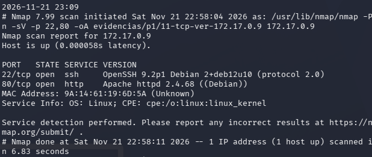

**172.17.0.10**
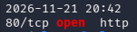

### Puertos fuera de lo habitual

Encontrados gracias al escaneo completo (`-p-`). No están entre los 1000 puertos más comunes de nmap (comprobado con la base de datos local de nmap, `/usr/share/nmap/nmap-services`):

- 172.17.0.5:1883/tcp - mqtt, versión no identificada
- 172.17.0.5:5672/tcp - amqp?, versión no identificada
- 172.17.0.5:8161/tcp - Jetty 9.4.39.v20210325
- 172.17.0.5:32987/tcp - tcpwrapped, versión no identificada
- 172.17.0.5:61613/tcp - stomp, Apache ActiveMQ
- 172.17.0.5:61614/tcp - Jetty 9.4.39.v20210325
- 172.17.0.5:61616/tcp - ActiveMQ OpenWire transport 5.15.15

### UDP

- Abiertos confirmados: 172.17.0.8:137/udp (netbios-ns, Samba nmbd, workgroup: DL) y 172.17.0.10:623/udp (asf-rmcp).
- Sin confirmar (`open|filtered`, el servicio no respondió): 172.17.0.4 (91 puertos), 172.17.0.5 (93), 172.17.0.6 (92), 172.17.0.7 (94), 172.17.0.8 (90), 172.17.0.9 (91) y 172.17.0.10 (89). En 172.17.0.3, solo escaneado en 10 puertos, 137/udp y 5353/udp. No se cuentan como abiertos.

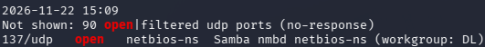
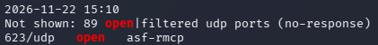

### Sistema operativo (deducido de los banners)

No se usó detección activa de sistema operativo (`-O`) para no enviar tráfico innecesario.

| IP | Sistema operativo según banners | De dónde sale |
|---|---|---|
| 172.17.0.3 | Linux (Ubuntu) | Apache httpd 2.4.58 ((Ubuntu)) |
| 172.17.0.4 | Linux (Debian 10) | OpenSSH 7.9p1 Debian 10+deb10u4 |
| 172.17.0.5 | Linux (Debian) | Apache httpd 2.4.59 ((Debian)) |
| 172.17.0.6 | Linux (Debian 12) | OpenSSH 9.2p1 Debian 2+deb12u2 |
| 172.17.0.7 | no identificado | OpenSSH 7.7 sin distribución en el banner |
| 172.17.0.8 | Linux (Ubuntu) | OpenSSH 9.6p1 Ubuntu 3ubuntu13.5 |
| 172.17.0.9 | Linux (Debian 12) | OpenSSH 9.2p1 Debian 2+deb12u10 |
| 172.17.0.10 | no identificado | SimpleHTTPServer 0.6 (Python 3.11.2) sin sistema en el banner |

## Correcciones al inventario del cliente

Hoja del cliente comparada con lo observado el 2026-11-22. La hoja no se usó como fuente; solo se contrastó al final. Las entradas que sobran significan que no respondieron desde esta red en el momento de la revisión, no que no existan: se recomienda comprobarlas físicamente.

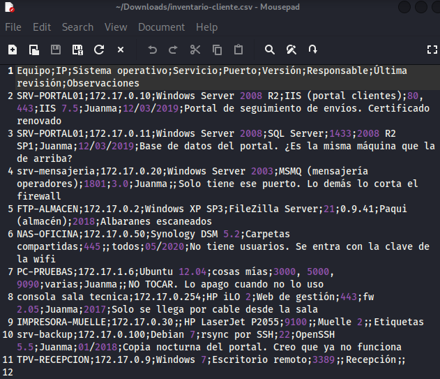

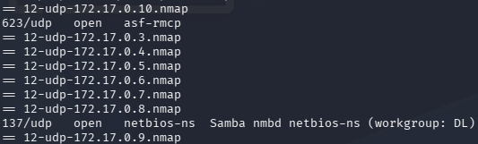

| Entrada de la hoja | Lo observado | Corrección | Tipo |
|---|---|---|---|
| SRV-PORTAL01, 172.17.0.10, Windows Server 2008 R2, IIS 7.5, 80 y 443 | Vivo, pero solo 80/tcp con SimpleHTTPServer 0.6 (Python 3.11.2). Sin 443 ni IIS. Además 623/udp abierto | Sistema, servicio, versión y puertos incorrectos | Mal |
| SRV-PORTAL01, 172.17.0.11, SQL Server 1433 | No responde a ICMP, TCP, UDP ni ARP | Dar de baja o comprobar físicamente. El nombre está duplicado en la hoja | Sobra |
| srv-mensajeria, 172.17.0.20, MSMQ 1801 | No responde | Dar de baja o comprobar físicamente | Sobra |
| FTP-ALMACEN, 172.17.0.2, FileZilla 21 | No responde | Dar de baja o comprobar físicamente | Sobra |
| NAS-OFICINA, 172.17.0.50, 445 | No responde | Dar de baja o comprobar físicamente | Sobra |
| consola sala tecnica, 172.17.0.254, HP iLO 2 | No responde. La hoja dice que solo se llega por cable | Comprobar físicamente | Sobra |
| IMPRESORA-MUELLE, 172.17.0.30, 9100 | No responde | Dar de baja o comprobar físicamente | Sobra |
| srv-backup, 172.17.0.100, Debian 7, OpenSSH 5.5 | No responde. Ningún equipo vivo tiene OpenSSH 5.5 | Dar de baja o comprobar físicamente | Sobra |
| TPV-RECEPCION, 172.17.0.9, Windows 7, RDP 3389 | Vivo, con 22 (OpenSSH 9.2p1 Debian 12) y 80 (Apache 2.4.68). Sin 3389 | Sistema, servicios y puertos incorrectos | Mal |
| PC-PRUEBAS, 172.17.1.6 | Fuera del alcance autorizado. No se escaneó | No verificable en esta revisión | Fuera de alcance |
| (no aparece) | 172.17.0.3 vivo con vsftpd 2.3.4 y Apache 2.4.58 | Añadirlo y asignarle responsable | Falta |
| (no aparece) | 172.17.0.4 vivo con SSH, AJP y Tomcat 9.0.30 | Añadirlo y asignarle responsable | Falta |
| (no aparece) | 172.17.0.5 vivo con web y ActiveMQ (1883, 5672, 8161, 61613, 61614, 61616) | Añadirlo y asignarle responsable | Falta |
| (no aparece) | 172.17.0.6 vivo con SSH y Jetty 10.0.18 | Añadirlo y asignarle responsable | Falta |
| (no aparece) | 172.17.0.7 vivo con OpenSSH 7.7 | Añadirlo y asignarle responsable | Falta |
| (no aparece) | 172.17.0.8 vivo con SSH, Apache y Samba (139, 445, 137/udp) | Añadirlo y asignarle responsable | Falta |

**Conclusión:** la hoja del cliente tiene 7 entradas que sobran, le faltan 6 equipos y contiene 2 entradas con datos erróneos. Una entrada más (172.17.1.6) queda fuera del alcance y no se pudo verificar. El inventario válido es el de este documento.

## Parte 2 - Enumeración sin autenticar

**Autor:** Pablo Ostenero Reyes
**Fecha de las comprobaciones:** 2026-11-22 (hora de la máquina virtual Kali)
**Criterio de evaluación:** RA3.b, inventario de cuentas de usuario y servicios mediante técnicas activas, sin autenticación.

### Criterio seguido

- Scripts NSE solo de las categorías default y safe a la vez (filtro `SAFE`), excluyendo intrusive, exploit, dos, brute, malware, auth, broadcast y external.
- Scripts sueltos de la categoría safe (`ssh2-enum-algos`, `ssh-hostkey`, `smb-os-discovery`, `smb2-security-mode`, `smb-security-mode`, `smb-protocols`, `nbstat`, `ipmi-version`), cuyas categorías se comprobaron antes de usarlos:
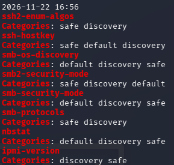
- Lectura de banners (con `nc` y con `/dev/tcp`) y peticiones HTTP normales con `curl`; una petición a cada recurso y sin rastreo de rutas.
- Sin credenciales, sin sesiones anónimas y sin fuerza bruta de rutas, usuarios o contraseñas.
- A 172.17.0.3 se le pasaron los scripts solo en el puerto 80, con `-T2`. No se lanzó ningún script contra su FTP (vsftpd 2.3.4), hallazgo grave que no se toca. El `ping` a ese equipo respondió sin pérdida de paquetes durante las comprobaciones.
- Los servicios de mensajería (1883, 5672, 61613, 61616, 32987) y el AJP de 172.17.0.4 (8009) no se probaron con scripts, siguiendo la regla de no acceder a colas de mensajes.

### 172.17.0.3 - Equipo antiguo y delicado

| Puerto/servicio | Qué expone sin autenticar | Cómo se obtuvo | Evidencia |
|---|---|---|---|
| 21/ftp | Banner `220 (vsFTPd 2.3.4)`, leído sin enviar nada | `/dev/tcp` (lectura del saludo) | `evidencias/p2/23-ftp-banner-172.17.0.3-bash.txt`, [captura](imagenes/p2-06-banner-ftp-172.17.0.3.png) |
| 80/http | Apache/2.4.58 (Ubuntu); título "Apache2 Ubuntu Default Page: It works"; `robots.txt` devuelve 404 | `curl -I`, `curl /robots.txt`, `whatweb -a 1`, NSE seguros | `evidencias/p2/21-http-cabeceras-172.17.0.3-80.txt`, `21-http-robots-172.17.0.3-80.txt`, `21-whatweb-172.17.0.3-80.txt`, [captura](imagenes/p2-03-http-172.17.0.3-80.png) |

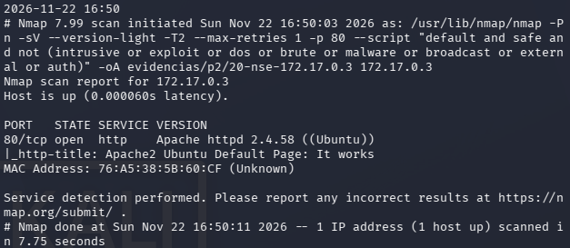

### 172.17.0.4

| Puerto/servicio | Qué expone sin autenticar | Cómo se obtuvo | Evidencia |
|---|---|---|---|
| 22/ssh | Banner `SSH-2.0-OpenSSH_7.9p1 Debian-10+deb10u4`, algoritmos y claves de host | `/dev/tcp`, `ssh2-enum-algos`, `ssh-hostkey` | `evidencias/p2/22-ssh-banner-172.17.0.4-bash.txt`, `22-ssh-172.17.0.4.nmap`, [captura 1](imagenes/p2-05-ssh-172.17.0.4-1.png), [captura 2](imagenes/p2-05-ssh-172.17.0.4-2.png) |
| 8080/http | Apache Tomcat 9.0.30 (título, favicon y pie de la página de error); `robots.txt` devuelve 404 | `curl`, `whatweb -a 1`, NSE seguros | `evidencias/p2/21-http-cabeceras-172.17.0.4-8080.txt`, `21-http-robots-172.17.0.4-8080.txt`, [captura](imagenes/p2-03-http-172.17.0.4-8080.png) |
| 8009/ajp13 | Solo la versión de `-sV` (Apache Jserv, AJP 1.3); sin script ni más pruebas | `nmap -sV` (Parte 1) | `evidencias/p1/11-tcp-ver-172.17.0.4.nmap` |

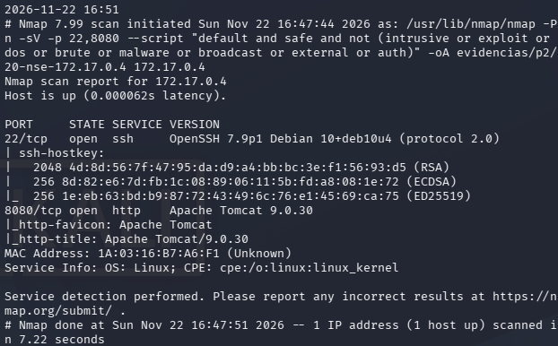

### 172.17.0.5 - Mensajería con operadores (probable)

| Puerto/servicio | Qué expone sin autenticar | Cómo se obtuvo | Evidencia |
|---|---|---|---|
| 80/http | Apache/2.4.59 (Debian); página por defecto de Apache | `curl`, `whatweb -a 1`, NSE seguros | `evidencias/p2/21-http-cabeceras-172.17.0.5-80.txt`, [captura](imagenes/p2-03-http-172.17.0.5-80.png) |
| 443/https | Web de plantilla "DockerLabs \| Plantilla gratuita Bootstrap 4.3.x" (autor de la plantilla: Devcrud) con el correo `info@dockerlabs.lab` en el pie | `curl`, `whatweb -a 1` | `evidencias/p2/21-http-pistas-172.17.0.5-443.txt`, `21-whatweb-172.17.0.5-443.txt`, [captura](imagenes/p2-03-http-172.17.0.5-443.png) |
| 443/https | Certificado autofirmado (emisor igual al sujeto): `C=US, ST=California, L=San Francisco, O=Your Organization, OU=Your Unit, CN=example.com`; válido del 2024-04-17 al 2025-04-17 (caducado) | `openssl s_client` | `evidencias/p2/21-tls-cert-172.17.0.5-443.txt`, [captura](imagenes/p2-04-tls-172.17.0.5.png) |
| 8161/http | Jetty 9.4.39.v20210325 que responde 401 con `WWW-Authenticate: basic realm ActiveMQRealm`; pide autenticación | `curl -I`, `whatweb -a 1` | `evidencias/p2/21-http-cabeceras-172.17.0.5-8161.txt`, `21-whatweb-172.17.0.5-8161.txt`, [captura](imagenes/p2-03-http-172.17.0.5-8161.png) |
| 61614/http | Jetty 9.4.39.v20210325. `http-methods` avisa de `TRACE` como método potencialmente arriesgado en un puerto Jetty de esta máquina | NSE seguros | `evidencias/p2/20-nse-172.17.0.5.nmap` |
| 1883, 5672 y 32987 | Sin banner: el saludo no devolvió datos (5672 mantuvo la conexión 5 s sin enviar nada; 32987 terminó sin datos) | `nc` y `/dev/tcp` | `evidencias/p2/23-banner-172.17.0.5-5672-bash.txt`, `23-banner-172.17.0.5-32987-bash.txt`, [captura](imagenes/p2-06-banner-5672-32987-172.17.0.5.png) |
| 61613 y 61616 | Solo la versión de `-sV` (STOMP de Apache ActiveMQ; ActiveMQ OpenWire 5.15.15); sin scripts | `nmap -sV` (Parte 1) | `evidencias/p1/11-tcp-ver-172.17.0.5.nmap` |

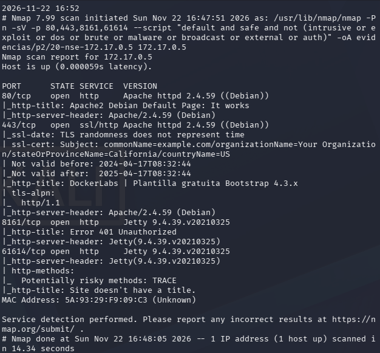

### 172.17.0.6 - Servidor donde se montaban cosas (probable)

| Puerto/servicio | Qué expone sin autenticar | Cómo se obtuvo | Evidencia |
|---|---|---|---|
| 22/ssh | Banner `SSH-2.0-OpenSSH_9.2p1 Debian-2+deb12u2`, algoritmos y claves de host | `/dev/tcp`, `ssh2-enum-algos`, `ssh-hostkey` | `evidencias/p2/22-ssh-banner-172.17.0.6-bash.txt`, `22-ssh-172.17.0.6.nmap`, [captura 1](imagenes/p2-05-ssh-172.17.0.6-1.png), [captura 2](imagenes/p2-05-ssh-172.17.0.6-2.png) |
| 8080/http | Jenkins 2.441 sobre Jetty 10.0.18 (cabeceras `X-Jenkins: 2.441` y `X-Hudson: 1.395`); la portada redirige a `/login` con formulario de contraseña; cookie `JSESSIONID` con `HttpOnly`; `robots.txt` con `Disallow: /` | `curl -I`, `curl /robots.txt`, `whatweb -a 1` | `evidencias/p2/21-http-cabeceras-172.17.0.6-8080.txt`, `21-http-robots-172.17.0.6-8080.txt`, `21-whatweb-172.17.0.6-8080.txt`, [captura](imagenes/p2-03-http-172.17.0.6-8080.png) |

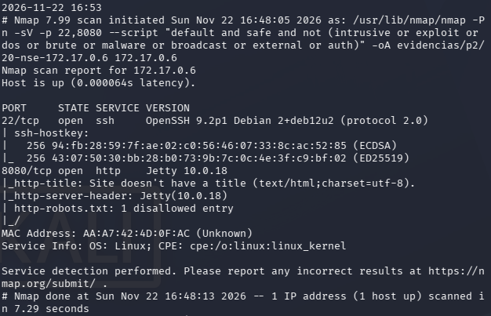

### 172.17.0.7

| Puerto/servicio | Qué expone sin autenticar | Cómo se obtuvo | Evidencia |
|---|---|---|---|
| 22/ssh | Banner `SSH-2.0-OpenSSH_7.7` (sin distribución), algoritmos y claves de host | `/dev/tcp`, `ssh2-enum-algos`, `ssh-hostkey` | `evidencias/p2/22-ssh-banner-172.17.0.7-bash.txt`, `22-ssh-172.17.0.7.nmap`, [captura 1](imagenes/p2-05-ssh-172.17.0.7-1.png), [captura 2](imagenes/p2-05-ssh-172.17.0.7-2.png) |

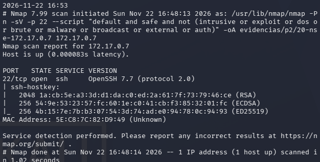

### 172.17.0.8 - Portal de clientes (probable, indicio débil)

| Puerto/servicio | Qué expone sin autenticar | Cómo se obtuvo | Evidencia |
|---|---|---|---|
| 22/ssh | Banner `SSH-2.0-OpenSSH_9.6p1 Ubuntu-3ubuntu13.5`, algoritmos y claves de host | `/dev/tcp`, `ssh2-enum-algos`, `ssh-hostkey` | `evidencias/p2/22-ssh-banner-172.17.0.8-bash.txt`, `22-ssh-172.17.0.8.nmap`, [captura 1](imagenes/p2-05-ssh-172.17.0.8-1.png), [captura 2](imagenes/p2-05-ssh-172.17.0.8-2.png) |
| 80/http | Apache/2.4.58 (Ubuntu); página titulada "Login" con campo de contraseña (no se entró) | `curl`, `whatweb -a 1`, NSE seguros | `evidencias/p2/21-http-pistas-172.17.0.8-80.txt`, `21-whatweb-172.17.0.8-80.txt`, [captura](imagenes/p2-03-http-172.17.0.8-80.png) |
| 139 y 445/tcp (SMB) | SMB 3.1.1 con firma habilitada pero no obligatoria; dialectos 2.0.2, 2.1, 3.0, 3.0.2 y 3.1.1. `smb-os-discovery` y `smb-security-mode` no devolvieron líneas | `smb2-security-mode`, `smb-protocols` | `evidencias/p2/24-smb-172.17.0.8.nmap`, [captura 1](imagenes/p2-07-smb-172.17.0.8-1.png), [captura 2](imagenes/p2-07-smb-172.17.0.8-2.png) |
| 137/udp (NetBIOS) | Nombre `SAMBASERVER`; nombres `SAMBASERVER<00>`, `<03>` y `<20>`, `__MSBROWSE__<01>` y `ESEEMEB.DL<00>`, `<1d>` y `<1e>`; usuario NetBIOS `<unknown>`. En la Parte 1, `-sV` mostró `workgroup: DL` | `nbstat`, `nmblookup -A` | `evidencias/p2/24-nbstat-172.17.0.8.nmap`, `24-nmblookup-172.17.0.8.txt` |

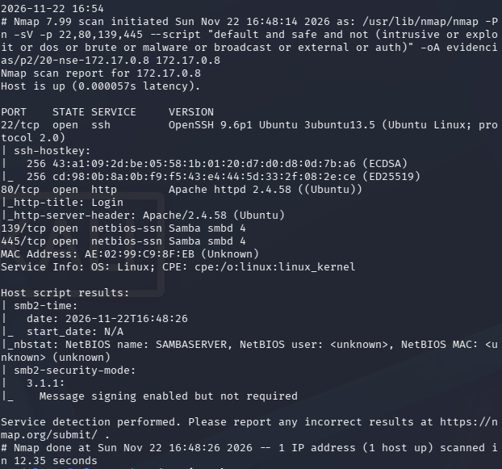

### 172.17.0.9

| Puerto/servicio | Qué expone sin autenticar | Cómo se obtuvo | Evidencia |
|---|---|---|---|
| 22/ssh | Banner `SSH-2.0-OpenSSH_9.2p1 Debian-2+deb12u10`, algoritmos y claves de host | `/dev/tcp`, `ssh2-enum-algos`, `ssh-hostkey` | `evidencias/p2/22-ssh-banner-172.17.0.9-bash.txt`, `22-ssh-172.17.0.9.nmap`, [captura 1](imagenes/p2-05-ssh-172.17.0.9-1.png), [captura 2](imagenes/p2-05-ssh-172.17.0.9-2.png) |
| 80/http | Apache/2.4.68 (Debian); página titulada "test page" | `curl`, `whatweb -a 1`, NSE seguros | `evidencias/p2/21-http-cabeceras-172.17.0.9-80.txt`, [captura](imagenes/p2-03-http-172.17.0.9-80.png) |

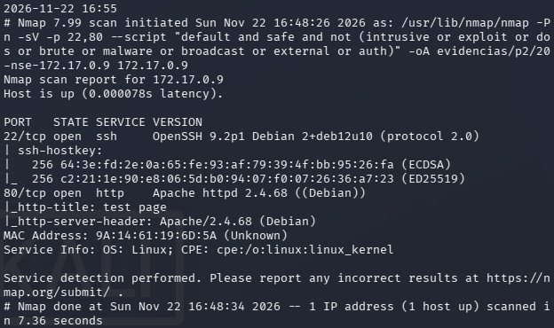

### 172.17.0.10 - Consola de gestión de servidores (probable)

| Puerto/servicio | Qué expone sin autenticar | Cómo se obtuvo | Evidencia |
|---|---|---|---|
| 80/http | SimpleHTTP/0.6 con Python 3.11.2; página titulada "CTG · IPMI bajo exposición" | `curl`, `whatweb -a 1`, NSE seguros | `evidencias/p2/21-http-cabeceras-172.17.0.10-80.txt`, `21-whatweb-172.17.0.10-80.txt`, [captura](imagenes/p2-03-http-172.17.0.10-80.png) |

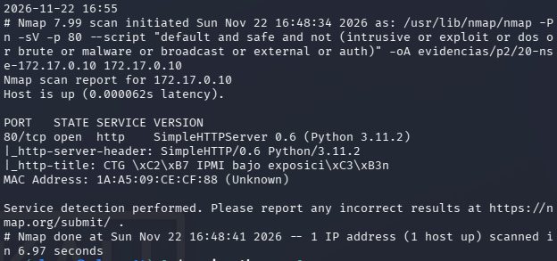

### Servicios UDP

| IP:puerto | Servicio | Qué expone | Evidencia |
|---|---|---|---|
| 172.17.0.10:623/udp | IPMI | Versión IPMI 2.0; `UserAuth: password, md5, md2, null`; `PassAuth: auth_msg, auth_user, non_null_user`; niveles 1.5 y 2.0. Es lo que el servicio anuncia; no se probó ninguna credencial | `evidencias/p2/25-ipmi-172.17.0.10.nmap`, [captura](imagenes/p2-08-udp-ipmi-172.17.0.10.png) |
| 172.17.0.8:137/udp | NetBIOS | Ver el apartado de 172.17.0.8 | `evidencias/p2/24-nbstat-172.17.0.8.nmap` |

### Cuentas de usuario descubiertas

| Cuenta | Equipo y servicio | Cómo se obtuvo | Evidencia |
|---|---|---|---|
| info@dockerlabs.lab | 172.17.0.5, web (443/tcp) | Correo de contacto en el pie de la página | `evidencias/p2/21-http-pistas-172.17.0.5-443.txt`, `21-whatweb-172.17.0.5-443.txt`, [captura](imagenes/p2-03-http-172.17.0.5-443.png) |

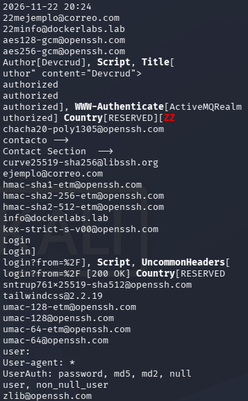

Ninguna cuenta se ha usado ni probado; solo se documenta que el servicio la revela. Se descartaron como candidatos `ejemplo@correo.com` (texto de ejemplo del formulario de login de 172.17.0.8), el autor de la plantilla `Devcrud` y los nombres de algoritmos SSH con forma de correo. NetBIOS devolvió el usuario `<unknown>`.

### Limitaciones

- No se probaron la sesión nula de SMB ni los scripts de enumeración de usuarios y recursos, ni el FTP anónimo ni communities SNMP: serían accesos con credenciales anónimas o por defecto, que las reglas de compromiso no permiten.
- No se lanzó ningún script contra el FTP de 172.17.0.3 (vsftpd 2.3.4), el AJP de 172.17.0.4 (8009) ni los servicios de mensajería de 172.17.0.5 (1883, 5672, 61613, 61616, 32987), por tratarse de hallazgos graves o de servicios que pueden devolver datos del cliente.
- 172.17.0.5:5672 y 32987 no devolvieron banner sin enviar datos; la versión de AMQP sigue sin identificar.
- 172.17.0.5:8161 pide autenticación (401): no se probaron credenciales.
- 172.17.0.6:8080 (Jenkins) y 172.17.0.8:80 tienen formulario de login: no se entró.
- Los scripts `smb-os-discovery` y `smb-security-mode` no devolvieron líneas para 172.17.0.8; no se investigó el motivo.
- Los puertos UDP marcados `open|filtered` en la Parte 1 no respondieron y no se pudieron confirmar. No se enumeraron SNMP, NTP ni DNS porque ningún equipo los tiene abiertos.
- No se descubrieron rutas web por fuerza bruta; solo se revisó lo que el servidor publica.
- Los banners leídos con `nc` aparecían recortados al listarlos con `grep`; se repitieron con `/dev/tcp` y la verificación de tamaño y de caracteres ocultos (`wc -c`, `cat -A`) mostró que los ficheros estaban completos.
