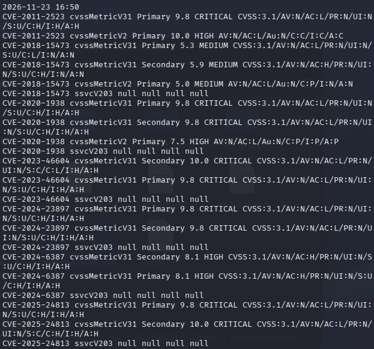
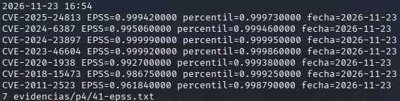
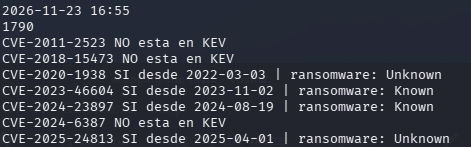
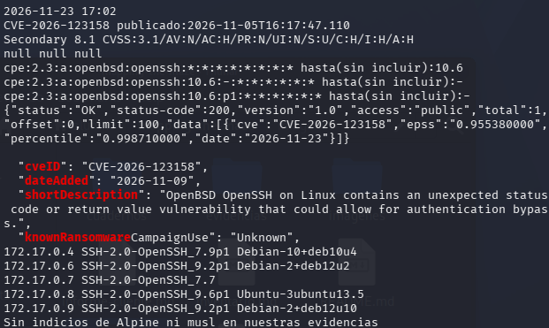

# Registro de vulnerabilidades - Gadir Logística, S.L.

**Alcance:** 172.17.0.0/24
**Autor:** Pablo Ostenero Reyes
**Fecha:** 2026-11-22 y 2026-11-23 (hora de la máquina virtual Kali)
**Criterio de evaluación:** RA3.b, inventario de potenciales vulnerabilidades.

## Método

1. Versiones obtenidas en las Partes 1 y 2 (nmap `-sV`, banners, cabeceras HTTP).
2. Candidatos con el script `vulners` de nmap (solo consulta) en los equipos normales y búsqueda en Exploit-DB con `searchsploit` (solo listado). A 172.17.0.3, equipo delicado, no se le lanzó `vulners`: su candidato sale de `searchsploit` y de NVD.
3. Verificación manual de cada candidato en NVD (descripción, CWE y rango de versiones afectadas) y, en los paquetes de Debian y Ubuntu, en el seguimiento de seguridad de la distribución, para detectar parches aplicados sin cambio de versión.
4. Descarte de los falsos positivos, documentado al final de este registro.

Ningún hallazgo se ha confirmado explotándolo. Todos son vulnerabilidades **potenciales**. No se abrió, descargó ni ejecutó ningún exploit.

## Orden de prioridad

**Autor de la priorización:** Pablo Ostenero Reyes
**Fecha de consulta de las fuentes:** 2026-11-23
**Fuentes:** NVD (CVSS y CWE), FIRST EPSS, CISA KEV.

### Método

No se ordena solo por CVSS. Los criterios, de mayor a menor peso, son:

1. Explotación conocida: estar en el catálogo KEV de CISA, y sobre todo con uso en ransomware.
2. Probabilidad de explotación: EPSS igual o superior a 0,1 o percentil igual o superior a 0,95. Los ocho CVE superan los dos umbrales, así que este criterio no los distingue entre sí.
3. Gravedad técnica: puntuación CVSS base.
4. Importancia del equipo para el negocio: consola de gestión, mensajería con operadores (facturación), portal de clientes, equipo antiguo y servidor de pruebas.
5. Solidez de la evidencia: versión clara y sin parche de la distribución, frente a una condición de configuración que no se ve desde la red.

| Prioridad | ID | Equipo y servicio | CVE | CVSS | EPSS | KEV | Por qué va en este puesto |
|---|---|---|---|---|---|---|---|
| 1 | V-03 | 172.17.0.5, ActiveMQ OpenWire 61616 | CVE-2023-46604 | 9.8 | 0.99992 | Sí, ransomware Known | Explotación conocida en ransomware, ejecución remota sin autenticar y equipo de mensajería ligado a la facturación |
| 2 | V-04 | 172.17.0.6, Jenkins 2.441 | CVE-2024-23897 | 9.8 | 0.99999 | Sí, ransomware Known | Mismo caso que V-03, pero lee ficheros en lugar de ejecutar código |
| 3 | V-02 | 172.17.0.4, Tomcat 9.0.30 con AJP | CVE-2020-1938 | 9.8 | 0.99270 | Sí | En KEV, versión en rango y AJP abierto; la actualización de Tomcat resuelve también V-06 |
| 4 | V-08 | 172.17.0.7, OpenSSH 7.7 | CVE-2026-123158 | 8.1 | 0.95538 | Sí | KEV y noticias lo adelantan a V-06 y a V-01, que tienen más CVSS; queda detrás por depender de una configuración desconocida |
| 5 | V-06 | 172.17.0.4, Tomcat 9.0.30 | CVE-2025-24813 | 9.8 | 0.99942 | Sí | En KEV, pero exige un ajuste desactivado por defecto que no se ve |
| 6 | V-01 | 172.17.0.3, vsftpd 2.3.4 | CVE-2011-2523 | 9.8 | 0.96184 | No | Grave, pero sin explotación conocida y con evidencia limitada al banner; es el equipo delicado |
| 7 | V-07 | 172.17.0.6, OpenSSH 9.2p1 Debian | CVE-2024-6387 | 8.1 | 0.99506 | No | No está en KEV y su complejidad es alta |
| 8 | V-05 | 172.17.0.7, OpenSSH 7.7 | CVE-2018-15473 | 5.3 | 0.98675 | No | Impacto bajo: solo revela si un usuario existe |

Casos en que KEV hace que un hallazgo con menos CVSS vaya antes que otro con más: V-08 (8.1) va antes que V-01 (9.8) porque está en KEV y V-01 no. Y V-08 (8.1) va antes que V-06 (9.8), que también está en KEV, porque V-06 exige un ajuste desactivado por defecto.

Una sola actualización de Tomcat resuelve V-02 y V-06, y actualizar OpenSSH en el equipo 172.17.0.7 cubre V-05 y V-08.

### Datos no disponibles

- CVE-2026-123158: NVD no ha publicado puntuación propia; se usa la de la CNA (8.1).
- CVE-2023-46604, CVE-2025-24813 y CVE-2018-15473: la CNA publica una puntuación distinta de la de NVD (10.0, 10.0 y 5.9); se usa la de NVD y la otra se indica en cada ficha.
- No se consultó el seguimiento de seguridad de Debian ni de Ubuntu para CVE-2026-123158.

Evidencias: `evidencias/p4/40-cvss.txt`, `evidencias/p4/41-epss.json`, `evidencias/p4/42-kev-2026-11-23.json` y `evidencias/p4/43-aviso-nvd.json`.

---

## V-01 - Posible puerta trasera en vsftpd 2.3.4

| Campo | Valor |
|---|---|
| Equipo y servicio | 172.17.0.3, 21/tcp, vsftpd 2.3.4 |
| CVE | [CVE-2011-2523](https://nvd.nist.gov/vuln/detail/CVE-2011-2523) |
| Explicación | Según NVD, las copias de vsftpd 2.3.4 descargadas entre el 30 de junio y el 3 de julio de 2011 contienen una puerta trasera que abre una shell en el puerto 6200/tcp. |
| CWE | CWE-78: Neutralización incorrecta de elementos especiales en comandos del sistema operativo (inyección de comandos). Es la que da NVD. |
| Técnica ATT&CK | T1195.002 Compromise Software Supply Chain: la puerta trasera viene dentro del propio software distribuido. |
| Lo observado | Banner `220 (vsFTPd 2.3.4)`, leído sin enviar nada. `nmap -sV` también da `vsftpd 2.3.4`. En el escaneo completo de puertos de este equipo solo constan abiertos el 21 y el 80; el 6200 no. |
| Por qué sospechamos | La versión coincide exactamente con la afectada en NVD (CPE `vsftpd 2.3.4`) y `searchsploit` lista una entrada de tipo "Backdoor Command Execution" para esa versión. No consta parche de la distribución. |
| Evidencias | `evidencias/p1/11-tcp-ver-172.17.0.3.nmap`, `evidencias/p2/23-ftp-banner-172.17.0.3-bash.txt`, `evidencias/p3/32-searchsploit.txt`, `evidencias/p3/33-nvd-CVE-2011-2523.json` |
| Capturas | [versión observada](imagenes/p1-06-versiones-172.17.0.3.png), [banner FTP](imagenes/p2-06-banner-ftp-172.17.0.3.png), [searchsploit](imagenes/p3-02-searchsploit.png), [ficha NVD](imagenes/p3-03-nvd-CVE-2011-2523.png) |
| Limitaciones | No se ha confirmado porque no se explota. NVD limita el fallo a copias descargadas en unos días concretos de 2011 y el banner no permite distinguir una copia comprometida de una limpia. El banner podría estar modificado. No se lanzó `vulners` contra este equipo por ser el delicado. El puerto 6200 cerrado no descarta el fallo, porque no se ha hecho ninguna prueba que lo abra. |
| Pendiente de comprobar | En una fase posterior y con permiso del cliente: comprobar el origen y la integridad del paquete instalado (por ejemplo su suma de verificación) y, solo con autorización expresa, la confirmación activa. |
| CVSS | Versión 3.1, puntuación **9.8 (Crítica)**, vector `CVSS:3.1/AV:N/AC:L/PR:N/UI:N/S:U/C:H/I:H/A:H`. Fuente: NVD (también CVSS 2.0: 10.0). |
| Qué implica (C/I/A) | Confidencialidad: alta, podría leer los datos del equipo. Integridad: alta, podría modificarlos. Disponibilidad: alta, podría detenerlo. Se ataca por red, sin credenciales y sin intervención del usuario. |
| EPSS | 0.96184 (percentil 0.99879). Fuente: FIRST EPSS, consultado el 2026-11-23. |
| KEV | No figura. Fuente: CISA KEV, consultado el 2026-11-23. |
| Prioridad | **6**. CVSS crítico, pero sin explotación conocida (no está en KEV) y con la evidencia limitada al banner. Es el equipo delicado: conviene planificar su sustitución. |

---

## V-02 - Apache Tomcat con el conector AJP expuesto (Ghostcat)

| Campo | Valor |
|---|---|
| Equipo y servicio | 172.17.0.4, 8009/tcp (AJP 1.3) y 8080/tcp, Apache Tomcat 9.0.30 |
| CVE | [CVE-2020-1938](https://nvd.nist.gov/vuln/detail/CVE-2020-1938) |
| Explicación | Tomcat trata las conexiones AJP con más confianza que las HTTP. En las versiones afectadas, el conector AJP venía activado por defecto y un atacante con acceso a él puede aprovecharlo de formas inesperadas. |
| CWE | CWE-20: Validación incorrecta de la entrada. **Propuesta propia**: NVD solo indica `NVD-CWE-Other`. Se elige por la confianza excesiva en los atributos de la petición AJP. CWE-22 (recorrido de rutas) sería la alternativa si se atiende al efecto. |
| Técnica ATT&CK | T1190 Exploit Public-Facing Application, con T1005 Data from Local System como efecto. |
| Lo observado | `nmap -sV`: `8009/tcp ajp13 Apache Jserv (Protocol v1.3)` y `8080/tcp http Apache Tomcat 9.0.30`; la portada y el favicon también muestran Tomcat 9.0.30. |
| Por qué sospechamos | La versión 9.0.30 está dentro del rango de NVD (de 9.0.0 hasta antes de 9.0.31) y el puerto AJP está abierto en la red. No hay indicio de que venga de un paquete de Debian. `vulners` propone este CVE en este equipo. |
| Evidencias | `evidencias/p1/11-tcp-ver-172.17.0.4.nmap`, `evidencias/p2/21-http-pistas-172.17.0.4-8080.txt`, `evidencias/p3/31-vulners-172.17.0.4.nmap`, `evidencias/p3/33-nvd-CVE-2020-1938.json` |
| Capturas | [versión observada](imagenes/p1-06-versiones-172.17.0.4.png), [vulners](imagenes/p3-01-vulners-172.17.0.4.png), [ficha NVD 1](imagenes/p3-03-nvd-CVE-2020-1938-1.png), [ficha NVD 2](imagenes/p3-03-nvd-CVE-2020-1938-2.png) |
| Limitaciones | No se ha confirmado porque no se explota. La versión sale de `-sV` y de la portada. No se lanzó ningún script contra el AJP. No se sabe si el conector está configurado con secreto o restringido por red. |
| Pendiente de comprobar | En una fase posterior y con permiso: revisar la configuración del conector AJP (dirección de escucha y secreto) y limitar el acceso por red. |
| CVSS | Versión 3.1, puntuación **9.8 (Crítica)**, vector `CVSS:3.1/AV:N/AC:L/PR:N/UI:N/S:U/C:H/I:H/A:H`. Fuente: NVD (la CNA publica la misma). |
| Qué implica (C/I/A) | Confidencialidad: alta, podría leer ficheros de las aplicaciones. Integridad: alta. Disponibilidad: alta. Se ataca por red, sin credenciales y sin intervención del usuario. |
| EPSS | 0.99270 (percentil 0.99938). Fuente: FIRST EPSS, consultado el 2026-11-23. |
| KEV | Sí, incluido el 2022-03-03; uso en ransomware: Unknown. Fuente: CISA KEV, consultado el 2026-11-23. |
| Prioridad | **3**. Está en KEV (sin ransomware conocido), la versión está en rango y el AJP está abierto en la red. Actualizar Tomcat resuelve también V-06. |

---

## V-03 - Ejecución remota de código en Apache ActiveMQ (OpenWire)

| Campo | Valor |
|---|---|
| Equipo y servicio | 172.17.0.5, 61616/tcp, ActiveMQ OpenWire transport 5.15.15 |
| CVE | [CVE-2023-46604](https://nvd.nist.gov/vuln/detail/CVE-2023-46604) |
| Explicación | El deserializador del protocolo OpenWire permite que un atacante con acceso de red al broker ejecute comandos arbitrarios, manipulando los tipos de clase serializados. Se corrige en 5.15.16, 5.16.7, 5.17.6 y 5.18.3. |
| CWE | CWE-502: Deserialización de datos no confiables. Es la que da NVD. |
| Técnica ATT&CK | T1210 Exploitation of Remote Services: es un servicio de mensajería de la red interna. |
| Lo observado | `nmap -sV`: `61616/tcp apachemq ActiveMQ OpenWire transport 5.15.15`. En el mismo equipo hay más puertos de ActiveMQ (STOMP 61613 y Jetty 9.4.39 en 8161 y 61614). |
| Por qué sospechamos | La versión 5.15.15 queda dentro del rango de NVD (hasta antes de 5.15.16). `vulners` lo propone en este equipo, con módulos públicos para el fallo. |
| Evidencias | `evidencias/p1/11-tcp-ver-172.17.0.5.nmap`, `evidencias/p3/31-vulners-172.17.0.5.nmap`, `evidencias/p3/33-nvd-CVE-2023-46604.json` |
| Capturas | [versión observada 1](imagenes/p1-06-versiones-172.17.0.5-1.png), [versión observada 2](imagenes/p1-06-versiones-172.17.0.5-2.png), [vulners 1](imagenes/p3-01-vulners-172.17.0.5-1.png), [vulners 2](imagenes/p3-01-vulners-172.17.0.5-2.png), [ficha NVD 1](imagenes/p3-03-nvd-CVE-2023-46604-1.png), [ficha NVD 2](imagenes/p3-03-nvd-CVE-2023-46604-2.png) |
| Limitaciones | No se ha confirmado porque no se explota ni se envía ningún mensaje al broker. La versión sale de `-sV`. No consta si el broker procede de un paquete de la distribución con parches propios (no se consultó el seguimiento de Debian). |
| Pendiente de comprobar | En una fase posterior y con permiso: confirmar la versión exacta del broker y actualizarlo a 5.15.16 o posterior, y restringir el acceso al puerto 61616. |
| CVSS | Versión 3.1, puntuación **9.8 (Crítica)**, vector `CVSS:3.1/AV:N/AC:L/PR:N/UI:N/S:U/C:H/I:H/A:H`. Fuente: NVD. La CNA publica 10.0 (`S:C`, alcance cambiado). |
| Qué implica (C/I/A) | Confidencialidad: alta, podría leer los mensajes del broker. Integridad: alta, podría ejecutar comandos y alterar mensajes. Disponibilidad: alta, podría detener el servicio. Se ataca por red, sin credenciales y sin intervención del usuario. |
| EPSS | 0.99992 (percentil 0.99986). Fuente: FIRST EPSS, consultado el 2026-11-23. |
| KEV | Sí, incluido el 2023-11-02; uso en ransomware: Known. Fuente: CISA KEV, consultado el 2026-11-23. |
| Prioridad | **1**. Está en KEV con ransomware Known, ejecuta código sin autenticar, la versión está clara y es el equipo de mensajería ligado a la facturación. |

---

## V-04 - Lectura arbitraria de ficheros en Jenkins

| Campo | Valor |
|---|---|
| Equipo y servicio | 172.17.0.6, 8080/tcp, Jenkins 2.441 sobre Jetty 10.0.18 |
| CVE | [CVE-2024-23897](https://nvd.nist.gov/vuln/detail/CVE-2024-23897) |
| Explicación | En Jenkins 2.441 y anteriores, el analizador de comandos del CLI sustituye un `@` seguido de una ruta por el contenido del fichero, lo que permite leer ficheros arbitrarios del sistema del controlador. |
| CWE | CWE-22: Limitación incorrecta de una ruta a un directorio restringido (recorrido de rutas). NVD indica también CWE-27. |
| Técnica ATT&CK | T1190 Exploit Public-Facing Application, con T1005 Data from Local System como efecto. |
| Lo observado | Cabecera `X-Jenkins: 2.441` y `whatweb` con `Jenkins[2.441]`; la portada responde 403 y redirige a `/login` con formulario de contraseña (no se entró). |
| Por qué sospechamos | La versión 2.441 está en el rango de NVD (hasta 2.442 sin incluir en versiones no LTS; la 2.441 no tiene formato LTS). `searchsploit` lista una entrada "Local File Inclusion" para Jenkins 2.441. |
| Evidencias | `evidencias/p2/21-http-cabeceras-172.17.0.6-8080.txt`, `evidencias/p2/21-whatweb-172.17.0.6-8080.txt`, `evidencias/p3/32-searchsploit.txt`, `evidencias/p3/33-nvd-CVE-2024-23897.json` |
| Capturas | [web observada](imagenes/p2-03-http-172.17.0.6-8080.png), [searchsploit](imagenes/p3-02-searchsploit.png), [ficha NVD](imagenes/p3-03-nvd-CVE-2024-23897.png) |
| Limitaciones | No se ha confirmado porque no se explota ni se usa el CLI de Jenkins. `vulners` no propuso este CVE; sale de `searchsploit` y de NVD. NVD habla de atacantes no autenticados, pero la portada exige login: el alcance real depende de los permisos de acceso anónimo, que desde fuera no se comprueban. |
| Pendiente de comprobar | En una fase posterior y con permiso: comprobar la versión exacta y los permisos de acceso anónimo, y actualizar Jenkins a una versión corregida. |
| CVSS | Versión 3.1, puntuación **9.8 (Crítica)**, vector `CVSS:3.1/AV:N/AC:L/PR:N/UI:N/S:U/C:H/I:H/A:H`. Fuente: NVD (la CNA publica la misma). |
| Qué implica (C/I/A) | Confidencialidad: alta, podría leer cualquier fichero del servidor, incluidas claves de acceso. Integridad: alta y disponibilidad: alta según el vector, por lo que podría usar esa información para actuar sobre el sistema. Se ataca por red, sin credenciales y sin intervención del usuario. |
| EPSS | 0.99999 (percentil 0.99995). Fuente: FIRST EPSS, consultado el 2026-11-23. |
| KEV | Sí, incluido el 2024-08-19; uso en ransomware: Known. Fuente: CISA KEV, consultado el 2026-11-23. |
| Prioridad | **2**. Está en KEV con ransomware Known y la versión está confirmada por cabecera. Va detrás de V-03 porque por sí solo lee ficheros y no ejecuta código. |

---

## V-05 - Enumeración de usuarios en OpenSSH 7.7

| Campo | Valor |
|---|---|
| Equipo y servicio | 172.17.0.7, 22/tcp, OpenSSH 7.7 |
| CVE | [CVE-2018-15473](https://nvd.nist.gov/vuln/detail/CVE-2018-15473) |
| Explicación | OpenSSH hasta la 7.7 no retrasa el rechazo de un usuario no válido hasta haber analizado completamente el paquete, lo que permite distinguir si un usuario existe. |
| CWE | CWE-362 según NVD (condición de carrera). Aviso: el efecto descrito es la revelación de usuarios válidos, por lo que la clasificación de NVD es discutible. |
| Técnica ATT&CK | T1087 Account Discovery (descubrir cuentas válidas), con el SSH como servicio expuesto. |
| Lo observado | Banner `SSH-2.0-OpenSSH_7.7`, sin distribución. `nmap -sV`: `OpenSSH 7.7 (protocol 2.0)`. |
| Por qué sospechamos | NVD afecta a OpenSSH hasta la 7.7 incluida y el banner es exactamente esa versión. `vulners` lo propone en este equipo y `searchsploit` lista entradas de enumeración de usuarios hasta esa versión. |
| Evidencias | `evidencias/p2/22-ssh-banner-172.17.0.7-bash.txt`, `evidencias/p3/31-vulners-172.17.0.7.nmap`, `evidencias/p3/32-searchsploit.txt`, `evidencias/p3/33-nvd-CVE-2018-15473.json` |
| Capturas | [vulners](imagenes/p3-01-vulners-172.17.0.7.png), [searchsploit](imagenes/p3-02-searchsploit.png), [ficha NVD](imagenes/p3-03-nvd-CVE-2018-15473.png) |
| Limitaciones | No se ha confirmado porque no se prueba ningún usuario. La versión 7.7 está justo en el límite del rango, y el título de una entrada de `searchsploit` dice "antes de 7.7": manda la ficha de NVD. El banner no indica distribución, así que no se puede consultar el seguimiento de parches de Debian o Ubuntu. |
| Pendiente de comprobar | En una fase posterior y con permiso: confirmar el origen del paquete y actualizar OpenSSH. |
| CVSS | Versión 3.1, puntuación **5.3 (Media)**, vector `CVSS:3.1/AV:N/AC:L/PR:N/UI:N/S:U/C:L/I:N/A:N`. Fuente: NVD. La CNA publica 5.9 (`AC:H`, `C:H`). |
| Qué implica (C/I/A) | Confidencialidad: baja, permite saber si un usuario existe. Integridad: ninguna. Disponibilidad: ninguna. Se ataca por red, sin credenciales y sin intervención del usuario. |
| EPSS | 0.98675 (percentil 0.99925). Fuente: FIRST EPSS, consultado el 2026-11-23. |
| KEV | No figura. Fuente: CISA KEV, consultado el 2026-11-23. |
| Prioridad | **8**. Tiene un EPSS muy alto, pero su impacto es bajo y no está en KEV. Es el último: solo revela usuarios y no cambia ni detiene nada. |

---

## V-06 - Posible ejecución remota en Apache Tomcat por PUT parcial

| Campo | Valor |
|---|---|
| Equipo y servicio | 172.17.0.4, 8080/tcp, Apache Tomcat 9.0.30 |
| CVE | [CVE-2025-24813](https://nvd.nist.gov/vuln/detail/CVE-2025-24813) |
| Explicación | Una equivalencia de rutas (punto interno en el nombre de fichero) en el servlet por defecto con escritura activada puede dar lugar a ejecución remota de código, revelación de información o contenido malicioso añadido a ficheros subidos. Exige varias condiciones de configuración a la vez. |
| CWE | CWE-44: Equivalencia de rutas con punto interno, elegida como principal por ser la del título del CVE. NVD indica también CWE-502 y CWE-706. |
| Técnica ATT&CK | T1190 Exploit Public-Facing Application. |
| Lo observado | Tomcat 9.0.30 (`nmap -sV`, título y pie de la página de error). |
| Por qué sospechamos | La versión 9.0.30 está en el rango de NVD (hasta antes de 9.0.99). `vulners` lo propone en este equipo y `vulners` marca exploits públicos. |
| Evidencias | `evidencias/p1/11-tcp-ver-172.17.0.4.nmap`, `evidencias/p3/31-vulners-172.17.0.4.nmap`, `evidencias/p3/33-nvd-CVE-2025-24813.json` |
| Capturas | [versión observada](imagenes/p1-06-versiones-172.17.0.4.png), [vulners](imagenes/p3-01-vulners-172.17.0.4.png), [ficha NVD 1](imagenes/p3-03-nvd-CVE-2025-24813-1.png), [ficha NVD 2](imagenes/p3-03-nvd-CVE-2025-24813-2.png) |
| Limitaciones | Hallazgo en estado "pendiente de comprobar". La versión entra en rango, pero la explotación exige escritura activada en el servlet por defecto (desactivada de fábrica), soporte de PUT parcial, y para el RCE persistencia de sesiones en fichero y una librería aprovechable en una deserialización. Ninguna de estas condiciones es visible desde la red. |
| Pendiente de comprobar | En una fase posterior y con permiso: revisar la configuración de Tomcat (servlet por defecto y persistencia de sesión) y actualizar a 9.0.99 o posterior. |
| CVSS | Versión 3.1, puntuación **9.8 (Crítica)**, vector `CVSS:3.1/AV:N/AC:L/PR:N/UI:N/S:U/C:H/I:H/A:H`. Fuente: NVD. La CNA publica 10.0 (`S:C`). |
| Qué implica (C/I/A) | Confidencialidad: alta. Integridad: alta, podría añadir contenido a ficheros subidos. Disponibilidad: alta. Según NVD exige varias condiciones de configuración a la vez, que no se ven desde la red. |
| EPSS | 0.99942 (percentil 0.99973). Fuente: FIRST EPSS, consultado el 2026-11-23. |
| KEV | Sí, incluido el 2025-04-01; uso en ransomware: Unknown. Fuente: CISA KEV, consultado el 2026-11-23. |
| Prioridad | **5**. Está en KEV, pero exige un ajuste desactivado por defecto (escritura en el servlet por defecto) que no se ve. Se resuelve con la misma actualización que V-02. |

---

## V-07 - Condición de carrera en sshd de OpenSSH 9.2p1 (regreSSHion)

| Campo | Valor |
|---|---|
| Equipo y servicio | 172.17.0.6, 22/tcp, OpenSSH 9.2p1 Debian 2+deb12u2 |
| CVE | [CVE-2024-6387](https://nvd.nist.gov/vuln/detail/CVE-2024-6387) |
| Explicación | Una condición de carrera hace que `sshd` trate algunas señales de forma insegura. Un atacante remoto sin autenticar podría aprovecharlo si no completa la autenticación en el tiempo establecido. |
| CWE | CWE-362 y CWE-364 según NVD: condición de carrera y condición de carrera en un manejador de señales. |
| Técnica ATT&CK | T1210 Exploitation of Remote Services: es un servicio de acceso remoto interno. |
| Lo observado | Banner `SSH-2.0-OpenSSH_9.2p1 Debian-2+deb12u2`. |
| Por qué sospechamos | La versión 9.2p1 está en el rango de NVD (de 8.6 a 9.8 incluida). El seguimiento de seguridad de Debian marca como corregidas en bookworm las revisiones `1:9.2p1-2+deb12u9` (seguridad) y `1:9.2p1-2+deb12u10`; la observada, `deb12u2`, es anterior, así que no consta parche. `vulners` lo propone en este equipo. |
| Evidencias | `evidencias/p2/22-ssh-banner-172.17.0.6-bash.txt`, `evidencias/p3/31-vulners-172.17.0.6.nmap`, `evidencias/p3/33-nvd-CVE-2024-6387.json` |
| Capturas | [vulners](imagenes/p3-01-vulners-172.17.0.6.png), [tracker de Debian](imagenes/p3-04-backport-CVE-2024-6387.png), [ficha NVD](imagenes/p3-03-nvd-CVE-2024-6387.png) |
| Limitaciones | No se ha confirmado porque no se explota. La versión sale del banner, que podría estar modificado. La comparación de revisiones se hace con la tabla del tracker, no con el paquete instalado. |
| Pendiente de comprobar | En una fase posterior y con permiso: confirmar la versión del paquete instalado y actualizar a una revisión corregida. |
| CVSS | Versión 3.1, puntuación **8.1 (Alta)**, vector `CVSS:3.1/AV:N/AC:H/PR:N/UI:N/S:U/C:H/I:H/A:H`. Fuente: NVD (la CNA publica la misma). |
| Qué implica (C/I/A) | Confidencialidad: alta. Integridad: alta. Disponibilidad: alta, según el vector. Se ataca por red, sin credenciales y sin intervención del usuario, pero con complejidad alta: es una carrera de tiempos que exige muchos intentos. |
| EPSS | 0.99506 (percentil 0.99946). Fuente: FIRST EPSS, consultado el 2026-11-23. |
| KEV | No figura. Fuente: CISA KEV, consultado el 2026-11-23. |
| Prioridad | **7**. No está en KEV y su complejidad es alta. La versión no tiene la corrección de Debian según el seguimiento de seguridad. |

---

## V-08 - Posible omisión de autenticación por contraseña en OpenSSH 7.7 (sshole)

| Campo | Valor |
|---|---|
| Equipo y servicio | 172.17.0.7, 22/tcp, OpenSSH 7.7 |
| CVE | [CVE-2026-123158](https://nvd.nist.gov/vuln/detail/CVE-2026-123158) |
| Explicación | Según NVD, `sshd` de OpenSSH anterior a 10.6p2 en Linux con musl libc y sin PAM no distingue bien si una cadena es una contraseña o un hash. Según el artículo del aviso, una contraseña larga permite entrar a cuentas sin contraseña válida sin conocerla. |
| CWE | CWE-394: Código de estado o valor de retorno inesperado. **Propuesta propia** a partir de la descripción de CISA; se sustituye por la de NVD si la ficha la trae. |
| Técnica ATT&CK | T1210 Exploitation of Remote Services, con T1078 Valid Accounts como efecto. |
| Lo observado | Banner `SSH-2.0-OpenSSH_7.7`, sin distribución. Solo SSH abierto en este equipo. |
| Por qué sospechamos | La versión 7.7 es anterior a 10.6p2 y el equipo ofrece SSH. CISA lo incluye en KEV desde el 2026-11-09. La sospecha es débil: el fallo solo se da con musl libc y sin PAM, y eso no se puede saber desde la red. |
| Evidencias | `evidencias/p2/22-ssh-banner-172.17.0.7-bash.txt`, `evidencias/p3/31-vulners-172.17.0.7.nmap`, `evidencias/p4/43-aviso-nvd.json` |
| Capturas | [SSH 1](imagenes/p2-05-ssh-172.17.0.7-1.png), [SSH 2](imagenes/p2-05-ssh-172.17.0.7-2.png), [vulners](imagenes/p3-01-vulners-172.17.0.7.png), [comprobación del aviso](imagenes/p4-04-aviso.png) |
| Limitaciones | Hallazgo en estado "pendiente de comprobar". No consta la libc, ni PAM, ni si hay cuentas sin contraseña. El banner sin distribución es compatible con Alpine, con RHEL o CentOS y con una copia compilada a mano. No se probó ninguna contraseña. |
| Pendiente de comprobar | En una fase posterior y con permiso: confirmar el sistema base de este equipo y si usa PAM. Mientras tanto, desactivar las contraseñas en SSH y actualizar a OpenSSH 10.6p2 o a un paquete corregido. |
| CVSS | Versión 3.1, puntuación **8.1 (Alta)**, vector `CVSS:3.1/AV:N/AC:H/PR:N/UI:N/S:U/C:H/I:H/A:H`. Fuente: la CNA, a través de NVD; NVD no ha publicado puntuación propia. |
| Qué implica (C/I/A) | Confidencialidad: alta. Integridad: alta. Disponibilidad: alta, según el vector. Se ataca por red, sin credenciales y sin intervención del usuario, pero con complejidad alta porque exige una configuración concreta. |
| EPSS | 0.95538 (percentil 0.99871). Fuente: FIRST EPSS, consultado el 2026-11-23. |
| KEV | Sí, incluido el 2026-11-09; uso en ransomware: Unknown. Fuente: CISA KEV, consultado el 2026-11-23. |
| Prioridad | **4**. Está en KEV y en las noticias. Aunque su CVSS es menor que el de V-06 y V-01, la explotación conocida lo adelanta a V-01; V-06 va detrás porque exige un ajuste desactivado por defecto, mientras que aquí se desconoce el sistema base. |

---

## Candidatos descartados (falsos positivos)

Propuestos por las herramientas automáticas y descartados tras revisarlos.

| CVE | Equipo y servicio | Lo propuso | Motivo del descarte | Evidencia |
|---|---|---|---|---|
| CVE-2024-6387 | 172.17.0.9, OpenSSH 9.2p1 Debian 2+deb12u10 | vulners | Parcheado por Debian: la revisión observada es igual o mayor que la corregida (`deb12u10`, backport) | [tracker de Debian](imagenes/p3-04-backport-CVE-2024-6387.png) |
| CVE-2024-6387 | 172.17.0.8, OpenSSH 9.6p1 Ubuntu 3ubuntu13.5 | vulners | Parcheado por Ubuntu: la corrección en 24.04 es `3ubuntu13.3` y la observada es posterior (backport) | [tracker de Ubuntu](imagenes/p3-04-backport-CVE-2024-6387-ubuntu.png) |
| CVE-2023-38408 | 172.17.0.9, OpenSSH 9.2p1 Debian 2+deb12u10 | vulners | Parcheado por Debian: la revisión observada es igual o mayor que la corregida (backport) | [tracker de Debian](imagenes/p3-04-backport-CVE-2023-38408.png) |
| CVE-2023-38408 | 172.17.0.4, .6 y .7, OpenSSH | vulners | Afecta a `ssh-agent` con reenvío de agente hacia una máquina controlada por el atacante, un componente de cliente; no hay evidencia de que se dé en el servidor | `evidencias/p3/33-nvd-CVE-2023-38408.json` |
| CVE-2025-26465 | 172.17.0.4, .6, .7, .8 y .9, OpenSSH | vulners | Solo ocurre con `VerifyHostKeyDNS` activado, una opción del cliente | `evidencias/p3/33-nvd-CVE-2025-26465.json` |
| CVE-2023-28531 | 172.17.0.6 y .9, OpenSSH | vulners | Afecta a `ssh-add`, una herramienta de cliente | `evidencias/p3/33-nvd-CVE-2023-28531.json` |
| CVE-2026-60002 | 172.17.0.4 y .9, OpenSSH | vulners | Según NVD, solo se produce en el cliente `ssh` | `evidencias/p3/33-nvd-CVE-2026-60002.json` |
| CVE-2026-123158 | 172.17.0.4, .6, .8 y .9, OpenSSH | vulners | Solo afecta a Linux con musl libc y sin PAM. La descripción de NVD limita el fallo a esa configuración y el artículo del aviso indica que Debian y Ubuntu (glibc) no están afectados. El banner de los cuatro es de un paquete de Debian o Ubuntu. 172.17.0.7 pasa a la ficha V-08 | `evidencias/p3/33-nvd-CVE-2026-123158.json`, `evidencias/p4/43-aviso-nvd.json` |
| CVE-2026-119618 | 172.17.0.5, .8 y .9, Apache httpd | vulners | Afecta a `mod_http2`, que no consta activo; en 172.17.0.5:443 el escaneo solo anuncia `http/1.1` | `evidencias/p3/33-nvd-CVE-2026-119618.json`, `evidencias/p2/20-nse-172.17.0.5.nmap` |
| CVE-2024-38475 | 172.17.0.5 y .8, Apache httpd | vulners | Requiere reglas de `mod_rewrite` concretas que no hay evidencia de que existan | `evidencias/p3/33-nvd-CVE-2024-38475.json` |
| CVE-2021-28169 | 172.17.0.6, Jetty 10.0.18 | vulners | La versión observada queda fuera del rango afectado (10.0.0 a antes de 10.0.3) | `evidencias/p3/33-nvd-CVE-2021-28169.json` |
| CVE-2021-28169 | 172.17.0.5, Jetty 9.4.39 | vulners | Requiere el `ConcatServlet`, del que no hay evidencia; la consola responde 401 | `evidencias/p3/33-nvd-CVE-2021-28169.json`, `evidencias/p2/21-http-cabeceras-172.17.0.5-8161.txt` |
| CVE-2017-7494 | 172.17.0.8, Samba | vulners | La versión no es fiable: solo se identifica `Samba smbd 4`, sin versión menor, y no se puede comparar con el rango | `evidencias/p3/33-nvd-CVE-2017-7494.json`, `evidencias/p1/11-tcp-ver-172.17.0.8.nmap` |
| CVE-2020-1472 | 172.17.0.8, Samba | vulners | Afecta a un controlador de dominio y no consta ese rol: `nbstat` no muestra nombres de controlador | `evidencias/p3/33-nvd-CVE-2020-1472.json`, `evidencias/p2/24-nbstat-172.17.0.8.nmap` |
